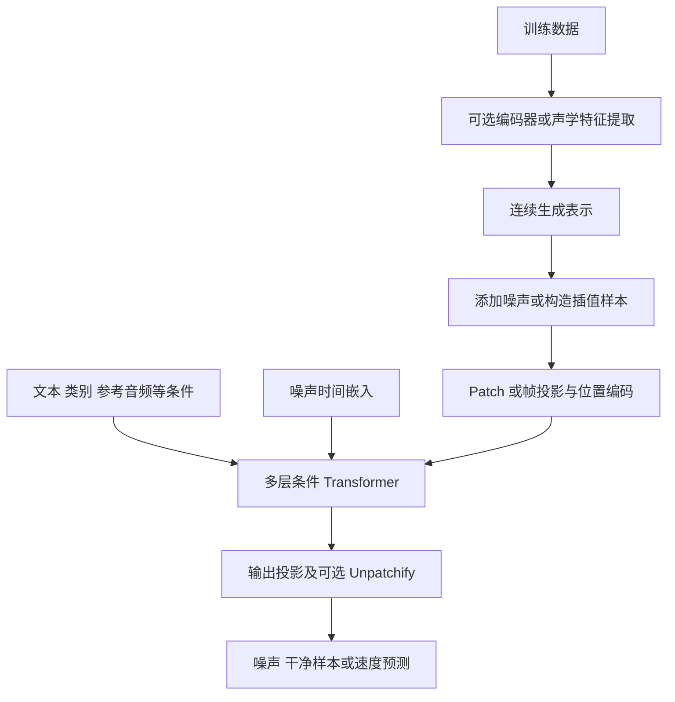

# DiT 完整介绍

## 1. DiT 是什么

**DiT（Diffusion Transformer，扩散 Transformer）是一类以 Transformer 为主要生成骨干的网络架构**。它把待生成的图像、音频或其他连续信号表示成 token 序列，根据噪声时间和外部条件预测噪声、干净样本或速度场，再通过迭代采样产生结果。

William Peebles 与 Saining Xie 在 2022 年 12 月提交的 *Scalable Diffusion Models with Transformers* 系统研究了这一架构，论文发表于 ICCV 2023。原始 DiT 在图像 VAE 潜空间中，以处理 latent patch 的 Transformer 替代常见的 U-Net 去噪网络。它的重要贡献是提供清晰的架构设计空间，并在受控实验中展示模型计算量与生成质量的关系。[DiT 原论文](https://arxiv.org/abs/2212.09748)

DiT 后来扩展到文本生成图像、视频、文本转语音、语音增强和音视频联合生成。在语音系统里，它既可以生成整段声学表示，也可以作为语言模型后面的声学渲染器，或在自回归过程中逐块生成连续音频表示。

### 1.1 三个需要分开的概念

| 维度 | 回答的问题 | 常见选择 |
|---|---|---|
| 骨干网络 | 用什么神经网络计算预测值 | DiT、U-Net、卷积网络 |
| 生成目标与路径 | 网络学习什么、怎样从噪声到数据 | DDPM、Flow Matching、Rectified Flow 等 |
| 生成顺序 | 沿输出时间轴如何生成 | 自回归 AR、非自回归 NAR、分块混合 |

这三个维度描述不同层面。例如，F5-TTS 可写成“**非自回归 + 条件流匹配 + DiT 骨干**”；采用 DiT 的系统也可以沿音频时间轴自回归生成。

“非自回归”表示不必逐个输出时间 token，却仍可能执行多次去噪或 ODE 求解。“使用 Flow Matching”也不代表一定使用 DiT，流匹配模型完全可以采用 U-Net。

### 1.2 原始 DiT 与广义 DiT

本文区分两个使用范围：

- **原始 DiT**：特指 Peebles 与 Xie 的图像潜扩散架构，以及其 patch、Transformer 和条件归一化设计。
- **广义 DiT 家族**：以 Transformer 为连续扩散或流生成核心的后续架构，可能采用一维声学 token、跨注意力、双流结构、局部窗口或不同的训练目标。

广义 DiT 不要求所有模型都使用 VAE、二维 patch 或 adaLN-Zero。判断具体模型时，应检查实际网络和生成目标；仅凭名称中出现 Transformer、diffusion 或 DiT 都不足以完成分类。

## 2. 技术背景

### 2.1 从 U-Net 扩散到 Transformer 扩散

扩散模型通过学习从带噪数据恢复数据来建立生成能力。早期图像扩散系统常用 U-Net：下采样获得更大感受野，上采样恢复细节，并通过跳跃连接保留局部信息。

U-Net 具有较强的局部和多尺度归纳偏置，也可以加入注意力实现全局交互。因此，不能简单把 U-Net 概括为“只能局部建模”。DiT 的变化是把主要计算组织成更规则的 token 序列与 Transformer 堆叠，使深度、宽度、token 数和条件接口更容易系统研究。

### 2.2 为什么在潜空间中生成

原始图像或波形的维度很高，直接使用全局注意力代价较大。潜扩散先训练编码器和解码器：

$$
z=E(x),\qquad \hat{x}=D(z),
$$

再在压缩表示 $z$ 上训练生成模型。这样可以缩短序列，降低生成骨干的计算成本；代价是压缩器可能损失信息，解码器也会影响最终质量。

语音系统常见两条路径：

```text
路径 A：文本与参考语音 → 生成 mel 频谱 → 声码器 → 波形
路径 B：文本与参考语音 → 生成连续音频 latent → VAE 解码器 → 波形
```

两条路径都可能使用 DiT。路径 B 省去独立的 mel 声码器，但仍有 latent 表示与解码器，不能称为“没有中间表示”或“完全无需解码”。

## 3. 生成原理

本节统一用 $z$ 表示生成空间中的连续数据：它可以是图像 latent、mel 频谱或波形 latent；$c$ 表示文本、类别、参考音频等条件。

### 3.1 扩散训练

典型 DDPM 前向过程向干净数据 $z_0$ 添加高斯噪声：

$$
z_t=\sqrt{\bar{\alpha}_t}z_0+\sqrt{1-\bar{\alpha}_t}\epsilon,\qquad \epsilon\sim\mathcal{N}(0,I).
$$

其中 $t$ 是噪声时间步，$\bar{\alpha}_t$ 决定信号与噪声比例。使用噪声预测参数化时，一个常见的简化训练目标是：

$$
\mathcal{L}_{\epsilon}=\mathbb{E}_{z_0,t,\epsilon}\left[\left\|\epsilon-\epsilon_\theta(z_t,t,c)\right\|_2^2\right].
$$

DiT 在这里承担 $\epsilon_\theta$ 的角色。推理从高斯噪声开始，借助网络预测和采样器逐步恢复数据。

上式用于解释基本机制，不等同于所有 DiT 实现的完整损失。原始 DiT 还涉及学习反向方差；后续模型也可能采用不同权重和预测参数化。

### 3.2 条件流匹配

Flow Matching 学习把噪声分布运输到数据分布的速度场。为避免与扩散记号混淆，本节改用 $\tau\in[0,1]$ 表示**从噪声到数据**的时间：

$$
z_\tau=(1-\tau)\epsilon+\tau z_{\mathrm{data}}.
$$

在线性插值的简化情形下，条件路径速度为：

$$
u_\tau=z_{\mathrm{data}}-\epsilon.
$$

训练速度预测网络：

$$
\mathcal{L}_{\mathrm{FM}}=\mathbb{E}\left[\left\|v_\theta(z_\tau,\tau,c)-(z_{\mathrm{data}}-\epsilon)\right\|_2^2\right].
$$

采样时求解常微分方程：

$$
\frac{dz_\tau}{d\tau}=v_\theta(z_\tau,\tau,c),\qquad z_{\tau=0}\sim\mathcal{N}(0,I).
$$

最简单的 Euler 更新是：

$$
z_{\tau+\Delta\tau}=z_\tau+\Delta\tau\,v_\theta(z_\tau,\tau,c).
$$

该线性路径只是便于理解的示例。实际系统可能采用带非零终端噪声的路径、其他噪声分布或不同采样时间表。Rectified Flow 与 Flow Matching 密切相关，但二者包含的具体训练构造与后续重整流程并不完全相同。

SiT 在 DiT 骨干上系统研究插值路径、训练目标和采样方式，说明骨干与生成过程可以分别设计。[SiT 论文](https://arxiv.org/abs/2401.08740)

### 3.3 噪声预测、干净样本预测与速度预测

| 预测量 | 直观含义 | 注意点 |
|---|---|---|
| $\epsilon$ | 输入中混入的噪声 | 常见于扩散模型 |
| $z_0$ 或 $x_0$ | 对应的干净样本 | 需要相应的损失权重与采样公式 |
| diffusion $v$ | 按噪声日程组合的预测量 | 依赖扩散参数化约定 |
| flow velocity | 噪声向数据移动的速度 | 依赖所选插值路径 |

后两项都常记为 $v$，但不能仅凭符号相同就认为定义相同。更换模型参数化时，训练损失与采样器必须一起匹配。

### 3.4 无分类器引导

Classifier-Free Guidance（CFG）通过组合有条件与无条件预测，增强模型对条件的遵循。用速度场举例：

$$
v_{\mathrm{guided}}=v_{\mathrm{uncond}}+s\big(v_{\mathrm{cond}}-v_{\mathrm{uncond}}\big).
$$

在这一约定下，$s=1$ 对应普通条件预测，$s>1$ 增强引导。部分代码使用另一种 guidance 参数约定，读配置时需要核对公式。

CFG 可能提升内容或音色一致性，过强时也可能造成过度锐化、声学失真或多样性下降。有条件与无条件分支通常都会增加计算，即使通过拼接 batch 在一次调用中执行，实际算力仍高于单分支。

## 4. 核心架构

### 4.1 整体数据流



训练通常随机选择一个噪声时间并计算损失；推理才需要按采样时间表多次调用模型。两者不能画成完全相同的执行过程。

### 4.2 Patchify 与 token 数量

对二维 latent $z\in\mathbb{R}^{H\times W\times C}$，使用边长为 $p$ 的 patch 后：

$$
N=\frac{H}{p}\frac{W}{p},\qquad h_i=W_p\operatorname{flatten}(z_i)+e_i.
$$

其中 $h_i$ 是第 $i$ 个 token，$e_i$ 为位置编码。原始 DiT 中，256×256 图像经 8 倍空间压缩成为 32×32 latent；$p=2,4,8$ 分别得到 256、64、16 个 token。

音频通常沿时间轴分组。设有 $T$ 个声学帧，每 $p_t$ 帧组成一个 token，则近似有：

$$
N\approx\left\lceil\frac{T}{p_t}\right\rceil.
$$

较大的时间 patch 可以减少 token，但会改变局部细节的建模方式。部分语音 DiT 直接将每个 mel 帧投影成 token，即 $p_t=1$，无需照搬图像的二维切块。

### 4.3 自注意力与前馈网络

标准注意力可写成：

$$
\operatorname{Attention}(Q,K,V)=\operatorname{softmax}\left(\frac{QK^\top}{\sqrt{d_k}}+M\right)V,
$$

其中 $M$ 是可选注意力掩码。全局注意力让不同位置直接交互，因果或块因果掩码则限制模型能够看到的未来内容。

注意力负责位置之间的信息交换，前馈网络负责每个位置内部的特征变换，残差连接维持信息和梯度传播。全局交互为长程韵律建模提供能力，但自然语调是否改善仍取决于训练数据、目标与条件设计。

### 4.4 adaLN 与 adaLN-Zero

自适应层归一化将条件向量转成逐通道的缩放与偏移：

$$
\operatorname{adaLN}(h,c)=(1+\gamma(c))\odot\operatorname{LN}(h)+\beta(c).
$$

DiT 块还可通过条件生成残差门：

$$
h'=h+g_{\mathrm{attn}}(c)\odot\operatorname{Attn}\big(\operatorname{adaLN}(h,c)\big),
$$

$$
h''=h'+g_{\mathrm{ffn}}(c)\odot\operatorname{FFN}\big(\operatorname{adaLN}(h',c)\big).
$$

上述公式省略了两个分支各自的调制参数。**adaLN-Zero** 将有关调制与门控输出零初始化，使残差块初始接近恒等映射，从而改善训练行为。原始图像 DiT 使用噪声时间和类别标签条件；它并不是原生的文本生成图像系统。[原论文架构说明](https://arxiv.org/html/2212.09748v2)

### 4.5 其他条件注入方式

| 方法 | 信息交互方式 | 适合的条件 |
|---|---|---|
| adaLN 或全局调制 | 条件生成各层缩放、偏移或门控 | 时间、类别、全局风格向量 |
| Cross-Attention | 声学或图像 token 查询条件序列 | 变长文本、语义特征 |
| In-Context Conditioning | 条件 token 与生成 token 一起参与注意力 | 可直接序列化的条件 |
| 联合注意力 | 不同模态保持各自处理分支，再共同交互 | 文本与图像、文本与音频 |
| 输入特征融合 | 同一时间位置拼接或融合多个特征 | 带噪 mel、已知音频、掩码与文本特征 |

条件向量与条件序列承载的信息量不同。把整段文本压成一个全局向量可能损失细粒度对应关系，因此实际系统经常组合多种接口。

### 4.6 输出层与解码

Transformer 输出经线性层映射回目标维度。使用 patch 的模型还需执行 Unpatchify；语音模型则可能直接输出逐帧速度或 latent。

完成采样后，图像 latent 进入图像解码器；mel 进入声码器；波形 latent 进入音频 VAE 解码器。这些输出模块的质量上限与运行成本都应计入完整系统。

## 5. 可扩展性与计算代价

### 5.1 原始规模配置

| 配置 | Transformer 层数 | 隐藏维度 | 注意力头数 |
|---|---:|---:|---:|
| DiT-S | 12 | 384 | 6 |
| DiT-B | 12 | 768 | 12 |
| DiT-L | 24 | 1024 | 16 |
| DiT-XL | 28 | 1152 | 16 |

原论文结合不同 patch size 研究计算量变化。DiT-XL/2 约有 6.75 亿参数；在带 CFG 的 ImageNet 类别条件生成设置中，报告 256×256 的 FID 为 2.27，512×512 为 3.04。它们是特定历史实验结果，不代表今天所有生成任务的统一水平。[论文实验](https://arxiv.org/html/2212.09748v2)、[官方实现](https://github.com/facebookresearch/DiT)

研究显示，在论文覆盖的配置范围内，增加深度、宽度或 token 数带来的更高前向计算量与更低 FID 相关。这是可扩展性的经验证据，不能推导成“无限加参数必然单调提升”，也不能直接把图像中的量化关系迁移到语音。

### 5.2 计算量来自哪里

设序列长度为 $N$、隐藏维度为 $d$、层数为 $L$，标准 Transformer 前向计算可粗略表示为：

$$
O\left(L(N^2d+Nd^2)\right).
$$

若采样需要 $K$ 次网络评估，则生成骨干的总计算还要乘以 $K$。CFG、多个条件分支和高阶求解器可能进一步改变实际开销。

token 增加一倍时，注意力中的二次项约增至四倍，其他项并不都增加四倍。FlashAttention 可避免显式存储完整注意力矩阵，降低显存和访存成本，但不会把标准全注意力的计算复杂度自动变为线性。

### 5.3 语音帧率的影响

以下为说明 token 预算的计算示例，假设每帧对应一个 token，忽略文本与额外条件 token：

| 声学帧率 | 生成 30 秒对应 token 数 |
|---|---:|
| 100 Hz | 3,000 |
| 25 Hz | 750 |
| 12.5 Hz | 375 |

100 Hz 降到 25 Hz，token 数变为四分之一，注意力二次项理论上变为十六分之一。但高压缩 latent 可能更难学习，解码器也可能更复杂，所以这个比例不等于端到端加速比。

## 6. 发展脉络

### 6.1 主要阶段

| 阶段 | 代表工作 | 核心变化 |
|---|---|---|
| 2022 年 | U-ViT、DiT | 探索 Transformer 扩散，形成可系统扩展的 latent token 骨干 |
| 2023 年 | PixArt-α、早期语音 Transformer 扩散 | 引入文本条件，探索不同模态 |
| 2024 年 | SiT、SD3、Sora、F5-TTS | 解耦传输目标；发展多模态注意力、时空 patch 与语音流匹配 |
| 2025 年 | MegaTTS 3、CosyVoice 3、Qwen2.5-Omni | 改进语音对齐、少步采样和分块声学生成 |
| 2026 年的已核实例子 | LongCat-AudioDiT、M3-TTS | 波形 latent 生成和原生文本—语音双流交互 |

这是一条代表性时间线，并非完整模型清单，也不表示每个后续模型都直接继承前一项。

### 6.2 Transformer 扩散早于原始 DiT

U-ViT 于 2022 年 9 月提交，将时间、条件和带噪图像 patch 都视为 token，并使用浅层到深层的长跳跃连接。因此，“DiT 是第一个 Transformer 扩散模型”并不准确。[U-ViT 论文](https://arxiv.org/abs/2209.12152)

### 6.3 从类别条件到文本与多模态条件

PixArt-α 在 Transformer 扩散中引入文本交互设计，代表类别条件向文本条件的扩展。SD3 的 MMDiT 为文本和图像设置独立的处理权重，再通过联合注意力交互，同时采用 Rectified Flow。这样的变化说明条件结构与生成目标可以同步演进。[PixArt-α](https://arxiv.org/abs/2310.00426)、[SD3 论文](https://arxiv.org/abs/2403.03206)

### 6.4 从空间 patch 到时空 patch

视频不仅有图像空间维度，还有时间维度。Sora 的公开技术报告描述了将压缩后的图像和视频转换为时空 patch，再交给 diffusion Transformer 的路线。这有利于统一处理不同分辨率、长宽比和时长。[Sora 技术报告](https://openai.com/index/video-generation-models-as-world-simulators/)

公开报告没有披露全部模型与实现细节，因此不能据此确认固定的“4D 注意力结构”，也不能把 Sora 写成首个 Transformer 视频扩散模型。

### 6.5 从扩展规模到提高训练与推理效率

后续研究同时关注表示学习、压缩器、注意力效率与采样步数。REPA 通过让去噪网络的中间状态对齐预训练视觉编码器的表示，改善训练效率与生成质量。这提供了一种训练辅助方法，并不能证明所有 DiT 的收敛瓶颈都只有一个原因。[REPA 论文](https://arxiv.org/abs/2410.06940)

## 7. DiT 在语音中的建模问题

### 7.1 为什么适合语音生成

语音包含字词发音、时长、停顿、音高、情感和音色等多种尺度的信息。Transformer 可以让较远的声学位置共享上下文，也便于接入文本、参考音频和语义表示；连续扩散或流生成则适合建模高维声学分布。

这些特性让 DiT 成为有吸引力的声学生成骨干，但不会自动带来更好的发音、鲁棒性或更低延迟。提升必须通过同任务、同数据或合理控制变量的实验确认。

### 7.2 文本与声学序列长度不同

一句话可能只有几十个字符，却包含上千个声学帧。系统既要确定总输出长度，也要建立文本单元与声学时间位置的对应关系。

| 对齐路线 | 基本做法 | 主要权衡 |
|---|---|---|
| 显式时长 | 用对齐器或时长预测器展开文本 | 时间控制直接，但依赖额外组件 |
| Filler 补齐 | 短文本补到声学长度，由网络学习对应 | 管线简洁，难句对齐仍可能失败 |
| 跨注意力 | 声学序列查询原始长度的文本 | 保留文本结构，仍需输出长度方案 |
| 稀疏边界 | 提供部分对齐边界 | 降低搜索难度，同时保留局部自由度 |
| 原生双流 | 文本和语音各保留长度并共同交互 | 减少文本展开，但仍要安排音频长度 |

“没有音素时长预测器”与“无需知道输出时长”是两回事。即使模型学会隐式对齐，整段 NAR 采样仍需确定生成张量的长度。

### 7.3 不同声学表示

| 表示 | 生成与还原路径 | 主要问题 |
|---|---|---|
| Mel 频谱 | DiT → mel → 声码器 | 帧数较多，最终质量依赖声码器 |
| Mel-VAE latent | DiT → 压缩 mel latent → 解码与波形还原 | 压缩误差与序列长度之间需要权衡 |
| 波形 VAE latent | DiT → 波形 latent → VAE 解码器 | latent 的可生成性与重建能力需一起优化 |
| 原始波形或波形 patch | 直接建模时间信号 | 序列长、相位和高频细节难建模 |
| 离散 codec token 条件 | LM 产生 token，DiT 生成连续声学表示 | 多阶段误差、帧率匹配与信息瓶颈 |

连续 latent 与离散 codec token 不应混用。部分系统同时使用两者：离散表示负责内容规划，连续表示负责声学重建。

## 8. 语音系统中的三种生成组织方式

### 8.1 整段非自回归生成

```text
文本 + 参考音频 + 目标长度
            ↓
整段噪声上的 DiT 扩散或流匹配
            ↓
整段 mel / latent → 波形
```

F5-TTS、DiTTo-TTS 和 LongCat-AudioDiT 分别提供了不同表示与条件设计的实例。这类系统能够并行更新整段声学序列，也适合使用左右上下文进行语音编辑；整段非因果计算则会影响首包延迟和长文本处理。

### 8.2 语言模型与 DiT 渲染器组合

```text
文本 → 语言模型产生语音 token 或隐藏表示
                         ↓
                 DiT 生成连续声学特征
                         ↓
                    解码得到波形
```

语言模型负责顺序生成和内容组织，DiT 在后端还原声学细节。CosyVoice 3 与 Qwen2.5-Omni 是代表性实例。是否支持稳定流式输出，要检查 token 生成、DiT 掩码、分块策略和解码器的完整链路，不能仅凭结构名称判断。

### 8.3 扩散自回归

第三种方式把连续扩散放在每个自回归步骤中：先根据历史上下文，再通过局部扩散生成当前帧组或 patch，随后推进到下一块。

它保留沿时间轴的自回归组织，同时使用连续生成头，区别于“一次生成整句”和“先完成所有 token 再运行独立渲染器”。ARDiT 提供了这一方向的早期实例。[ARDiT 论文](https://arxiv.org/abs/2406.05551)

## 9. 代表性语音模型

### 9.1 DiTTo-TTS

DiTTo-TTS 于 **2024 年 6 月 17 日**首次提交，研究不依赖音素及音素级时长等领域组件的潜扩散 TTS。它使用 DiT 主干，研究变长生成与总语音长度预测，并分析文本语义和语音 latent 的对应关系。

论文报告了扩展到 8.2 万小时数据与 7.9 亿参数的实验。其价值在于提供“DiT、变长建模、表示语义”之间的实验分析，而不是证明所有语音任务都应取消对齐组件。[DiTTo-TTS 论文](https://arxiv.org/abs/2406.11427)

### 9.2 F5-TTS

F5-TTS 将 E2 TTS 的字符与 filler 补齐输入方式，与 ConvNeXt 文本细化、DiT 骨干和条件流匹配结合，并提出推理阶段的 Sway Sampling。文本细化帮助学习文本与声学的对应关系，Sway Sampling 调整采样时间分配，无需因此重训模型。[F5-TTS 论文](https://arxiv.org/html/2410.06885v3)

```text
参考语音及转写 + 目标文本 + 目标 mel 长度
                     ↓
       文本补齐与 ConvNeXt 特征细化
                     ↓
       带参考声学条件的 DiT 速度场预测
                     ↓
          ODE 求解与 Sway Sampling
                     ↓
               mel → 声码器 → 波形
```

模型没有独立的音素级时长预测器，但通常仍需参考转写以及总长度估计。它的公开代码、权重与推理工具使其适合研究对齐和采样策略；具体模型版本、声码器与许可证应分别核对。[F5-TTS 官方仓库](https://github.com/SWivid/F5-TTS)

### 9.3 Seed-TTS 与 Seed-TTS DiT 变体

Seed-TTS 是模型家族，技术报告包含不同生成组织方式，其中专门讨论了非自回归全扩散变体。描述时应明确是否指 `Seed-TTS_DiT`，不能把整个家族直接写成单阶段 NAR DiT。[Seed-TTS 报告](https://arxiv.org/abs/2406.02430)

### 9.4 MegaTTS 3

MegaTTS 3 使用稀疏对齐边界引导 latent DiT：边界帮助缩小对齐搜索范围，同时保留边界内部的时长和表现空间。它还采用多条件 CFG 控制口音强度，并通过分段 Rectified Flow 加速；论文报告可用 8 个采样步骤生成一分钟语音。[MegaTTS 3 论文](https://arxiv.org/abs/2502.18924)

“8 步生成一分钟语音”描述输出长度与采样设置，不表示推理一定只耗时 8 秒，也不直接给出首包延迟。

### 9.5 CosyVoice 2 与 CosyVoice 3

两代系统都结合语言模型和流匹配，但声学骨干应区分。CosyVoice 2 使用 chunk-aware 的因果 Conv-Transformer U-Net；不能因为有 Transformer 和 Flow Matching 就把它归为原始 DiT 路线。[CosyVoice 2 论文](https://arxiv.org/html/2412.10117v3)

CosyVoice 3 明确采用 DiT 作为 CFM 骨干，将该模块从约 100M 扩展到约 300M 参数，并用插值处理语音 token 与 mel 的帧率差异。这里的 300M 是声学生成模块规模，不能当作整套系统总参数量。[CosyVoice 3 论文 §4.2](https://arxiv.org/html/2505.17589v2)

### 9.6 Qwen2.5-Omni

Qwen2.5-Omni 采用 Thinker–Talker 组织文本和语音输出，并通过滑动窗口 DiT 与后续波形生成模块实现分块声学还原。这说明 DiT 可以成为多模态对话系统中的后端组件，而不必独立完成全部语义规划。[Qwen2.5-Omni 技术报告](https://arxiv.org/html/2503.20215)

### 9.7 LongCat-AudioDiT

LongCat-AudioDiT 的论文于 **2026 年 3 月 31 日**提交，在波形 VAE latent 空间执行非自回归生成。它研究提示区域的训练与推理不匹配，并以 Adaptive Projection Guidance（APG）替代传统 CFG。

论文还指出，Wav-VAE 重建质量更好不必然带来更好的 TTS：压缩表示既要能重建，也应便于生成骨干学习。该模型提供了省去 mel 与独立声码器的实例，但保留了 Wav-VAE 解码器。[LongCat-AudioDiT 论文](https://arxiv.org/abs/2603.29339)

### 9.8 M3-TTS

M3-TTS 使用原生双流结构，保留文本和语音各自长度，通过 packed joint self-attention 学习对应关系，再用 audio-only DiT 层细化声学表示；参考音频采用 AdaLN 风格条件注入。论文还报告了 Mel-VAE 变体。[M3-TTS 正式论文页面](https://aclanthology.org/2026.findings-emnlp.240/)

它提供了 filler 补齐之外的条件交互方式。保留原始文本长度减少了文本展开，但不应进一步推断为“无需确定声学输出长度”。

## 10. TTS 之外的语音与音频应用

### 10.1 语音转换与音色迁移

语音转换以已有语音为内容来源，在保留内容的同时改变说话人特征。典型条件包括内容编码、音高、源语音时间结构及目标参考音色。

Seed-VC 是公开的零样本语音与歌声转换项目，官方仓库提供实时支持。两份基础资料中的“字节跳动 2026 年官方模型”归属说法缺乏该仓库支持，本文不沿用，也不把其延迟当作所有 DiT 语音转换系统的共同指标。[Seed-VC 官方仓库](https://github.com/Plachtaa/seed-vc)

### 10.2 语音增强与统一前端

DiTSE 将潜空间 DiT 用于生成式语音增强，关注背景噪声、混响、内容幻觉以及说话人和副语言特征保留。这里的目标是恢复原有内容；音质提高不能替代对内容一致性的检验。[DiTSE 论文](https://arxiv.org/abs/2504.09381)

UniFlow 则探索在连续生成框架下统一语音增强、目标说话人提取、回声消除和语言查询音源分离。它体现了声学生成骨干向多任务语音前端扩展的方向。[UniFlow 论文](https://arxiv.org/abs/2508.07558)

### 10.3 歌声合成

歌声生成还需处理旋律、歌词、音高与较长音符。DiTSinger 将 DiT 与隐式对齐用于歌声合成，说明这一骨干可以接入音乐时间结构；其数据和评价与普通 TTS 不同，应单独讨论。[DiTSinger 论文](https://arxiv.org/abs/2510.09016)

### 10.4 音视频联合生成

AV-DiT 基于图像预训练 DiT，共享主体骨干，并增加时间注意力与轻量适配器，使音频和视频分支交互。论文在 AIST++ 和 Landscape 上研究联合生成。[AV-DiT 论文](https://arxiv.org/abs/2406.07686)

音视频联合生成与人物说话口型同步有重叠，但并不等价。证明场景声音和画面匹配，尚不足以证明音素级唇形、长时同步漂移和实时交互延迟都已解决。不能将论文未报告的口型误差或同步阈值补写成架构能力。

## 11. 与其他路线的比较

### 11.1 DiT 与 U-Net

| 维度 | DiT 类骨干 | U-Net 类骨干 |
|---|---|---|
| 计算组织 | token 序列与 Transformer 堆叠 | 下采样、上采样与跳跃连接 |
| 局部结构 | 常通过 patch、卷积或窗口补充 | 多尺度和局部偏置较强 |
| 全局交互 | 全注意力时直接交互 | 可通过注意力、多尺度结构实现 |
| 条件接口 | 调制、跨注意力、联合注意力等 | 条件残差块、跨注意力等 |
| 扩展重点 | 深度、宽度、token 预算 | 通道、尺度、残差块与注意力配置 |
| 主要成本 | 长序列注意力和多步调用 | 多尺度特征与多步调用 |

两者都可以加入卷积、注意力和长跳连，实际模型存在大量混合设计。哪个更好需要控制数据、生成目标、计算预算与输出表示，不能仅由名称判断。

### 11.2 三类语音系统

| 维度 | 整段 NAR DiT | LM 与 DiT 组合 | AR codec LM |
|---|---|---|---|
| 生成组织 | 多步更新整段连续表示 | 顺序规划，后端连续渲染 | 顺序生成离散 codec 表示 |
| 时长来源 | 预估、指定或预测总长度 | token 序列与分块策略 | token 序列与终止机制 |
| 首包延迟 | 整段非因果生成时通常较高 | 可通过分块降低 | 取决于 token 与 codec 解码结构 |
| 编辑能力 | 容易使用左右声学上下文 | 依赖系统具体设计 | 通常需额外编辑机制 |
| 主要风险 | 对齐失败、长句成本 | 多阶段误差与模块复杂度 | 重复遗漏、码率与解码约束 |

连续表示不保证绝对音质优势，离散表示也不意味着音质必然不足；codec 带宽、训练规模和解码器同样重要。表格用于解释结构差异，不是性能排名。

## 12. 训练与推理流程

### 12.1 数据与条件准备

语音训练首先需要可靠的音文对应、音频切分、采样率与响度处理，并过滤噪声、错转写、异常时长和无效片段。参考音频和目标语音的构造也影响说话人学习及泛化。

文本规范化、数字读法、语言覆盖和标点处理都会影响发音。骨干更大无法自动纠正系统性错标。

### 12.2 流匹配语音填充训练示意

下面是说明机制的伪代码，并非任一模型的原样实现。约定 $m=1$ 表示需要生成的区域：

```python
speech, text = sample_batch()
z_data = acoustic_representation(speech)
m = sample_generation_mask(z_data)
z_known = (1 - m) * z_data

noise = randn_like(z_data)
tau = sample_time()
z_tau = (1 - tau) * noise + tau * z_data
target_velocity = z_data - noise

condition = build_condition(text, z_known, m)
condition = randomly_drop_condition(condition)
prediction = dit(z_tau, tau, condition)

loss = masked_mse(prediction, target_velocity, m)
optimize(loss)
```

训练时通过保留部分音频、遮盖目标区域，学习根据文本与上下文补全语音。实际实现对提示区域的加噪、参考条件、掩码损失和条件丢弃方式可能不同。

### 12.3 推理流程

1. 处理目标文本，准备参考音频及模型需要的参考转写。
2. 提取参考声学表示，确定目标长度或当前生成块长度。
3. 初始化目标区域噪声，按训练约定构造已知条件。
4. 执行扩散采样或 ODE 求解，需要时加入 CFG 等引导。
5. 提取目标声学片段，经声码器或 VAE 解码器还原波形。
6. 对分块输出处理边界、响度和时间戳，并检查内容一致性。

将完整语音生成后分批发送属于输出分块。真正降低首包延迟，需要模型在未完成整句时就能生成并交付前面的音频块。

## 13. 效率与流式化

### 13.1 少步求解与蒸馏

降低网络评估次数是直接的加速方向，包括改进求解器、调整时间表、Consistency 或流模型蒸馏等。少步模型需要验证发音、音色和长句稳定性，不能只观察平均音质。

Sway Sampling 属于时间表调整；蒸馏则通常改变训练过程。两种方法不应混称。

### 13.2 块因果与滑动窗口

把音频拆成块，每块只看允许的历史与少量前瞻，可以限制计算并更早输出。需要联合设计块大小、历史上下文、前瞻长度、声学解码缓冲和拼接方式。

块过小可能损害韵律和边界连续性，块过大则增加首包等待。DiT 的可流式性是这些约束共同作用的结果。

### 13.3 缓存与系统优化

扩散中的当前状态随噪声时间变化，同一位置的中间激活也会变化。因此不能默认复用自回归 LLM 的全部 KV cache。只读文本条件的投影、部分稳定计算和近似中间状态可以分别考虑缓存，但缓存策略必须核对有效范围与误差。

FlashAttention、融合算子、混合精度、量化和 CUDA Graph 等可降低实际运行成本。它们的收益依赖硬件、形状、batch 和精度，不能统一承诺固定倍数。INT8 参数量化主要压缩权重，端到端显存还包含激活、缓存与解码器。

### 13.4 表示压缩与主干优化

降低 latent 帧率、使用分层或窗口结构、压缩条件 token，以及混合或线性注意力，都能改变计算预算。最终需要同时衡量重建能力、生成难度、延迟和训练稳定性，而不是单独优化压缩率。

## 14. 如何评价效果

### 14.1 常用指标

| 目标 | 指标 | 阅读时需要核对 |
|---|---|---|
| 内容正确 | WER、CER、难句失败率 | ASR 版本、语言、文本规范化 |
| 音色相似 | SIM、说话人嵌入余弦相似度 | 嵌入模型、参考音频协议 |
| 感知质量 | MOS、CMOS、SMOS、偏好测试 | 听测人数、题目、置信区间 |
| 自动音质 | UTMOS、DNSMOS 等 | 训练分布和适用任务 |
| 性能 | RTF、首包延迟、峰值显存、吞吐 | 硬件、NFE、CFG、时长、batch |
| 长时稳定 | 音色漂移、漏字重复、边界伪影 | 长度分布与失败样本比例 |
| 音视频一致 | 同步误差、唇形一致性、人工听看 | 场景、口型任务与具体评价协议 |

$$
\operatorname{RTF}=\frac{\text{生成耗时}}{\text{生成音频时长}}.
$$

RTF 小于 1 表示平均生成速度快于播放，但不保证首包足够低。例如等完整段落生成后再播放，仍可能需要明显等待。

### 14.2 一个有实验口径的性能例子

F5-TTS 论文在 LibriSpeech-PC test-clean 上报告如下结果；其 RTF 使用 RTX 3090 生成 10 秒语音测量：

| 配置 | WER，越低越好 | SIM-o，越高越好 | RTF，越低越好 |
|---|---:|---:|---:|
| F5-TTS，16 NFE | 2.53% | 0.66 | 0.15 |
| F5-TTS，32 NFE | 2.42% | 0.66 | 0.31 |

该表说明同一论文设置下采样预算与性能的权衡，不应与其他系统在不同硬件上的 RTF 直接排名。NFE 是函数评估次数；若一次 guided evaluation 内含条件与无条件分支，实际网络计算还需额外计入。[F5-TTS 论文表 1](https://arxiv.org/html/2410.06885v3)

## 15. 局限与研究方向

### 15.1 文本对齐与发音鲁棒性

隐式对齐可能在长数字、生僻词、重复模式、混合语言和噪声提示下失败。补充文本细化、稀疏边界、发音约束或更好的数据可缓解问题，仍需看困难样本的失败率。

### 15.2 长时韵律与音色一致性

局部听感好不等于长篇表达稳定。分段生成可能发生音色、语速或情感漂移，全局处理则增加序列长度。长程规划、跨块条件和层级表示仍是关键问题。

### 15.3 高保真与低延迟的权衡

全局上下文、多步生成和高带宽声学表示有利于表现细节，也会增加计算。块因果、少步生成与强压缩分别在上下文、采样精度和表示信息上引入约束，需要针对应用联合评估。

### 15.4 表示质量与生成难度

压缩器应与生成骨干共同考虑。保留更多细节可能使 latent 分布更难学习；极低帧率则可能加重解码负担。重建分数、下游生成质量与系统成本需要一起验证。

### 15.5 多模态一致性

联合注意力提供交互通道，并不自动保证音视频同步或指令控制。时间戳、条件绑定、训练数据中的对应关系和损失设计，都会影响可控性。

### 15.6 发展方向

结合上述工作，可以归纳出几条研究方向：更适合生成的音频 latent、更稳健的文本与声学对齐、少步或分块连续生成，以及语音、音乐、环境声和视频条件的统一建模。它们是从代表性论文归纳出的趋势，并不等于所有系统必然收敛到同一种架构。

## 16. 阅读模型资料时的判断清单

判断一个语音系统与 DiT 的关系，优先记录以下字段：

1. **主干**：真正执行连续预测的是平坦 Transformer、U-Net，还是混合结构？
2. **目标**：预测噪声、扩散参数化 $v$，还是流速度？
3. **表示**：mel、Mel-VAE、波形 latent，还是离散 codec token？
4. **生成顺序**：整段 NAR、LM 后端渲染，还是扩散自回归？
5. **条件**：文本与参考音频如何注入，是否需要参考转写？
6. **时间组织**：总时长如何确定，注意力是否因果，解码器是否能流式运行？
7. **计算预算**：模型模块参数、实际 NFE、引导分支和完整解码成本是多少？
8. **证据**：实验对应哪个版本、测试集、硬件和代码配置？

这些字段比单纯罗列模型名称更能说明技术路线，也更容易发现“使用流匹配所以是 DiT”“无时长模型所以无需长度”等分类错误。

## 附录 A 基础资料中的主要修订

| 基础资料中的表述 | 本文采用的口径 |
|---|---|
| DiT 是第一个 Transformer 扩散模型 | U-ViT 等先行工作更早公开，DiT 的贡献需按原论文界定 |
| DiTTo-TTS 首次出现于 2024 年 12 月 | arXiv 首次提交为 2024 年 6 月 17 日 |
| Sora 首次把 DiT 用于视频，使用固定的 4D 注意力 | 公开报告确认时空 latent patch 与 Transformer，未披露全部注意力实现 |
| U-Net 只有局部感受野，DiT 必然更高效 | U-Net 可含注意力；效率取决于结构、长度和预算 |
| 波形 latent 路线彻底没有中间表示 | 省去 mel，但仍有波形 latent 与解码器 |
| Seed-VC 因名称被归为字节官方模型 | 按 Plachtaa/seed-vc 官方项目表述，不推断机构归属 |
| 任意 Transformer Flow Matching 都属于 DiT | 检查具体主干，区分 U-Net Transformer 与 DiT 家族 |
| LongCat-AudioDiT 的论文日期一律写为 2026 年 4 月 | 首次 arXiv 提交为 2026 年 3 月 31 日，发布事件需另行区分 |
| REPA 链接写为 arXiv:2410.02640 | 正确编号为 arXiv:2410.06940，前者对应另一篇图像压缩论文 |
| INT8 或缓存必然带来固定显存和速度收益 | 参数、激活、硬件和缓存策略不同，需实际测量 |

对尚未核实的厂商内部架构、宣传性“首次”以及缺少协议的性能数字，本文未将其作为技术结论。两份基础资料中其他扩展模型可作为进一步查阅的线索，不据此声明为完整且已验证的最新模型清单。

## 附录 B 主要参考资料

### 架构与视觉生成

1. [Scalable Diffusion Models with Transformers](https://arxiv.org/abs/2212.09748) 与 [DiT 官方代码](https://github.com/facebookresearch/DiT)。
2. [All are Worth Words: A ViT Backbone for Diffusion Models](https://arxiv.org/abs/2209.12152)。
3. [SiT: Exploring Flow and Diffusion-based Generative Models with Scalable Interpolant Transformers](https://arxiv.org/abs/2401.08740)。
4. [PixArt-α](https://arxiv.org/abs/2310.00426)。
5. [Scaling Rectified Flow Transformers for High-Resolution Image Synthesis](https://arxiv.org/abs/2403.03206)。
6. [Video generation models as world simulators](https://openai.com/index/video-generation-models-as-world-simulators/)。
7. [Representation Alignment for Generation](https://arxiv.org/abs/2410.06940)。

### 语音与音频生成

8. [U-DiT TTS](https://arxiv.org/abs/2305.13195)，早期混合式 Transformer 扩散 TTS。
9. [DiTTo-TTS](https://arxiv.org/abs/2406.11427)。
10. [F5-TTS](https://arxiv.org/abs/2410.06885) 与 [官方仓库](https://github.com/SWivid/F5-TTS)。
11. [Seed-TTS](https://arxiv.org/abs/2406.02430)。
12. [MegaTTS 3](https://arxiv.org/abs/2502.18924)。
13. [CosyVoice 2](https://arxiv.org/abs/2412.10117) 与 [CosyVoice 3](https://arxiv.org/abs/2505.17589)。
14. [Qwen2.5-Omni Technical Report](https://arxiv.org/abs/2503.20215)。
15. [Autoregressive Diffusion Transformer for Text-to-Speech Synthesis](https://arxiv.org/abs/2406.05551)。
16. [LongCat-AudioDiT](https://arxiv.org/abs/2603.29339)。
17. [M3-TTS](https://aclanthology.org/2026.findings-emnlp.240/)。
18. [Seed-VC 官方项目](https://github.com/Plachtaa/seed-vc)。
19. [DiTSE](https://arxiv.org/abs/2504.09381)。
20. [UniFlow](https://arxiv.org/abs/2508.07558)。
21. [DiTSinger](https://arxiv.org/abs/2510.09016)。
22. [AV-DiT](https://arxiv.org/abs/2406.07686)。
