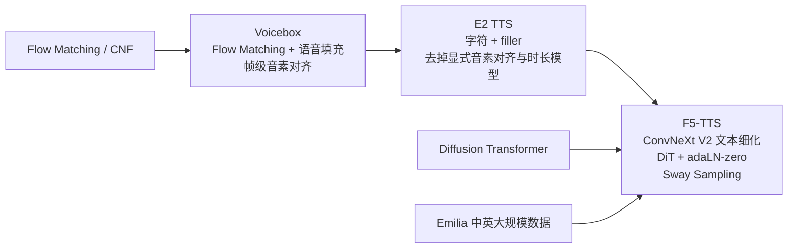
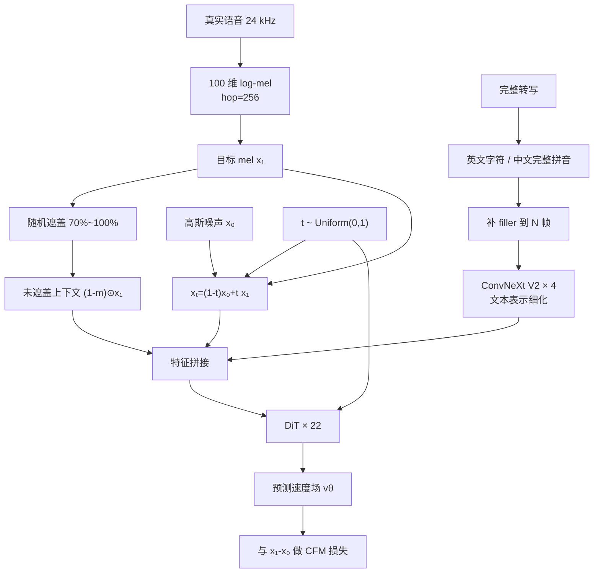
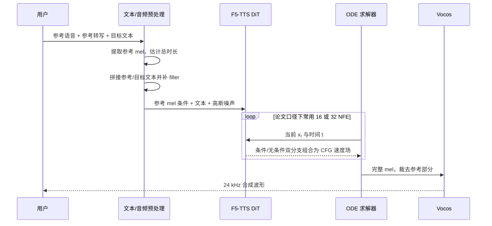

# F5-TTS 完整介绍

> **资料边界与版本口径**
>
> 本文以 **2026-09-14** 为访问截止日，优先依据 F5-TTS 的 [ACL 2025 正式论文](https://aclanthology.org/2025.acl-long.313/)、[arXiv 版本](https://arxiv.org/abs/2410.06885)、[官方项目页](https://swivid.github.io/F5-TTS/)、[官方 GitHub](https://github.com/SWivid/F5-TTS) 和官方发布记录。  
> “F5-TTS v1”在官方仓库中专指 **2025-03-12 发布的新版基础检查点与相应架构/训练改动**，不是论文所说的 arXiv v1，也不是名为“F5-TTS 2”的新论文。仓库软件包继续迭代至 [1.1.22（2026-07-23）](https://github.com/SWivid/F5-TTS/releases/tag/1.1.22)，但截至访问日没有可靠官方来源宣布“F5-TTS 2”。本文把论文模型、检查点版本和软件包版本分开叙述。

## 1. 摘要与模型定位

F5-TTS 是上海交通大学 X-LANCE 实验室等机构提出的、基于**条件流匹配**（Conditional Flow Matching, CFM）和**扩散 Transformer**（Diffusion Transformer, DiT）的全非自回归文本转语音系统。它接收目标文本、短参考语音及通常与之对应的转写，在连续 mel 频谱空间中从噪声并行生成目标语音，再由声码器还原波形。[原论文](https://aclanthology.org/2025.acl-long.313/)将其概括为不依赖显式音素级强制对齐、音素时长预测器或独立文本编码器的零样本 TTS。

最简洁的模型定位是：

```text
目标文本 + 参考语音（+ 参考转写）
        ↓
字符/拼音序列补齐到声学帧长度
        ↓
ConvNeXt V2 细化文本表示
        ↓
DiT 估计从噪声到 mel 频谱的速度场
        ↓
ODE 求解 + Sway Sampling + CFG
        ↓
Vocos 声码器（v1 官方路径）
        ↓
目标说话人风格的 24 kHz 语音
```

F5-TTS 的价值不在于首次使用 flow matching，也不在于首次实现零样本克隆。它建立在 Voicebox 的文本引导语音填充和 E2 TTS 的“字符 + filler token”极简对齐方式上，核心贡献是：

1. 用 **ConvNeXt V2 文本细化分支**缓解 E2 TTS 的收敛慢和文本—语音对齐不稳；
2. 用带 adaLN-zero 的 **DiT** 替换 E2 TTS 的 U-Net 式 Transformer；
3. 提出无需重训的 **Sway Sampling**，在推理时把更多 ODE 计算分配给早期流步骤；
4. 在约 9.5 万小时中英 Emilia 数据上训练 3.358 亿参数模型，并完整开源训练、推理、微调和部署代码。[论文实验设置](https://arxiv.org/html/2410.06885v3#S4) [官方仓库](https://github.com/SWivid/F5-TTS)

它尤其适合作为研究和非商业原型的“开放基线”：模型结构相对短、训练目标统一、检查点可获得、可微调，也便于研究采样、对齐和流模型加速。但“全非自回归”不等于“一步生成”，也不自动等于低首包延迟；论文主实验通常采用 16 或 32 个求解器 NFE，且启用 CFG 后每个 guided evaluation 包含有条件和无条件两个分支，实际 DiT 计算量约翻倍。长文本通常还要按句切块生成。[论文 §2.1、§2.2、§4](https://arxiv.org/html/2410.06885v3)

---

## 2. 研究背景与前置技术

### 2.1 从声学回归到大规模生成式 TTS

神经 TTS 大致经历了几条相互交叉的技术路线：

| 路线 | 典型表示与生成方式 | 优点 | 常见代价 |
|---|---|---|---|
| 传统声学模型 | 文本/音素 → mel → 声码器 | 管线成熟、可控性强 | 对齐器、时长模型、G2P 等组件较多 |
| 端到端连续生成 | 直接联合对齐、频谱或波形建模 | 管线紧凑 | 大规模零样本上下文学习并非早期重点 |
| 神经 codec 语言模型 | AR/NAR 生成离散 codec token | 易借鉴语言模型，隐式建模时长 | 量化损失、多码本、长序列和 AR 延迟 |
| 扩散/流匹配 | 在连续频谱或 latent 上迭代去噪/运输 | 可并行生成，连续表示保留细节 | 多步采样；总时长与文本对齐仍困难 |

[VALL-E](https://arxiv.org/abs/2301.02111) 在 2023 年把 TTS 明确改写为条件 codec 语言建模：根据文本和约 3 秒声学提示自回归生成第一层 EnCodec token，再非自回归补齐其余码本。它证明了大规模语音数据可带来强零样本上下文学习，但也把 AR 延迟、离散量化和长 codec 序列问题带入 TTS。

[Voicebox](https://proceedings.neurips.cc/paper_files/paper/2023/hash/2d8911db9ecedf866015091b28946e15-Abstract.html) 选择另一条路：在连续 mel 空间用 flow matching 学习文本引导的语音填充。它能利用左、右声学上下文执行零样本 TTS、编辑、去噪和风格转换，但仍使用帧级音素对齐和时长相关组件。[Voicebox 论文](https://arxiv.org/abs/2306.15687)

### 2.2 非自回归 TTS 的核心难题：不同长度模态如何对齐

文本可能只有几十个字符，24 kHz 语音经 hop size 256 提取后却约有 93.75 个 mel 帧/秒。AR 模型可以通过“何时输出结束符”隐式决定时长；NAR 模型若要并行产生整段声学序列，必须先知道输出长度，并解决每个文本单元对应哪些声学帧。

常见方案包括：

- 强制对齐得到帧级音素，再训练时长预测器；
- Monotonic Alignment Search（MAS）；
- 文本编码后通过 cross-attention 与声学序列交互；
- 先生成语义 token，再生成声学 token；
- E2 TTS/F5-TTS 的做法：给出总长度，把短文本序列用 filler token 补齐到声学帧长度，让模型端到端学习软对齐。

最后一种方法删掉了显式对齐模块，却没有让“时长问题”消失。F5-TTS 推理仍须确定总 mel 长度；原论文使用参考语音与目标文本字符数比例做简单估计，也允许直接指定时长。[F5-TTS §3.1](https://arxiv.org/html/2410.06885v3#S3.SS1)

### 2.3 Voicebox → E2 TTS → F5-TTS

技术继承关系可以画成：



[E2 TTS](https://arxiv.org/abs/2406.18009) 的关键发现是：字符序列补 filler 后与 mel 等长，再用语音填充任务训练，一个 Transformer 就可以联合学会字音映射、时长和声学生成。其原始实现采用带 U-Net 长跳连的平坦 Transformer。F5-TTS 作者复现后发现，E2 TTS 在跨域零样本场景中存在收敛慢和部分样本对齐失败，于是保留极简输入法，重做文本入口和骨干网络。[F5-TTS §3.2、§5.1](https://arxiv.org/html/2410.06885v3)

---

## 3. 发展时间线

### 3.1 2023-06：Voicebox 奠定流匹配语音填充范式

Meta 在 2023 年 6 月公布 Voicebox：用非自回归连续归一化流和 flow matching，在给定文本及周围音频时填补被遮盖语音；论文展示了单语/跨语言零样本 TTS、内容编辑、去噪、风格转换和数据生成。[Meta 官方介绍](https://ai.meta.com/blog/voicebox-generative-ai-model-speech/) [NeurIPS 2023 论文](https://proceedings.neurips.cc/paper_files/paper/2023/hash/2d8911db9ecedf866015091b28946e15-Abstract.html)

### 3.2 2024-06：E2 TTS 把对齐简化为字符补齐

E2 TTS 于 2024-06-26 首次提交 arXiv。它把 Voicebox 的帧级音素条件替换为“字符 + filler token”，不再需要 G2P、音素对齐器和音素时长模型；原论文模型在 5 万小时 LibriHeavy 英语数据上训练，也报告了 20 万小时私有数据实验。[E2 TTS arXiv](https://arxiv.org/abs/2406.18009)

### 3.3 2024-10-08/09：F5-TTS 代码、检查点和论文初版公开

- 官方 GitHub 新闻记录显示，F5-TTS 与复现的 E2 TTS 基础检查点于 **2024-10-08** 发布到 Hugging Face、ModelScope 等平台。[官方 README](https://github.com/SWivid/F5-TTS)
- arXiv:2410.06885 v1 于 **2024-10-09** 提交，v2 于 10 月 15 日修订。[arXiv 提交记录](https://arxiv.org/abs/2410.06885)
- 初版公开了完整训练、推理与评测代码，以及约 3.36 亿参数的 F5-TTS Base 和约 3.33 亿参数的 E2 TTS 复现模型。[论文](https://arxiv.org/html/2410.06885v1) [模型仓库](https://huggingface.co/SWivid/F5-TTS)

### 3.4 2025-03-12：F5-TTS v1 Base

官方 [1.0.0 发布说明](https://github.com/SWivid/F5-TTS/releases/tag/1.0.0)列出三项主要更新：

1. 同时对 filler token 和批处理 padding token 加入文本 padding mask；
2. 对 DiT 的 adaptive LayerNorm 做零初始化；
3. 对全部相关维度应用完整 Rotary Positional Embedding（RoPE）。

同日发布 `F5TTS_v1_Base/model_1250000.safetensors`。官方维护者说明，在相同学习率、更新数和总 batch 设置下，v1 相对 v0 收敛更快，并给出内部三随机种子对比：LibriSpeech-PC WER 2.33% → 2.09%、SIM 0.659 → 0.673；Seed-TTS test-en WER 1.76% → 1.55%、SIM 0.664 → 0.679。[官方 issue 回复](https://github.com/SWivid/F5-TTS/issues/868)

这些数字来自仓库维护者的版本比较，不是 ACL 论文主表，也没有完整公布硬件、解码配置和置信区间，因此适合说明更新方向，不应与论文主结果直接混排。v1 的 full RoPE 还可能增加部分 PyTorch 推理开销；维护者认为文本细化缓存可抵消一部分，并粗略判断总体速度接近，但没有给出统一正式基准，某些输入仍可能更慢。[官方 issue #854](https://github.com/SWivid/F5-TTS/issues/854) [官方 issue #868](https://github.com/SWivid/F5-TTS/issues/868)

### 3.5 2025-05/07：论文定稿并发表于 ACL 2025

arXiv v3 于 **2025-05-20** 更新；正式版本发表于 2025 年 7 月举行的第 63 届 ACL 年会长文集，页码 6255–6271，DOI 为 [10.18653/v1/2025.acl-long.313](https://doi.org/10.18653/v1/2025.acl-long.313)。因此，把 F5-TTS 写成“ICASSP 2025 模型”是不准确的。

### 3.6 2025—2026：部署、编辑、多语言社区与软件工程演进

官方仓库随后补充或强化了：

- pip 包、Python API、CLI、Gradio、Docker；
- Hugging Face Accelerate 训练/微调；
- 多说话人/多风格脚本、Qwen2.5 驱动的语音聊天样例；
- mel 域局部语音编辑；
- socket 分块输出；
- Triton Inference Server + TensorRT-LLM 部署；
- NVIDIA CUDA、AMD ROCm、Intel XPU 与 Apple Silicon 的安装说明；
- 社区阿拉伯语、芬兰语、法语、德语、印地语、意大利语、日语、拉脱维亚语、俄语、西班牙语检查点索引。[官方 README](https://github.com/SWivid/F5-TTS) [推理文档](https://github.com/SWivid/F5-TTS/blob/main/src/f5_tts/infer/README.md) [社区模型卡](https://github.com/SWivid/F5-TTS/blob/main/src/f5_tts/infer/SHARED.md)

截至访问日，最新可核实的软件包为 [1.1.22（2026-07-23）](https://github.com/SWivid/F5-TTS/releases/tag/1.1.22)，其变更是修复长文本分块时 `fix_duration` 被重复应用导致总时长膨胀。这是工程修复，不是新模型代际。1.1.16 还修复了 mel 域语音编辑边界伪影，1.1.18 调整了流式/非流式函数和并行处理。[1.1.16](https://github.com/SWivid/F5-TTS/releases/tag/1.1.16) [1.1.18](https://github.com/SWivid/F5-TTS/releases/tag/1.1.18)

### 3.7 后续与衍生研究：不是官方“F5-TTS 2”

- **F5R-TTS（2025-04）**：外部团队以 F5-TTS 为骨干，把确定性速度场输出概率化，再用带 WER 和说话人相似度奖励的 GRPO 强化学习。在 WenetSpeech4TTS Basic 7,226 小时重训、Seed-TTS test-zh 普通测试集的论文口径下，WER 从 2.10% 降至 1.48%（相对降低 29.5%），SIM 从 0.698 升至 0.730（相对提高 4.6%）；困难集的 WER 相对改善为 5.9%。这是独立论文，不属于 SWivid 官方版本。[arXiv:2504.02407](https://arxiv.org/html/2504.02407v3)
- **Fast F5-TTS / EPSS（2025-05）**：有原 F5-TTS 核心作者参与，提出经验剪枝步采样。在 RTX 3090、6 秒提示生成 20 秒语音并重复 100 次的独立端到端协议中，7 NFE 的 RTF 为 0.030，较该论文 32 NFE 基线的 0.123 约快 4 倍。这个结果不能与 ACL 表 1 的 RTF 直接横比；相关实现后来进入 SWivid 仓库，但它不是新版基础检查点。[arXiv:2505.19931](https://arxiv.org/html/2505.19931v2)
- **Cross-Lingual F5-TTS（2025-09）**：有原团队成员参与，通过训练时去除参考转写并加入语速预测，研究“没有参考文本的跨语言克隆”。它反过来说明标准 F5-TTS 通常依赖参考转写或 ASR 自动转写。[arXiv:2509.14579](https://arxiv.org/abs/2509.14579) [项目页](https://qingyuliu0521.github.io/Cross_lingual-F5-TTS/)
- **X-Voice（2026-05）**：在 F5-TTS 架构上扩展为约 0.4B 参数、30 语种的无参考转写跨语言声音克隆模型，以 IPA 统一文本表示并在约 42 万小时多语语料上分两阶段训练。它代表原团队参与的后续架构扩展，不是 F5-TTS v2 检查点。[arXiv:2605.05611](https://arxiv.org/abs/2605.05611)

> **事实与推断的边界：**这些工作说明 F5-TTS 已成为研究流匹配 TTS 的常用开放骨干，但它们的作者归属、训练数据与评测协议不同，也不能据此推断 SWivid 将沿其中某条路线发布名为“F5-TTS 2”的模型。

---

## 4. 核心原理：条件流匹配

### 4.1 从噪声分布到真实语音分布

Flow Matching 的目标是学习随时间变化的向量场 $v_\theta(x_t,t,c)$，把简单分布 $p_0$（通常是高斯噪声）连续运输到数据分布 $p_1$（真实 mel 频谱）。其中 $c$ 表示文本和参考语音条件。

F5-TTS 采用最优传输形式的线性概率路径：

$$
x_t=(1-t)x_0+t x_1,\qquad x_0\sim\mathcal{N}(0,I),\quad t\sim\mathcal{U}(0,1)
$$

该路径的真实速度为：

$$
\frac{dx_t}{dt}=x_1-x_0
$$

模型最小化条件流匹配均方误差：

$$
\mathcal{L}_{\mathrm{CFM}}(\theta)=\mathbb{E}_{t,x_0,x_1}\left[\left\|v_\theta(x_t,t,c)-(x_1-x_0)\right\|_2^2\right]
$$

训练不需要像传统连续归一化流那样求解 ODE 或计算 Jacobian；只需随机采样 $t$、噪声和真实频谱，回归局部速度。推理时则从 $x_0$ 出发，通过 ODE：

$$
\frac{dx_t}{dt}=v_\theta(x_t,t,c)
$$

积分到 $t=1$，得到生成频谱。[F5-TTS §2.1](https://arxiv.org/html/2410.06885v3#S2.SS1) [Flow Matching 原论文](https://arxiv.org/abs/2210.02747)

### 4.2 为什么是“流匹配”，却经常与扩散模型并称

扩散模型和 flow matching 都学习从噪声到数据的连续生成过程，也都可使用类似 Transformer 骨干和 classifier-free guidance。区别在于训练目标、概率路径和采样方程的具体形式。F5-TTS 论文还指出，若改用 log-SNR 参数化并预测噪声，其 OT-CFM 目标可与特定 diffusion v-prediction 形式建立联系，但二者不应简单视为完全相同。[F5-TTS §2.1](https://arxiv.org/html/2410.06885v3#S2.SS1)

### 4.3 文本引导的语音填充

训练时，从完整语音 mel $x_1\in\mathbb{R}^{F\times N}$ 中随机遮盖连续的 70%—100% 帧。模型同时接收：

- 带噪声的 $x_t=(1-t)x_0+t x_1$；
- 未遮盖的声学上下文 $(1-m)\odot x_1$；
- 完整转写经补齐后的文本序列；
- 流时间 $t$。

它学习在已知周围声学上下文和完整文本时恢复遮盖语音。高遮盖比例使“几乎整段生成”成为训练分布的一部分；保留的上下文则教会模型从参考语音继承说话人、声学环境和韵律信息。[论文 §3.1、§4](https://arxiv.org/html/2410.06885v3)

---

## 5. 文本填充、隐式对齐与时长

### 5.1 filler token 如何工作

假设转写被处理为 $M$ 个字符/拼音单元，而 mel 有 $N$ 帧，且 $M\le N$。F5-TTS 构造：

$$
z=(c_1,c_2,\ldots,c_M,\underbrace{\langle F\rangle,\ldots,\langle F\rangle}_{N-M})
$$

这里的 filler 不是静音标签，也不表示某个字符应持续多少帧。真实字符只占序列前部，模型结合完整自注意力、位置编码和声学条件，在训练中自行学习文本单元如何映射到整个 mel 时间轴。[F5-TTS 式 (5)](https://arxiv.org/html/2410.06885v3#S3.SS1)

这种设计的关键是**已知总声学长度，未知细粒度对齐**。它去掉了硬音素边界，允许模型学习更自然的时长和节奏；代价是对总长度估计和隐式对齐能力高度敏感。

### 5.2 英文与中文文本前端

论文基础模型：

- 英文直接使用字母与符号；
- 中文先用 `jieba` 和 `pypinyin` 转为完整拼音；
- 词表共 2546 个条目，包含 filler 和 Emilia 中出现的其他语言字符；
- 语音使用 24 kHz、100 维 log-mel，hop size 256。[论文 §4](https://arxiv.org/html/2410.06885v3#S4)

因此，“不使用 G2P”主要准确描述英文字符路径；中文仍有分词和拼音转换。它也不是完全无文本前端：大小写、数字、标点和语言识别仍会影响读法。官方推理指南明确建议为中文数字预先转成中文文字，并注意英文句末标点后的空格。[官方推理文档](https://github.com/SWivid/F5-TTS/blob/main/src/f5_tts/infer/README.md)

### 5.3 推理时长如何得到

给定参考 mel 长度 $N_\mathrm{ref}$、参考文本长度 $M_\mathrm{ref}$ 和目标文本长度 $M_\mathrm{gen}$，论文用字符数比例估计目标时长，直观形式近似：

$$
N_\mathrm{gen}\approx N_\mathrm{ref}\cdot\frac{M_\mathrm{gen}}{M_\mathrm{ref}}
$$

实现中还会根据语言和分块策略调整，也支持固定时长。这个启发式带来直接的**语速控制**：增大目标长度会放慢语速，减小会加快；但极端时长可能造成拖音、挤压、漏词或不自然停顿。[论文 §3.1 与项目页 Speed Control 样例](https://swivid.github.io/F5-TTS/)

---

## 6. 模型架构与数据流

### 6.1 整体训练数据流



### 6.2 ConvNeXt V2 文本细化

E2 TTS 直接把字符 embedding 与声学输入拼接。虽然字符和 mel 在物理长度上都为 \(N\)，有效信息密度却差异巨大：前 \(M\) 位是字符，其余大多是 filler，而声学帧几乎处处有信息。

F5-TTS 先让文本序列经过 4 层 ConvNeXt V2，使局部字符上下文和位置信息形成更平滑的时间表示，再与 noisy mel 和 masked mel 拼接。论文把这种“独立建模空间”视为提升隐式对齐和跨域鲁棒性的关键，而不是显式恢复音素边界。[论文 §3.2](https://arxiv.org/html/2410.06885v3#S3.SS2)

### 6.3 DiT、adaLN-zero 与位置编码

基础模型的主干配置为：

| 组件 | 论文配置 |
|---|---|
| DiT 层数 | 22 |
| 注意力头 | 16 |
| DiT embedding / FFN | 1024 / 2048 |
| ConvNeXt V2 层数 | 4 |
| ConvNeXt embedding / FFN | 512 / 1024 |
| 参数量 | 335.8M |
| dropout | 注意力与 FFN 均 0.1 |

[论文 §4](https://arxiv.org/html/2410.06885v3#S4)

流时间 \(t\) 先做正弦 embedding，再通过 adaLN 条件化各 DiT block；adaLN-zero 把调制残差分支初始化为接近恒等映射，有利于深层生成模型稳定启动。输入还使用卷积位置编码，自注意力采用 RoPE，文本序列在进入 ConvNeXt 前加入绝对正弦位置编码。[论文 §3.2](https://arxiv.org/html/2410.06885v3#S3.SS2)

2025 年 v1 检查点进一步启用完整 RoPE、文本 padding mask 和明确的 adaLN 零初始化。[1.0.0 发布说明](https://github.com/SWivid/F5-TTS/releases/tag/1.0.0)

### 6.4 与 codec 模型的根本区别

F5-TTS 的生成目标是连续 mel，而不是离散神经 codec token：

```text
F5-TTS：文本/参考 mel → 多步连续流 → mel → 声码器
VALL-E：文本/参考 codec → AR/NAR 离散 token → codec 解码器
MaskGCT：文本 → 语义 token → 声学 codec token → codec 解码器
```

连续 mel 避免了 codec 量化误差和多码本预测，但频谱序列仍然很长，而且质量上限受到 Vocos/BigVGAN 声码器影响。论文把“连续表示序列过长”列为主要局限。[论文 Limitations](https://arxiv.org/html/2410.06885v3#S7)

---

## 7. 训练目标与训练设置

### 7.1 训练数据

原始 Emilia 数据集含 101,654 小时、六种语言的 24 kHz 网络视频和播客语音；F5-TTS 经过转写失败和语言误判过滤后，实际保留约 **95K 小时英语与中文**，论文摘要将其四舍五入称为 100K 小时多语言数据。[Emilia 论文](https://arxiv.org/abs/2407.05361) [F5-TTS §4](https://arxiv.org/html/2410.06885v3#S4)

这里必须区分：

- Emilia 原始数据覆盖英、中、德、法、日、韩六语；
- 官方 F5-TTS Base 论文训练集是过滤后的**中英子集**；
- 基础检查点出现少量其他字符或偶发迁移能力，不等于官方训练和系统评测支持六语；
- 仓库列出的更多语言多数是社区训练/微调检查点。[官方社区模型卡](https://github.com/SWivid/F5-TTS/blob/main/src/f5_tts/infer/SHARED.md)

### 7.2 优化设置

论文基础模型训练到 120 万次更新，batch 为 307,200 个音频帧（约 0.91 小时），使用 8 张 NVIDIA A100 80GB，耗时一周以上。优化器为 AdamW，峰值学习率 \(7.5\times10^{-5}\)，前 20K 步线性 warm-up，之后线性衰减；梯度裁剪为 1。[论文 §4](https://arxiv.org/html/2410.06885v3#S4)

训练时：

- 随机遮盖 70%—100% mel 帧；
- 先以 0.3 概率丢弃 masked speech 条件；
- 再以 0.2 概率连同文本一起丢弃，以训练 CFG 的无条件/弱条件分支；
- 推理使用 EMA 权重。[论文 §4](https://arxiv.org/html/2410.06885v3#S4)

### 7.3 小数据训练说明了什么

论文还在 945 小时 WenetSpeech4TTS Premium、585 小时 LibriTTS 和 24 小时 LJSpeech 上训练约 1.58 亿参数小模型。结果表明结构可在较小数据上学会对齐，但这不等于几十分钟数据就能从零训练通用零样本模型；小数据实验要么是受限领域/单说话人，要么仍经过数十万更新。[论文 Appendix B.7](https://arxiv.org/html/2410.06885v3#A2.SS7)

微调则可以复用预训练模型。官方仓库提供 CLI 和 Gradio 微调入口及 Accelerate 配置，但数据质量、转写一致性、词表匹配和过拟合风险比“音频分钟数”更关键。[官方训练目录](https://github.com/SWivid/F5-TTS/tree/main/src/f5_tts/train)

---

## 8. 推理、采样与声码器

### 8.1 标准零样本推理



参考文本不是理论上不可移除，但标准官方检查点和管线通常需要它。CLI 允许留空，此时会加载 ASR 自动转写，增加显存、延迟及转写错误传播。[官方推理文档](https://github.com/SWivid/F5-TTS/blob/main/src/f5_tts/infer/README.md)

### 8.2 Classifier-Free Guidance（CFG）

训练时随机丢弃条件，使同一模型同时学会有条件与无条件速度场。推理时组合：

$$
v_{\mathrm{CFG}}
=
v_\theta(x_t,t,c)
+\alpha\left[
v_\theta(x_t,t,c)-v_\theta(x_t,t,\varnothing)
\right]
$$

增大 \(\alpha\) 通常加强对文本/参考条件的服从，但可能牺牲多样性或造成过度引导。论文主实验默认 CFG strength 为 2。由于每个 guided evaluation 都要计算有条件和无条件分支，CFG 大致使 DiT 计算量翻倍；论文和后续工作仍按求解器步数报告“16/32 NFE”，通常不会把表中的 NFE 数字写成两倍。[F5-TTS §2.2、§5](https://arxiv.org/html/2410.06885v3) [Fast F5-TTS §2.2](https://arxiv.org/html/2505.19931v2#S2.SS2)

### 8.3 Sway Sampling

标准 ODE 求解会在 \(t\in[0,1]\) 上均匀取步。F5-TTS 定义：

$$
f_{\mathrm{sway}}(u;s)
=u+s\left(
\cos\frac{\pi u}{2}-1+u
\right)
$$

其中：

$$
s\in\left[-1,\frac{2}{\pi-2}\right]
$$

- \(s=0\)：均匀步；
- \(s<0\)：向早期 \(t\to0\) 倾斜；
- \(s>0\)：向后期倾斜。

论文默认 \(s=-1\)。作者的解释是：从纯噪声出发的早期步骤决定语音“轮廓”、文本对齐和大体音色，后期更多修饰细节；把有限 NFE 集中到早期可提高内容忠实度和相似度。训练仍均匀采样 \(t\)，Sway 仅改变推理网格，因此不需重训。[论文 §3.2、§5.2](https://arxiv.org/html/2410.06885v3)

消融中，在 midpoint、32 NFE 下，LibriSpeech-PC 上 F5-TTS 从无 Sway 的 WER 2.84 / SIM 0.62 / UTMOS 3.70 改善为有 Sway 的 2.41 / 0.66 / 3.89；同策略也改善了复现的 E2 TTS，支持其可迁移性。[论文 Appendix B.3](https://arxiv.org/html/2410.06885v3#A2.SS3)

### 8.4 ODE 求解器与 NFE

官方主设置为：

- F5-TTS：Euler；
- E2 TTS：midpoint；
- 典型 NFE：16 或 32；
- 默认 CFG：2；
- 默认 Sway：\(-1\)。[论文 §4、Appendix B.4](https://arxiv.org/html/2410.06885v3)

NFE 越高，数值积分通常越精确，但延迟近似线性增长。这里的 NFE 是论文表格采用的求解器报告口径，不应直接理解成启用 CFG 后的实际 DiT 前向次数。Euler 每步计算一次 guided velocity，但 guided velocity 内含条件/无条件双分支；midpoint 或高阶方法在相同名义步数或实现口径下还可能需要更多计算。比较 RTF 时必须同时确认 CFG、求解器和 NFE 定义。

### 8.5 声码器

论文默认使用预训练 [Vocos](https://arxiv.org/abs/2306.00814) 把 100 维 log-mel 还原为波形，附录也评测了与 BigVGAN 配套训练的模型设置。但声码器不能在所有检查点间任意替换：官方当前说明 `F5TTS_v1_Base` 只支持 Vocos，BigVGAN 需要使用相匹配的旧版 `F5TTS_Base_bigvgan` 配置与检查点。声码器及其配套声学模型设置会影响 WER、SIM 和音质。[论文 Appendix B.6](https://arxiv.org/html/2410.06885v3#A2.SS6) [官方推理说明](https://github.com/SWivid/F5-TTS/blob/main/src/f5_tts/infer/README.md) [官方 issue #872](https://github.com/SWivid/F5-TTS/issues/872)

---

## 9. F5-TTS 与 E2 TTS 的关系和差异

| 维度 | E2 TTS | F5-TTS |
|---|---|---|
| 基本任务 | 文本引导 mel 语音填充 | 相同 |
| 生成方式 | 全 NAR、CFM + ODE | 相同 |
| 文本对齐 | 字符 + filler，无显式音素对齐 | 保留该核心思想 |
| 文本入口 | 字符 embedding 直接与声学输入拼接 | 先经 ConvNeXt V2 细化 |
| 骨干 | 24 层 flat U-Net Transformer，长跳连 | 22 层 DiT，adaLN-zero，无 U-Net 长跳连 |
| 时间条件 | 作为额外 token/输入 | 调制 adaLN |
| 位置编码 | 复现版使用 RoPE 等 | 卷积位置编码 + RoPE + 文本绝对位置 |
| 参数量（论文复现） | 333.2M | 335.8M |
| 采样 | 原论文 midpoint，均匀时间步 | Euler + Sway Sampling |
| 主要问题/改进 | 结构简单，但作者复现时收敛慢、跨域对齐不稳 | 更快收敛、更低 WER，保持相近 SIM |

[E2 TTS 论文](https://arxiv.org/abs/2406.18009) [F5-TTS §3.2、§4](https://arxiv.org/html/2410.06885v3)

论文 945 小时中文小模型消融中，训练 800K 步后，F5-TTS 为 WER 4.17 / SIM 0.54，E2 TTS 为 9.63 / 0.53；E2 TTS 约 7% 样本持续出现 WER > 50% 的失败。去掉参考音频、仅给文本时，两者 WER 差距显著缩小，作者据此推断 E2 TTS 语义与声学条件纠缠过深。[论文 §5.1、Appendix B.2](https://arxiv.org/html/2410.06885v3)

这项结论应限定在 F5-TTS 作者的复现、数据和评测条件内。E2 TTS 原论文在 LibriHeavy 英语设置中报告了很强结果；两篇论文使用的训练数据、ASR 评测器和提示列表并不完全相同，不能将某一表格泛化成“E2 TTS 在所有场景都差”。[E2 TTS §3](https://arxiv.org/html/2406.18009)

---

## 10. 能力与语音方向应用

### 10.1 零样本声音克隆

F5-TTS 可从短参考语音继承未见说话人的音色、语速、韵律和部分录音环境，不更新模型参数即可合成新文本。[官方项目页 Zero-shot Generation](https://swivid.github.io/F5-TTS/) 但“克隆”并非身份完全复制：

- SIM 是嵌入余弦相似度，不等于人类或声纹系统无法区分；
- 参考录音噪声、混响、情绪和发音会一并成为条件；
- 参考转写错误可能导致边界和内容错位；
- 论文测试主要是 4—10 秒英语样本及 Seed-TTS 中英集合，不覆盖所有真实录音条件。

### 10.2 中英多语言、跨语言与 code-switching

官方 Base 在约 95K 小时**中英**数据上训练，项目页展示：

- 中文、英文零样本合成；
- 中文参考说英文或英文参考说中文的跨语言克隆；
- 中英句内 code-switching。[项目页](https://swivid.github.io/F5-TTS/) [论文 §4](https://arxiv.org/html/2410.06885v3#S4)

跨语言时，目标语言发音与说话人原口音可能相互影响。基础检查点不应被描述为原生任意语言模型；更多语言来自社区检查点，质量、许可、词表和评测口径各不相同。[社区模型卡](https://github.com/SWivid/F5-TTS/blob/main/src/f5_tts/infer/SHARED.md)

### 10.3 情感、韵律与风格

参考音频可以传递明显情绪和说话风格，官方项目页提供情感样例。但原论文明确把“缺少副语言细节的细粒度控制，例如情绪”列为局限。[项目页 Emotion](https://swivid.github.io/F5-TTS/) [论文 Limitations](https://arxiv.org/html/2410.06885v3#S7)

因此应区分：

- **提示式模仿**：用悲伤/激动/耳语参考，让生成近似该风格；
- **显式控制**：输入“愤怒 0.7、语速 1.1、重音在某词”并稳定执行。

基础 F5-TTS 擅长前者，不原生提供可靠、解耦、可标定的后者。后续外部工作用 ControlNet、activation steering 或微调补足该能力，但不能倒推为官方基础模型自带功能。

### 10.4 语速控制

改变目标 mel 总长度即可调节语速，无需音素级 duration predictor。适合配音时长适配和粗粒度节奏控制；但它是整句全局控制，不能像显式时长模型那样直接指定每个音素或词的时长。[论文 §3.1](https://arxiv.org/html/2410.06885v3#S3.SS1)

### 10.5 语音编辑、补全与续写

语音填充训练天然支持：

- 在已知左右声学上下文时重生成局部片段；
- 保留前缀音频并续写目标文本；
- 替换错词、数字或短句；
- 对拼接边界进行 mel 域修复。

官方仓库提供 `speech_edit.py`，按时间戳把待编辑 mel 区间置空，并把其余 mel 作为条件重生成；1.1.16 又修复了边界伪影。[官方编辑脚本](https://github.com/SWivid/F5-TTS/blob/main/src/f5_tts/infer/speech_edit.py) [1.1.16](https://github.com/SWivid/F5-TTS/releases/tag/1.1.16)

局部编辑仍依赖可靠时间边界和新旧文本对应关系。若替换文本长度变化很大，韵律连续性和后续时间轴会更难保持。

### 10.6 对话、有声书与多角色内容

官方 Gradio/CLI 支持：

- 按句分块的长文本合成；
- 在配置文件中为不同角色指定不同参考音频；
- Qwen2.5-3B-Instruct 驱动的语音聊天演示。[官方推理文档](https://github.com/SWivid/F5-TTS/blob/main/src/f5_tts/infer/README.md)

这适合有声书、播客草稿、游戏角色对白和对话代理原型。不过它们是**应用层编排**：长内容由多次短片段生成、静音处理和 cross-fade 拼接，不是单次端到端生成整本书，也不保证跨章节韵律和角色状态长期一致。

### 10.7 辅助数据生成

在获得说话人授权、保留来源元数据并做质量筛选的前提下，F5-TTS 可用于：

- 扩充低资源 ASR/TTS 训练句式；
- 合成长尾数字、专名、口音与 code-switch 样本；
- 为语音代理构造测试集；
- 生成成对的文本—语音或编辑前后样本。

但合成数据会继承 ASR 转写错误、训练语料偏差和模型特有伪影。若反复用合成数据训练同类模型，可能放大模式坍缩和说话人/口音分布偏差。F5-TTS 论文没有给出系统的数据增强收益实验；Voicebox 才在其论文中专门展示了 ASR 数据生成应用。[Voicebox 论文](https://arxiv.org/abs/2306.15687)

### 10.8 实时、流式与端侧应用

F5-TTS 的全 NAR 特性有利于 GPU 并行，但标准模型不是原生因果流式架构：

- 每个分块通常要先确定总长度；
- 整个分块经历多次 ODE/DiT 前向后才能解码；
- 官方所谓 socket “real-time service”输出的是**已生成分块的流式传输**，不是逐帧因果生成；
- 长文本需切块，首包延迟取决于分块长度、NFE、CFG、声码器和硬件。[官方推理文档](https://github.com/SWivid/F5-TTS/blob/main/src/f5_tts/infer/README.md) [官方 issue #700](https://github.com/SWivid/F5-TTS/issues/700)

端侧方面，官方 README 支持 Apple Silicon 的 PyTorch 安装，并链接社区 [MLX 实现](https://github.com/lucasnewman/f5-tts-mlx)和 [ONNX 实现](https://github.com/DakeQQ/F5-TTS-ONNX)。MLX 项目提供 4/8 bit 量化，但这些是社区移植，数值一致性、功能覆盖和版本兼容需单独验证。

---

## 11. 性能与评测

### 11.1 指标口径

F5-TTS 论文采用 cross-sentence 零样本任务：

- **WER/CER**：生成语音经 ASR 转写后的词/字错误率；英语用 Whisper-large-v3，中文用 Paraformer-zh；
- **SIM-o**：WavLM-large 说话人验证 embedding 与目标真实语音的余弦相似度；
- **CMOS**：相对真实语音的比较主观质量分；
- **SMOS**：对参考提示与生成语音的说话人相似度打分；
- **RTF**：生成耗时 / 音频时长，越低越快；论文表 1 用 RTX 3090 生成 10 秒语音测量。[论文 §4](https://arxiv.org/html/2410.06885v3#S4)

WER 会受到所选 ASR 的偏差影响，SIM 会受到说话人编码器影响，RTF 则高度依赖硬件、精度、求解器、NFE、CFG、实现优化和是否包含声码器。不同论文同名指标不一定可直接比较。

### 11.2 同一 LibriSpeech-PC 口径的主结果

下表摘自 F5-TTS 论文对 1127 条、约 2 小时的 4—10 秒 LibriSpeech-PC test-clean 子集评测；开源模型结果取三次随机生成平均：

| 模型 | 参数量 | 训练数据 | NFE | WER ↓ | SIM-o ↑ | RTF ↓ |
|---|---:|---:|---:|---:|---:|---:|
| Ground Truth | — | — | — | 2.23 | 0.69 | — |
| Vocoder Resynthesized | — | — | — | 2.32 | 0.66 | — |
| E2 TTS（作者复现） | 333M | 100K Multi. | 32 | 2.95 | 0.69 | 0.68 |
| F5-TTS | 336M | 100K Multi. | 16 | 2.53 | 0.66 | 0.15 |
| F5-TTS | 336M | 100K Multi. | 32 | 2.42 | 0.66 | 0.31 |

[F5-TTS 表 1](https://arxiv.org/html/2410.06885v3#S5)

表中的 `100K Multi.` 是论文原表的概括写法；实际训练数据是过滤后约 95K 小时的英语和中文数据，并不表示六语都被纳入官方 Base 训练。

结论应限定为：

- 32 NFE 比 16 NFE 略降 WER，但 RTF 约翻倍；
- 主表的完整系统设置下，F5-TTS 比同数据重训的 E2 TTS WER 更低且更快，但主表同时混合了 E2 的 32 NFE midpoint 与 F5 的 Euler 设置，不能当作纯架构速度对照；在相同 midpoint + Sway 的附录实验中，F5 仍更快：16 NFE 为 0.26 对 0.34，32 NFE 为 0.53 对 0.68；
- vocoder 重建本身已使 Ground Truth 的 SIM 从 0.69 降到 0.66，说明声码器可解释部分相似度差距，但这不是数学意义上的严格上限；
- RTF 0.15 表示生成 10 秒语音约耗 1.5 秒，不代表首包延迟为 150 ms。

### 11.3 Seed-TTS 中英测试集

| 测试集 | 系统 | WER/CER ↓ | SIM-o ↑ | CMOS ↑ | SMOS ↑ |
|---|---|---:|---:|---:|---:|
| Seed-TTS test-en | Ground Truth | 2.06 | 0.73 | 0.00 | 3.91 |
|  | F5-TTS 16 NFE | 1.89 | 0.67 | 0.16 | 3.79 |
|  | F5-TTS 32 NFE | 1.83 | 0.67 | 0.31 | 3.89 |
| Seed-TTS test-zh | Ground Truth | 1.26 | 0.76 | 0.00 | 3.72 |
|  | F5-TTS 16 NFE | 1.74 | 0.75 | 0.02 | 3.72 |
|  | F5-TTS 32 NFE | 1.56 | 0.76 | 0.21 | 3.83 |

[F5-TTS 表 2](https://arxiv.org/html/2410.06885v3#S5)

主观评测邀请英语和普通话各 20 名母语者，对每个测试集随机 30 轮样本评分。[Appendix C](https://arxiv.org/html/2410.06885v3#A3) 这些结果说明 F5-TTS 在该协议下接近真实语音的内容和相似度指标，不意味着所有语言、说话人、情感、长文本或噪声场景达到人类水平。

### 11.4 困难文本与失败模式

在 ELLA-V 的 100 个困难英文句式上，论文报告 F5-TTS 32 NFE 的 WER 为 4.40%，其中替换 1.81%、删除 2.40%、插入 0.18%；重复词堆叠时仍会跳词，但低插入率说明无休止重复较少。[论文 Appendix B.5](https://arxiv.org/html/2410.06885v3#A2.SS5)

这比只看普通测试集更能揭示：

- 罕见词与非常规拼写易误读；
- 连续重复词会漏读；
- 不同参考说话人会改变同一难词的可识别度；
- ASR 指标会把合理口音差异计为错误。

### 11.5 官方部署基准

官方仓库给出单张 NVIDIA L20、26 组提示/目标、16 NFE 的部署测试：

| 模式 | 并发/批量 | 平均延迟 | RTF |
|---|---:|---:|---:|
| PyTorch offline | batch 1 | — | 0.1467 |
| TensorRT-LLM offline | batch 1 | — | 0.0402 |
| Triton client-server | concurrency 2 | 253 ms | 0.0394 |

[官方 Triton/TensorRT-LLM 文档](https://github.com/SWivid/F5-TTS/blob/main/src/f5_tts/runtime/triton_trtllm/README.md)

该结果显示专用推理引擎可显著提高吞吐，但不能与 ACL 论文 RTX 3090 RTF 直接横比，也不能只凭 253 ms 平均请求延迟断言端到端对话首包延迟。

---

## 12. 与代表模型的定性比较

| 模型 | 主要生成表示/范式 | 对齐与时长 | 零样本与控制侧重 | 开放性与相对 F5-TTS 的差异 |
|---|---|---|---|---|
| VALL-E | AR 第一层 + NAR 其余层的离散 EnCodec LM | AR 隐式时长 | 约 3 秒提示、音色/环境保持 | 原始权重未公开；离散 codec 与 AR 不同于 F5 的连续全 NAR 流 |
| Voicebox | mel 上 NAR flow matching + infilling | 帧级音素对齐/时长 | 编辑、去噪、跨语言、数据生成 | 是 E2/F5 的直接范式前驱；Meta 未公开模型和代码 |
| NaturalSpeech 2 | codec latent 上扩散 | 时长/音高预测与提示 | 零样本语音及歌声 | 更强调 latent codec、歌声和显式韵律条件 |
| NaturalSpeech 3 | FACodec 因子化 + 多个扩散模型 | 因子化内容/韵律/音色/声学细节 | 属性解耦和细粒度建模 | 管线更复杂；F5 更简洁但控制解耦较弱 |
| Seed-TTS / Seed-TTS DiT | 大规模 AR；另有全扩散 DiT | DiT 版无预估音素时长 | 情感、表达力、编辑、RL 增强 | 训练数据/完整细节未公开；F5 规模更透明且可复现 |
| MaskGCT | 两阶段 masked semantic/acoustic codec Transformer | 无显式对齐，先预测时长再并行 mask-and-predict | 高质量零样本、情感/VC 扩展 | 开源；离散两阶段、参数更多，与 F5 连续单主干不同 |
| CosyVoice 系列 | AR 语音 token + flow-matching mel + vocoder | AR 语义 token 隐式时长 | v1 强调多语言与指令控制；v2 强化统一流式/非流式 | 开源全栈；控制与流式更工程化，结构比 F5 复杂 |
| F5-TTS | 连续 mel 上 CFM + DiT | 字符补 filler，启发式总时长 | 中英零样本、code-switch、速度、填充编辑 | 结构简洁、训练/推理开源；细粒度控制和原生流式较弱 |

资料来源：[VALL-E](https://arxiv.org/abs/2301.02111)、[Voicebox](https://arxiv.org/abs/2306.15687)、[NaturalSpeech 2](https://www.microsoft.com/en-us/research/publication/naturalspeech-2-latent-diffusion-models-are-natural-and-zero-shot-speech-and-singing-synthesizers/)、[NaturalSpeech 3](https://www.microsoft.com/en-us/research/publication/naturalspeech-3-zero-shot-speech-synthesis-with-factorized-codec-and-diffusion-models/)、[Seed-TTS](https://arxiv.org/abs/2406.02430)、[MaskGCT](https://github.com/open-mmlab/Amphion/tree/main/models/tts/maskgct)、[CosyVoice v1](https://arxiv.org/abs/2407.05407)、[CosyVoice 2](https://arxiv.org/abs/2412.10117)

### 12.1 为什么不做“统一排行榜”

各工作常使用不同：

- LibriSpeech 子集和提示列表；
- ASR 与说话人验证模型；
- 采样次数和重排序策略；
- 声码器；
- 训练语言、数据规模与清洗程度；
- 主观评测人员和问题描述；
- RTF 硬件、精度和是否包含前后处理。

F5-TTS 论文自己也把旧模型在不同 LibriSpeech 子集上的分数用星号标记，并建立了公开的 LibriSpeech-PC 子集来改善可比性。[论文 §4、表 1](https://arxiv.org/html/2410.06885v3) 因此本文只对结构和能力做定性比较，数值主表只保留同一论文同一口径的结果。

---

## 13. 开源生态与部署实践

### 13.1 许可边界

- 官方代码：MIT；
- 官方预训练检查点：因训练数据 Emilia，采用 CC BY-NC 4.0 许可；
- Emilia 原始音频版权仍归原视频/音频权利人，数据集维护者明确限制为非商业研究/教育用途。[F5-TTS README](https://github.com/SWivid/F5-TTS#license) [Emilia 数据说明](https://huggingface.co/datasets/amphion/Emilia)

所以“代码 MIT”不等于“官方权重可直接商用”。商业项目必须分别审查代码、模型权重、训练数据、参考声音授权和生成内容权利。

### 13.2 安装与接口

官方路径包括：

```bash
pip install f5-tts

f5-tts_infer-cli \
  --model F5TTS_v1_Base \
  --ref_audio ref.wav \
  --ref_text "参考音频的准确转写。" \
  --gen_text "需要生成的文本。"
```

也可使用 Python API、Gradio、Docker 或本地 editable 安装；训练和微调使用 Hugging Face Accelerate。[官方 README](https://github.com/SWivid/F5-TTS)

### 13.3 检查点与资源

官方 v1 Base 检查点约 1.35 GB，配置为 1024 维、22 层、16 头、4 层文本 ConvNeXt；HF 路径为 `SWivid/F5-TTS/F5TTS_v1_Base`。[官方模型目录](https://huggingface.co/SWivid/F5-TTS/tree/main/F5TTS_v1_Base) [模型卡](https://github.com/SWivid/F5-TTS/blob/main/src/f5_tts/infer/SHARED.md)

官方没有给出适用于所有长度和功能的固定最低显存。维护者在早期 issue 中报告，仅加载 TTS、不加载 ASR 时约占 1622 MB，并称约 2 GB 是最低量级；实际峰值随片段长度、batch、精度、声码器、ASR 和界面组件变化。[官方 issue #197](https://github.com/SWivid/F5-TTS/issues/197)

### 13.4 参考音频实践

当前官方推理指南建议：

- 单次总生成长度最多约 30 秒，长文本自动分块；
- 长参考音频会截到约 12 秒；
- 参考末尾保留约 1 秒合适静音，避免截断在词中；
- 参考文本必须与实际语音严格匹配；
- 已知转写时直接提供，避免额外加载 ASR；
- 标点和空格要符合分句预处理规则。[官方推理指南](https://github.com/SWivid/F5-TTS/blob/main/src/f5_tts/infer/README.md)

干净、单说话人、低混响参考通常更容易得到稳定音色；若希望模仿特定情感，则参考又需要保留相应韵律。两者之间存在任务相关取舍。

### 13.5 生产部署

官方提供 Triton + TensorRT-LLM 路径：

1. 转换 F5-TTS 检查点；
2. 构建 TensorRT-LLM 引擎；
3. 把 Vocos 导出 ONNX；
4. 通过 Triton HTTP/gRPC 服务批处理并发请求。[部署文档](https://github.com/SWivid/F5-TTS/blob/main/src/f5_tts/runtime/triton_trtllm/README.md)

生产环境还应补齐：

- 请求大小、文本长度和音频时长限制；
- 参考音频恶意文件检测；
- 多租户显存隔离和队列背压；
- 确定性 seed 与版本锁定；
- 失败重试但避免无限重采样；
- 输出水印、内容来源记录和审计日志；
- 说话人授权与黑名单策略。

### 13.6 社区生态

官方仓库承认并链接：

- [f5-tts-mlx](https://github.com/lucasnewman/f5-tts-mlx)：Apple MLX 与 4/8-bit 量化；
- [F5-TTS-ONNX](https://github.com/DakeQQ/F5-TTS-ONNX)：ONNX Runtime 移植；
- 多语种社区检查点；
- Hugging Face Space、ModelScope 演示；
- F5R-TTS、Fast F5-TTS 等研究衍生。

社区项目不自动继承官方测试结论。部署前应固定 commit/checkpoint，测试文本前端、v0/v1 配置、声码器和数值精度是否匹配。

---

## 14. 局限、风险、伦理与安全

### 14.1 技术局限

1. **连续序列仍长**：约 93.75 mel 帧/秒，每次 ODE 步骤都在整段序列上运行；长文本的注意力和多步采样成本高。[论文 Limitations](https://arxiv.org/html/2410.06885v3#S7)
2. **总时长依赖启发式或外部指定**：字符比例无法完全反映数字、标点、语言和说话人语速。
3. **细粒度副语言控制不足**：情感、重音、停顿和局部韵律没有原生解耦控制。[论文 Limitations](https://arxiv.org/html/2410.06885v3#S7)
4. **文本前端并非“零规则”**：中文拼音、数字、大小写和标点都需要规范化。
5. **困难文本仍会漏读**：重复词、罕见词和跨语言专名尤其明显。[Appendix B.5](https://arxiv.org/html/2410.06885v3#A2.SS5)
6. **声码器构成质量瓶颈**：mel 到波形重建会损失相似度和细节。
7. **不是原生因果流式**：socket 输出和长文本 chunking 不能消除整块多步求解。
8. **评测覆盖有限**：主评测集中于英语和普通话朗读/自然语音，不能代表方言、歌声、病理语音、强噪声或超长对话。

### 14.2 数据与许可风险

Emilia 来自网络视频和播客。即使经过自动过滤，也可能包含：

- 转写错误和语言误判；
- 未充分表示的口音、年龄和社会群体；
- 原始上传者未预期用于声音克隆的语音；
- 背景音乐、隐私信息或版权内容；
- 不清晰的说话人同意链。

Emilia 项目明确表示不拥有原始音频版权，用户须承担合规责任。[数据集说明](https://huggingface.co/datasets/amphion/Emilia) 模型的 CC BY-NC 4.0 许可也不能替代个人声音权、隐私权或当地深度合成法规。

### 14.3 冒充与认证攻击

短参考克隆可被用于：

- 电话诈骗和熟人冒充；
- 绕过低安全等级的声纹认证；
- 制作虚假声明、伪造证据；
- 未经同意复刻配音演员、主播或公众人物；
- 大规模生成骚扰或舆论操纵内容。

F5-TTS 论文伦理声明直接指出 voice identification spoofing 风险，并建议加入水印和检测模型；但截至访问日，官方 README 没有说明基础生成管线默认嵌入水印或捆绑检测器。[论文 Ethics Statement](https://arxiv.org/html/2410.06885v3#S8) [官方仓库](https://github.com/SWivid/F5-TTS)

### 14.4 安全治理建议

部署者至少应实施：

1. 获取参考说话人的可验证、可撤回授权；
2. 对高风险身份和公共人物设置额外审核；
3. 保存输入文本、参考音频哈希、模型版本、seed 和操作者审计记录；
4. 对外输出添加鲁棒水印或可验证内容凭证；
5. 明示 AI 合成，不把“听起来像”用作身份认证；
6. 对速率、批量、异常文本和重复请求做限制；
7. 建立投诉、下架和撤销机制；
8. 用多个检测器、人工复核和来源验证组合防护，不依赖单一“AI 音频检测”分数。

水印会被重编码、剪切、加噪和重录攻击；检测器又会随新模型失效。安全机制应作为分层治理，而非一次性技术补丁。

---

## 15. 未来趋势

### 15.1 更少步甚至一步的连续生成

Sway Sampling 和外部 EPSS 已说明时间步分配有大量优化空间。下一步可能结合：

- consistency / trajectory distillation；
- 分布匹配蒸馏；
- 自适应 ODE 求解和缓存；
- 针对语音轮廓与细节的分阶段 NFE；
- 训练时与推理时一致的非均匀时间分布。

这是一条有文献依据的趋势，但 F5-TTS 官方尚未宣布具体下一代方案。[论文 §5.2](https://arxiv.org/html/2410.06885v3#S5.SS2) [Fast F5-TTS](https://arxiv.org/abs/2505.19931)

### 15.2 更短、更通用的连续表示

论文首要局限就是 mel 序列过长。未来可能在低帧率连续 latent、可逆声学表示或联合训练声码器上取得更好折中：既避免离散 VQ 损失，又降低 DiT 序列长度。[论文 Limitations](https://arxiv.org/html/2410.06885v3#S7)

### 15.3 对齐与时长的软约束

完全硬对齐可能限制自然韵律，完全隐式对齐又容易漏词。可能的中间路线包括：

- 可微单调先验；
- 词/音节级弱时长；
- ASR/CTC 一致性奖励；
- 采样时内容验证与局部重生成；
- 把总时长、语速和停顿作为独立条件。

### 15.4 可解释、解耦的情感与韵律控制

基础 F5-TTS 已能从提示继承风格，但未来更需要：

- 文本指令控制；
- 连续情绪强度；
- 局部词级重音和停顿；
- 音色、内容、情感、环境的可组合解耦；
- 保持说话人身份时改变表达方式。

### 15.5 真正低首包延迟的流式流模型

应用层 chunking 能提高可用性，却不等于因果流式。真正的实时对话需要：

- 边接收文本边生成；
- 局部或块状注意力；
- 可续接的噪声/流状态；
- 增量声码器；
- 跨块韵律和音色一致；
- 在低 NFE 下维持文本忠实度。

### 15.6 强化学习与可验证奖励

F5R-TTS 展示了 WER/SIM 奖励优化的可能，但 ASR 和说话人模型本身可被“钻空子”。未来奖励应加入自然度、人类偏好、韵律、编辑保持、口音公平性和安全约束，并避免只优化代理指标。[F5R-TTS](https://arxiv.org/abs/2504.02407)

### 15.7 原生溯源与隐私保护

随着零样本克隆普及，训练数据许可、说话人撤回、模型反记忆、输出水印和跨平台内容凭证会从附加功能变成系统设计的一部分。

---

## 16. 结论

F5-TTS 是 2024—2025 年开放 TTS 研究中一项重要的结构简化工作。它没有沿 VALL-E 的离散 codec 自回归路线，而是继承 Voicebox 的 flow-matching 语音填充和 E2 TTS 的字符补齐思想，以 ConvNeXt V2 文本细化、DiT/adaLN-zero 和 Sway Sampling 改善隐式对齐、收敛与推理效率。

其优势是：

- 结构相对统一，没有显式音素对齐和音素时长模型；
- 全非自回归，GPU 并行友好；
- 中英零样本克隆、code-switch、速度控制和填充编辑能力完整；
- 论文、检查点、训练/微调/推理/部署代码开放；
- 已形成 MLX、ONNX、多语言微调和推理加速生态。

其边界同样清晰：

- 推理仍是多步 ODE，不是一步生成或天然低首包延迟；
- 总时长估计、困难文本和长内容稳定性仍有问题；
- 官方 Base 的可靠语言边界主要是中文与英文；
- 情感和韵律更多依赖提示模仿，缺少细粒度解耦控制；
- 官方权重非商业许可，训练数据与声音授权需要额外审查；
- 高相似度克隆带来真实的冒充、诈骗和认证攻击风险。

截至 2026-09-14，能可靠确认的是 F5-TTS v1 Base、ACL 2025 正式论文和持续到 1.1.22 的工程迭代。F5R-TTS 是外部团队的独立工作；Fast F5-TTS、Cross-Lingual F5-TTS 和 X-Voice 有原 F5-TTS 团队成员参与，属于后续或衍生研究。它们都不能写成官方新一代基础检查点或尚未发布的“F5-TTS 2”。

---

## 17. 参考资料

以下链接访问日期均为 **2026-09-14**。

### 17.1 F5-TTS 一手资料

1. Chen, Y. et al. **F5-TTS: A Fairytaler that Fakes Fluent and Faithful Speech with Flow Matching**. ACL 2025, pp. 6255–6271. [ACL Anthology](https://aclanthology.org/2025.acl-long.313/)；[DOI: 10.18653/v1/2025.acl-long.313](https://doi.org/10.18653/v1/2025.acl-long.313)。
2. Chen, Y. et al. F5-TTS arXiv:2410.06885，提交与修订记录。[arXiv](https://arxiv.org/abs/2410.06885)；[HTML v3](https://arxiv.org/html/2410.06885v3)。
3. F5-TTS 官方项目页与音频样例。[项目页](https://swivid.github.io/F5-TTS/)。
4. SWivid/F5-TTS 官方代码仓库。[GitHub](https://github.com/SWivid/F5-TTS)。
5. F5-TTS 官方检查点。[Hugging Face](https://huggingface.co/SWivid/F5-TTS)。
6. F5-TTS v1 / 软件 1.0.0 发布说明。[GitHub Release 1.0.0](https://github.com/SWivid/F5-TTS/releases/tag/1.0.0)。
7. F5-TTS 1.1.22 发布说明。[GitHub Release 1.1.22](https://github.com/SWivid/F5-TTS/releases/tag/1.1.22)。
8. 官方推理、编辑、长文本与 socket 服务文档。[Inference README](https://github.com/SWivid/F5-TTS/blob/main/src/f5_tts/infer/README.md)。
9. 官方 Triton / TensorRT-LLM 部署文档。[Runtime README](https://github.com/SWivid/F5-TTS/blob/main/src/f5_tts/runtime/triton_trtllm/README.md)。
10. 官方社区检查点索引。[SHARED.md](https://github.com/SWivid/F5-TTS/blob/main/src/f5_tts/infer/SHARED.md)。

### 17.2 直接前置技术

11. Eskimez, S. E. et al. **E2 TTS: Embarrassingly Easy Fully Non-Autoregressive Zero-Shot TTS**. arXiv:2406.18009. [arXiv](https://arxiv.org/abs/2406.18009)。
12. Le, M. et al. **Voicebox: Text-Guided Multilingual Universal Speech Generation at Scale**. NeurIPS 2023. [NeurIPS](https://proceedings.neurips.cc/paper_files/paper/2023/hash/2d8911db9ecedf866015091b28946e15-Abstract.html)；[arXiv](https://arxiv.org/abs/2306.15687)；[Meta 官方介绍](https://ai.meta.com/blog/voicebox-generative-ai-model-speech/)。
13. Lipman, Y. et al. **Flow Matching for Generative Modeling**. ICLR 2023. [arXiv:2210.02747](https://arxiv.org/abs/2210.02747)。
14. Peebles, W.; Xie, S. **Scalable Diffusion Models with Transformers**. ICCV 2023. [论文](https://arxiv.org/abs/2212.09748)。
15. Ho, J.; Salimans, T. **Classifier-Free Diffusion Guidance**. [arXiv:2207.12598](https://arxiv.org/abs/2207.12598)。
16. Woo, S. et al. **ConvNeXt V2: Co-designing and Scaling ConvNets with Masked Autoencoders**. CVPR 2023. [论文](https://arxiv.org/abs/2301.00808)。

### 17.3 数据、声码器与评测

17. He, H. et al. **Emilia: An Extensive, Multilingual, and Diverse Speech Dataset for Large-Scale Speech Generation**. [arXiv:2407.05361](https://arxiv.org/abs/2407.05361)；[数据与许可说明](https://huggingface.co/datasets/amphion/Emilia)。
18. Meister, A. et al. **LibriSpeech-PC: Benchmark for Evaluation of Punctuation and Capitalization Capabilities of End-to-End ASR Models**. [arXiv:2310.02943](https://arxiv.org/abs/2310.02943)。
19. Siuzdak, H. **Vocos: Closing the Gap Between Time-Domain and Fourier-Based Neural Vocoders for High-Quality Audio Synthesis**. [arXiv:2306.00814](https://arxiv.org/abs/2306.00814)。
20. Lee, S.-g. et al. **BigVGAN: A Universal Neural Vocoder with Large-Scale Training**. [arXiv:2206.04658](https://arxiv.org/abs/2206.04658)。
21. Seed-TTS 官方评测集合。[GitHub](https://github.com/BytedanceSpeech/seed-tts-eval)。

### 17.4 代表性对比模型

22. Wang, C. et al. **Neural Codec Language Models are Zero-Shot Text to Speech Synthesizers (VALL-E)**. [arXiv:2301.02111](https://arxiv.org/abs/2301.02111)。
23. Shen, K. et al. **NaturalSpeech 2: Latent Diffusion Models are Natural and Zero-Shot Speech and Singing Synthesizers**. ICLR 2024. [Microsoft Research](https://www.microsoft.com/en-us/research/publication/naturalspeech-2-latent-diffusion-models-are-natural-and-zero-shot-speech-and-singing-synthesizers/)。
24. Ju, Z. et al. **NaturalSpeech 3: Zero-Shot Speech Synthesis with Factorized Codec and Diffusion Models**. ICML 2024. [Microsoft Research](https://www.microsoft.com/en-us/research/publication/naturalspeech-3-zero-shot-speech-synthesis-with-factorized-codec-and-diffusion-models/)。
25. Seed Team. **Seed-TTS: A Family of High-Quality Versatile Speech Generation Models**. [arXiv:2406.02430](https://arxiv.org/abs/2406.02430)。
26. Wang, Y. et al. **MaskGCT: Zero-Shot Text-to-Speech with Masked Generative Codec Transformer**. ICLR 2025. [论文](https://arxiv.org/abs/2409.00750)；[官方实现](https://github.com/open-mmlab/Amphion/tree/main/models/tts/maskgct)。
27. Du, Z. et al. **CosyVoice: A Scalable Multilingual Zero-shot Text-to-Speech Synthesizer based on Supervised Semantic Tokens**. [arXiv:2407.05407](https://arxiv.org/abs/2407.05407)；[官方仓库](https://github.com/FunAudioLLM/CosyVoice)。
28. Du, Z. et al. **CosyVoice 2: Scalable Streaming Speech Synthesis with Large Language Models**. [arXiv:2412.10117](https://arxiv.org/abs/2412.10117)。

### 17.5 后续与衍生工作

29. **F5R-TTS: Improving Flow-Matching based Text-to-Speech with Group Relative Policy Optimization**. [arXiv:2504.02407](https://arxiv.org/abs/2504.02407)。
30. **Accelerating Flow-Matching-Based Text-to-Speech via Empirically Pruned Step Sampling (Fast F5-TTS)**. [arXiv:2505.19931](https://arxiv.org/abs/2505.19931)；[Interspeech 2025](https://www.isca-archive.org/interspeech_2025/zheng25d_interspeech.html)。
31. **Cross-Lingual F5-TTS**. [arXiv:2509.14579](https://arxiv.org/abs/2509.14579)；[项目页](https://qingyuliu0521.github.io/Cross_lingual-F5-TTS/)。
32. **X-Voice: Enabling Everyone to Speak 30 Languages via Zero-Shot Cross-Lingual Voice Cloning**. [arXiv:2605.05611](https://arxiv.org/abs/2605.05611)。
33. 社区 Apple MLX 实现。[lucasnewman/f5-tts-mlx](https://github.com/lucasnewman/f5-tts-mlx)。
34. 社区 ONNX Runtime 实现。[DakeQQ/F5-TTS-ONNX](https://github.com/DakeQQ/F5-TTS-ONNX)。
