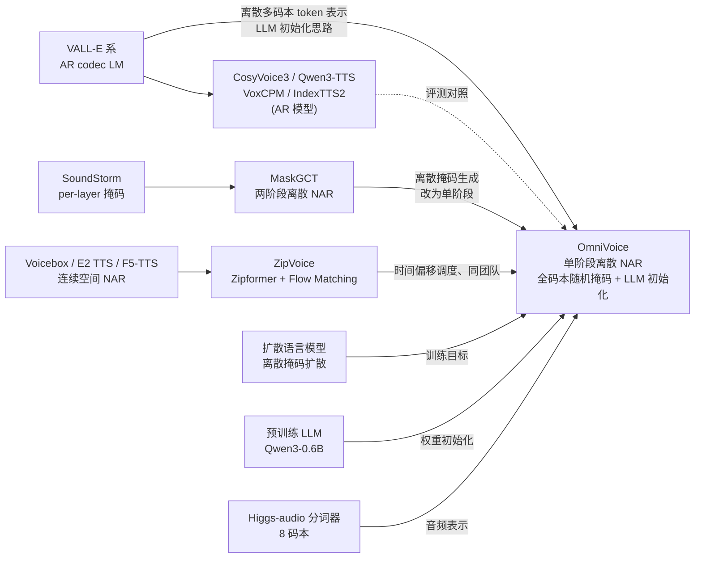
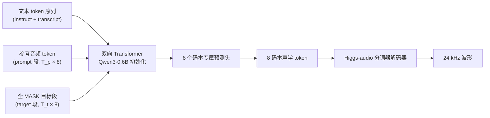
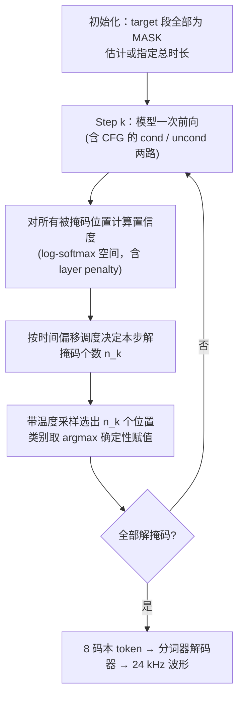

# OmniVoice 完整介绍

> **说明**
>
> 本文信息截至 **2026-10-24**，主要依据 [OmniVoice 论文（arXiv:2604.00688 v3）](https://arxiv.org/abs/2604.00688)和[官方 GitHub 仓库](https://github.com/k2-fsa/OmniVoice)的 README 与文档。论文中的基准结果均为**作者自报**；速度数字与步数、batch、硬件强相关，引用时请带上口径。

---

## 1. 摘要与模型定位

OmniVoice 是小米新一代 Kaldi 团队（k2-fsa，Daniel Povey 为通讯作者之一）于 2026 年 4 月开源的**大规模多语言零样本文本转语音（TTS）模型**。它的论文标题直接点明了定位：*Towards Omnilingual Zero-Shot Text-to-Speech with Diffusion Language Models*。

一句话概括：

> **用一个 Qwen3-0.6B 初始化的双向 Transformer，以“掩码补全”的方式，一步到位地把文本直接映射成 8 码本声学 token；训练时对所有码本做随机掩码，推理时用 32 步迭代去掩码并行生成，支持 600+ 语言、3–10 秒零样本克隆和文本描述式音色设计。**

关键事实一览：

| 维度 | 内容 |
|---|---|
| 架构范式 | 单阶段、离散 token、非自回归（NAR）、扩散语言模型风格 |
| 骨干 | 双向 Transformer，由 **Qwen3-0.6B** 权重初始化（隐藏维 1024、28 层） |
| 音频表示 | Higgs-audio 分词器，**8 层码本**，24 kHz |
| 总参数量 | 0.8B（含音频分词器等整个克隆系统） |
| 训练数据 | **581k 小时**，覆盖 600+ 语言，约 50 个开源数据集聚合，**全部来自开源数据** |
| 语言覆盖 | 600+ 种（官方文档称 600+，列表共 646 种） |
| 推理速度 | 16 步、H20、batch=1 的 RTF 为 0.0319，batch=8 为 0.0224；官方称 RTF 低至 0.025（约 40 倍实时） |
| 三种模式 | 声音克隆、声音设计（Voice Design）、自动音色（Auto Voice） |
| 代码许可 | Apache-2.0 |
| 社区热度 | GitHub 约 1.58 万 Stars（2026-10-24） |

OmniVoice 的价值可以归纳为三点：

1. **范式上**：证明了“单阶段离散 NAR”可以不输、甚至优于复杂的两阶段（文本→语义→声学）级联方案；
2. **规模上**：用纯开源数据把零样本 TTS 的语言覆盖推到 600+，其中大量语言在商业 TTS 中从未出现；
3. **工程上**：0.8B 体量、并行解码、完整的开源推理/训练/评测代码和快速成型的社区生态。

它的边界同样需要说清楚：**声音克隆是最稳定的模式**，Voice Design 只用中英数据训练；离散 NAR 目前缺乏类似流蒸馏那样的“大幅减少步数”手段；RTF 数字与步数、batch、GPU 强相关，不能脱离口径引用。

---

## 2. 研究背景与前置技术

### 2.1 零样本 TTS 的几条技术路线

| 路线 | 代表工作 | 生成方式 | 典型代价 |
|---|---|---|---|
| 自回归（AR）codec / LLM 式 | VALL-E、CosyVoice3、Qwen3-TTS、IndexTTS2、VoxCPM | 逐 token（或逐帧）预测 | 推理延迟高，长序列误差累积 |
| 连续空间 NAR | F5-TTS、ZipVoice、Voicebox、E2 TTS | 在 mel/latent 上做流匹配或扩散，并行生成 | 需多步 ODE；总时长需预先给定 |
| 离散 token NAR（两阶段） | MaskGCT、SoundStorm | 掩码生成离散 token，常分“文本→语义→声学”两段 | 误差传播、语义瓶颈、系统复杂 |
| **离散 token NAR（单阶段）** | **OmniVoice** | 文本直接到多码本声学 token，掩码补全 | 离散空间难以像连续空间那样蒸馏减步 |

论文在引言中给出了一个关键判断：离散 NAR 已被证明有更好的韵律多样性，但**现有 SOTA 的离散 NAR 系统依赖复杂两阶段流水线**，带来两个问题：

- **误差传播**：语义预测的错误会直接降低最终音质；
- **信息瓶颈**：低码率语义表示丢掉了细粒度声学细节（音色质感等）。

此前的单阶段离散方案虽然绕开了这两个问题，却在**可懂度**上落后于两阶段系统。OmniVoice 的目标就是补上这块短板。

### 2.2 谱系图



### 2.3 OmniVoice 与各技术路线的关键差异

沿着 §2.1 的四条路线，把各自的代表模型与 OmniVoice 在机制层面逐项对照：

| 维度 | AR 零样本<br/>（VALL-E 系、CosyVoice3、Qwen3-TTS 等） | 两阶段离散 NAR<br/>（MaskGCT） | 连续 NAR<br/>（F5-TTS、ZipVoice） | **OmniVoice** |
|---|---|---|---|---|
| 系统结构 | 语言模型 + 声学解码器，具体组成因系统而异 | 文本→语义、语义→声学两个模型串联 | 单个生成模型 + 声码器 | **单个模型，直接文本→声学 token** |
| 声学表示 | 离散 codec / 语义 token | 离散：语义 token + 声学 token | 连续 mel 频谱 | **离散 8 码本声学 token** |
| 生成方式 | 逐 token 顺序生成 | 迭代掩码并行生成 | ODE 求解并行生成 | **迭代去掩码并行生成** |
| 训练目标 | 下一 token 预测 | 掩码预测（声学阶段为 per-layer 掩码） | 条件流匹配（回归速度场） | **全码本随机掩码 + 分类交叉熵** |
| 文本输入 | 子词或音素，视系统而定 | 音素（需 G2P） | 字符/拼音等（F5-TTS 用 filler 补齐到声学帧长） | **LLM 子词分词器，无 G2P、无语言专用归一化** |
| 总时长 | 由结束符隐式决定 | 需预先给定 | 需预先估计或指定 | 需预先给定：按字符权重比估计，或用 `duration` / `speed` 指定 |
| 推理加速手段 | 流式、缓存等 | 减少迭代步数 | 流蒸馏可大幅减步 | 减少步数、FlashInfer / CUDA Graph；离散空间暂无流蒸馏等价手段 |
| 语言扩展 | 取决于数据与分词方式 | 取决于 G2P 与数据 | 官方模型主要为中英 | **统一子词建模，600+ 语言** |

从表中可以读出 OmniVoice 与三类路线各自的差异：

- **对 AR 路线**：保留离散多码本 token 与 LLM 初始化的思路，但换成并行生成。代价是必须先确定总时长；收益是推理不再随序列长度线性增长，也不会出现逐 token 的误差累积。
- **对两阶段离散 NAR（MaskGCT）**：同属掩码生成，但去掉语义中间层，避免误差传播和信息瓶颈；训练上改用全码本随机掩码（§5.1），并借助 LLM 初始化补回单阶段方案原本落后的可懂度（§5.2）。
- **对连续 NAR（F5-TTS、ZipVoice）**：任务形式相同，都是“给定参考片段与目标文本，补全被遮盖的声学序列”；差别在于生成空间与训练目标——一边是连续 mel 上的流匹配，一边是离散 token 上的掩码扩散。连续路线可借助流蒸馏大幅减步，离散路线目前没有对应手段，这也是 OmniVoice 论文自己承认的局限。

三类 NAR 方案共同的结构性约束是：**并行生成必须先确定输出总长度**，这是换取速度和鲁棒性所付出的代价。

---

## 3. 发展脉络与时间线

### 3.1 团队背景：从 Kaldi 到 k2-fsa

OmniVoice 来自一条连续的技术谱系：

```text
Kaldi（2011，Daniel Povey）
   │  经典混合式 ASR 工具链
   ▼
新一代 Kaldi：k2 / Lhotse / icefall / Sherpa 系列（2019 年起，Povey 加入小米后）
   │  k2：基于 FSA 的可微分解码；Lhotse：数据准备；icefall：训练脚本
   ▼
ZipVoice（2025-06，arXiv:2506.13053，ASRU 2025）
   │  Zipformer + Flow Matching，约 0.1B 参数，主打“小而快”
   ▼
OmniVoice（2026-04）
      转向离散 NAR 扩散语言模型，目标升级为“全语言 + 快 + 高质量”
```

ZipVoice 是 OmniVoice 的直接前序：两者一作同为 Han Zhu，核心作者高度重叠。论文推理部分直接沿用了 ZipVoice 提出的**时间偏移（time-shifted）去掩码调度**，速度对比的实验设置（3 秒提示生成 10 秒音频）也与 ZipVoice 和 F5-TTS 保持一致。团队内部因此形成了“连续空间 flow matching（ZipVoice）”与“离散空间掩码扩散（OmniVoice）”的双路线对照。

### 3.2 时间线

| 时间 | 事件 |
|---|---|
| 2025-06 | ZipVoice 论文发布 |
| 2026-04-01 | OmniVoice arXiv v1 提交；代码仓库开源 |
| 2026-04-02 | PyPI `omnivoice` v0.1.0 首发，当天 v0.1.1 修复安装问题 |
| 2026-04-21 | 论文更新至 v3 |
| 2026-04-28 | v0.1.5：训练支持 SDPA、修复离线加载 |
| 2026-07-06 | v0.2.0：新增 Intel Arc XPU 支持、CI/CD 自动发布 |
| 2026-07-16 | v0.2.1 |
| 2026-07-30 | 集成 FlashInfer，无损推理加速约 2–2.9 倍 |
| 2026-08-05 | 新增基于 PEFT 的 LoRA 微调支持 |
| 2026-08-24 | `denoise_audio` 工具修复 |

此外，中文媒体报道称 Daniel Povey 于 2026 年 7 月当选 ISCA Fellow（[IT之家报道](https://m.ithome.com/html/977452.htm)），与模型本身无直接关系。

### 3.3 演进逻辑：三级跳

1. **能力验证期（ZipVoice）**：证明团队能做出高质量零样本 TTS，卖点是小和快；
2. **范式突破期（OmniVoice 初版）**：改用单阶段离散 NAR + LLM 初始化 + 581k 小时多语言数据；
3. **生态扩张期（v0.2.x）**：多硬件后端（CUDA / MPS / XPU）、FlashInfer / CUDA Graph 加速、LoRA 微调、第三方 serving 和桌面工具，从“一个模型”变成“一个平台”。

---

## 4. 核心架构

### 4.1 为什么放弃两阶段级联

典型两阶段离散方案的流水线是：

```text
文本 → [文本到语义 token] → [语义到声学 token] → [声学解码器] → 波形
```

OmniVoice 的做法是把中间的语义阶段整个拿掉：



### 4.2 输入表示

论文将输入分为两部分：

- **文本 token 序列 $\mathbf{y}$**：把**指令（instruct）**与**转写文本（transcript）**拼接而成，提供语言学内容和任务指引。指令段可含目标语言标记和声音设计描述（如 `female, british accent`）；训练中还会出现特殊标记 `<|denoise|>`（见 §8.2）。
- **声学 token 矩阵 $X \in \mathbb{Z}^{T\times C}$**：$T$ 为时间步，$C=8$ 为码本数。矩阵沿时间轴分成两段：
  - **prompt 段**：参考音频的声学 token，作为已知前缀，提供说话人身份与声学环境；
  - **target 段**：待生成区域，训练时按比例被随机替换为 `[MASK]`，推理时初始为全 `[MASK]`。

模型的任务是：**依据文本、prompt 和 target 中尚未被掩码的 token，恢复 target 中被掩码位置的原始 token。**

文本侧使用 LLM 自带的**子词分词器**，因此无需 G2P，也无需针对每种语言单独做文本归一化——这是 646 种语言可以放进同一个模型的前提之一。

### 4.3 嵌入与输出头

- **输入侧**：文本 token 通过文本嵌入层；声学 token 通过**各码本专属的嵌入层**，同一时间步的 8 个码本嵌入**求和**为一个向量，送入 Transformer；
- **输出侧**：使用 **8 个码本专属的预测头（C 个独立 head）**，每个 head 把最终隐状态映射到对应码本的词表分布。每层码本的词表规模约为 1025；
- **骨干**：结构与标准 AR LLM 完全相同，因此可以直接迁移预训练权重；但注意力改为**双向**（LLM 原本使用因果掩码），论文报告这种“因果预训练 → 双向使用”的迁移在实践中效果良好。

### 4.4 训练目标

只在 **target 段被掩码的位置** 上计算损失，形式上是对这些位置做交叉熵：

$$
\mathcal{L}=-\sum_{(t,c)\in\mathcal{M}}\log p_\theta\big(x_{t,c}\mid\mathbf{y},X_{\text{prompt}},X_{\text{target}}^{\text{unmasked}}\big)
$$

其中 $\mathcal{M}$ 是被掩码的 $(t,c)$ 索引集合。论文公式（1）的具体归一化方式以原文为准。

这就是“扩散语言模型风格”的含义：**训练目标是离散掩码扩散（按随机比例掩码并恢复），而不是自回归的下一 token 预测，也不是连续空间的去噪回归。**

---

## 5. 两项核心创新

### 5.1 全码本随机掩码（Full-Codebook Random Masking）

**背景**：多码本声学 token 的不同层承载不同粒度的信息（低层偏粗、高层偏细）。SoundStorm、MaskGCT 一类方法采用 **per-layer（逐层）掩码**：每个训练样本只随机选一层，在该层内做随机掩码并只对该层算损失，比它更高的层被整体掩码但不计损失，以对齐“逐层推理”的方式。代价是每次迭代只优化 token 矩阵中很稀疏的一部分。

**OmniVoice 的做法**：对 $T\times C$ 矩阵中的**每个元素独立采样二值掩码**，掩码比例 $r \sim U(0,1)$（每个训练实例采样一次）。于是：

- 平均约 **50%** 的 token 参与损失；
- 参与损失的 token 数量是 per-layer 策略的约 **C 倍**；
- 模型学会在“任意残缺程度、跨任意码本”的条件下补全，推理时也可以在所有码本上同时选位置解码。

**消融**（Emilia 100k 小时训练 300k 步，LibriSpeech-PC test-clean，论文 Table 5）：

| 掩码策略 | SIM-o ↑ | WER ↓ | UTMOS ↑ |
|---|---|---|---|
| SoundStorm 风格 | 0.661 | 3.00 | 4.12 |
| MaskGCT 风格 | 0.660 | 2.04 | 4.17 |
| **全码本随机掩码** | **0.697** | **1.57** | **4.23** |
| 全码本掩码，但只对单码本算损失 | 0.648 | 2.85 | 4.22 |

最后一行说明：收益主要来自**稠密的跨码本损失**，而不仅是掩码方式本身。

### 5.2 预训练 LLM 初始化

**问题**：单阶段离散 NAR 模型在可懂度上历来落后于两阶段系统。

**做法**：用预训练 **Qwen3-0.6B** 权重初始化骨干，继承其多语言语言学知识作为“文本到语音”映射的先验。论文称，OmniVoice 是**第一个成功从 LLM 初始化中获得显著可懂度收益的 NAR TTS 模型**（AR TTS 已有类似做法）。

**消融**（论文 Table 6，WER ↓）：

| 初始化 | 学习率 | LibriSpeech-PC | Seed-en | Seed-zh |
|---|---|---|---|---|
| **LLM 初始化** | 1e-4 | **1.57** | **1.72** | **0.89** |
| 随机初始化 | 1e-4 | 2.79 | 2.34 | 1.11 |
| 随机初始化 | 2e-4 | 2.52 | 2.43 | 1.01 |
| 随机初始化 | 5e-4 | 2.56 | 2.07 | 1.01 |
| 随机初始化 | 1e-3 | 2.72 | 2.29 | 1.02 |

即便把学习率调遍，随机初始化的 WER 仍系统性偏高。

**需要注意**：Qwen3-0.6B 是**整个双向 Transformer 骨干**，同时处理文本和声学 token。OmniVoice 没有独立的文本编码器、声学解码器和声码器三层结构，波形由 Higgs-audio 分词器的解码器还原。


## 6. 训练数据与训练配置

### 6.1 数据

- **规模**：581k 小时，600+ 语言，由约 **50 个开源数据集**聚合而成（完整清单见论文附录 A）。代表性来源包括 Emilia、Emilia-YODAS、LibriTTS、Common Voice、VoxBox、Meta Omnilingual ASR Corpus、FLEURS、GigaSpeech 2、YODAS-Granary、IndicVoices-R、WenetSpeech-yue/chuan、KeSpeech、Ksponspeech、ReazonSpeech、AISHELL-6、MGB-2/3/5 等。
- **清洗**：许多数据集并非为 TTS 设计，含噪声音频和不准确转写。论文使用**语音复原模型（Sidon）**增强受损语音，并用**规则过滤**剔除无效转写。
- **语言级重采样**：为缓解长尾失衡，给第 $i$ 种语言一个重复因子 $r_i$，由该语言总时长 $D_i$、最大语言时长 $D_{\max}$ 和平滑超参 $\beta$ 决定：

$$
r_i=\max\Big(1,\mathrm{round}\big((D_{\max}/D_i)^{1-\beta}\big)\Big),\quad \beta=0.8
$$

  $\beta=1$ 保持自然长尾，$\beta=0$ 趋于均匀分布；论文称 $\beta$ 是经验设定，以“保住高资源语言性能的同时让低资源语言获得足够曝光”。
- **时长最大的语言**：

| 语言 | 英语 | 中文 | 日语 | 西班牙语 | 法语 | 德语 | 俄语 | 葡萄牙语 | 粤语 | 泰语 | 韩语 | 越南语 |
|---|---|---|---|---|---|---|---|---|---|---|---|---|
| 小时数 | 206,061 | 111,343 | 36,914 | 27,560 | 23,675 | 21,927 | 20,339 | 16,855 | 13,302 | 10,500 | 8,609 | 8,482 |

### 6.2 两个训练变体

| 变体 | 数据 | 用途 |
|---|---|---|
| **OmniVoice-Emilia** | Emilia 中英 100k 小时；不含 prompt denoising | 与 F5-TTS / ZipVoice / MaskGCT 在**同数据**下公平比较 |
| **OmniVoice（多语言）** | 自建 581k 小时 | 发布的正式模型 |

### 6.3 训练配置

| 项目 | 配置 |
|---|---|
| 硬件 | 8 × H800，BF16 混合精度 |
| 序列组织 | sequence packing，每 GPU 8192 token |
| 优化器 | AdamW，cosine 学习率，3% warmup；峰值学习率 1e-4 |
| 多语言版 | 2M 次更新，约 **9.66 天** |
| Emilia 双语版 | 300k 次更新，约 **1.33 天** |
| 初始化 | Qwen3-0.6B |
| 音频分词器 | Higgs-audio，8 码本 |

训练成本相对克制：8 卡不到十天即得到覆盖 600+ 语言的模型。

---

## 7. 推理机制

### 7.1 迭代去掩码流程



论文 §3.4 描述的要点：

- **默认 32 步**迭代去掩码。到第 $k$ 步累计解掩码比例遵循 ZipVoice 提出的**时间偏移调度**，每步新解掩码数为相邻累计比例之差；
- **位置选择**：在 log-softmax 空间用**置信度**打分，并加**温度**后再采样，以引入随机性、避免局部最优；
- **token 赋值**：位置选定后，具体 token 取预测分布的 **argmax**（确定性）；
- **layer penalty**：对置信度施加层惩罚，鼓励**低层码本先解码**；
- **CFG**：在 log-softmax 空间做 classifier-free guidance，guidance scale = 2。启用 CFG 意味着每一步有条件和无条件两路前向，官方 FlashInfer 优化即专门针对这一对序列做了 packing。

### 7.2 默认参数（官方文档）

| 参数 | 默认值 | 含义 |
|---|---|---|
| `num_step` | 32 | 去掩码步数；16 为加速档 |
| `guidance_scale` | 2.0 | CFG 强度 |
| `t_shift` | 0.1 | 时间偏移；越小越强调解码早期步 |
| `position_temperature` | 5.0 | 选位置的温度；0 为贪心 |
| `class_temperature` | 0.0 | token 采样温度；0 为贪心 |
| `layer_penalty_factor` | 5.0 | 对深层码本的惩罚，鼓励浅层先解 |
| `denoise` | True | 是否在输入前加 `<|denoise|>` |
| `preprocess_prompt` / `postprocess_output` | True | 去除参考音频长静音、补标点；去除输出长静音 |
| `pad_duration` / `fade_duration` | 0.1 s | 两端静音填充与淡入淡出 |

### 7.3 总时长估计

NAR 必须先知道输出长度。OmniVoice 的做法与 F5-TTS 的“字符比例估计”思路一致，但更细：为每个字符按**书写系统**（CJK、拉丁等）赋予不同的**时长权重**，再按

$$
\hat{T}_{\text{target}}=T_{\text{prompt}}\times\frac{\text{目标文本字符权重和}}{\text{参考文本字符权重和}}
$$

估计目标时长（论文公式 (4)）。用户可以用 `duration`（固定秒数，优先级最高）或 `speed`（语速因子，>1 更快）覆盖。需注意：`duration` 生效时默认后处理可能裁掉尾部静音，使实际时长略短，若要严格对齐须设 `postprocess_output=False`。

### 7.4 长文本

当估计时长超过 `audio_chunk_threshold`（默认 30 秒）时，文本自动按约 `audio_chunk_duration`（默认 15 秒）切分，逐段生成再拼接。官方文档称这使模型可接受任意长文本，同时显存几乎恒定。

### 7.5 步数、质量与速度的权衡

**质量随步数变化**（论文 Table 9，多语言版）：

| 步数 | LibriSpeech-PC WER | Seed-en WER | Seed-zh WER | LibriSpeech-PC UTMOS |
|---|---|---|---|---|
| 64 | 1.28 | 1.60 | 0.81 | 4.30 |
| **32（默认）** | 1.30 | 1.53 | 0.84 | 4.28 |
| 16 | 1.50 | 1.72 | 0.99 | 4.23 |
| 8 | 2.02 | 1.94 | 1.58 | 4.02 |

16 步质量略降、可接受；8 步明显下降；64 步相对 32 步几乎无增益。

**速度（RTF，H20，PyTorch，3 秒提示生成 10 秒音频，论文 Table 8）**：

| 步数 \ batch | 1 | 2 | 4 | 8 |
|---|---|---|---|---|
| 16 | 0.0319 | 0.0263 | 0.0235 | 0.0224 |
| 32 | 0.0598 | 0.0486 | 0.0436 | 0.0414 |

同设置下 ZipVoice 16 步 batch=1 的 RTF 为 0.0557。

**如何正确理解“RTF 0.025 / 40 倍实时”**：它对应的是 **16 步 + 较大 batch** 的结果。默认 32 步、batch=1 时论文口径约为 0.06（约 17 倍实时）。

**官方 FlashInfer 加速**（README，H100，fp16，`num_step=32`，Seed-TTS zh 测试集 2020 条/3.3 小时，声音克隆，输出经 ASR 验证为无损）：

| batch | 基线 RTF | FlashInfer RTF | 加速比 |
|---|---|---|---|
| 1 | 0.0899 | 0.0430 | 2.1× |
| 1 + CUDA Graph | — | 0.0367 | 2.4× |
| 2 | 0.0480 | 0.0245 | 2.0× |
| 4 | 0.0331 | 0.0152 | 2.2× |
| 8 | 0.0298 | **0.0115** | **2.6×** |

README 建议：batch=1 的低延迟场景启用 CUDA Graph；batch≥4 时普通 FlashInfer 路径已最优。注意论文表（H20）与 README 表（H100、真实测试集）的设备与负载不同，**不可直接横向比较**。

---

## 8. 能力与控制方式

### 8.1 零样本声音克隆

- 用 **3–10 秒**参考音频即可克隆音色；官方提示更长的参考反而会拖慢推理并可能降低效果；
- `ref_text` 可省略，此时模型用 **Whisper ASR** 自动转写参考音频（可通过 `asr_model_name`、`asr_device` 指定模型和设备）；
- 支持跨语言克隆，但**口音会随参考音频迁移**：用韩语参考说英语会带韩语口音。要标准发音，应使用**目标语言母语者**的参考；
- 可用 `create_voice_clone_prompt` 预先编码参考音频并保存为 `.pt`，后续用 `VoiceClonePrompt.load` 复用，省去音频加载与转写。

### 8.2 提示去噪（Prompt Denoising）

实际参考音频常带环境噪声或混响。训练时对部分样本在 prompt 段**注入合成噪声与混响**，并配上指令 token `<|denoise|>`，迫使模型把**说话人本征音色**与**声学环境**解耦。推理时默认开启（`denoise=True`），即使参考音频有噪声也尽量输出干净语音。

论文 Table 7 展示了代价与收益：

| 设置 | SIM-o | WER | UTMOS |
|---|---|---|---|
| 无 prompt denoising | 0.697 | 1.57 | 4.23 |
| 有 prompt denoising | 0.668 | 1.56 | 4.32 |

自然度上升，相似度略降：因为输出比带噪参考“更标准”。这是设计目标，但对追求原声环境还原的场景（例如要保留房间混响）需要意识到这一取舍，可用 `denoise=False` 关闭。

### 8.3 声音设计（Voice Design）

无需参考音频，通过 `instruct` 传入逗号分隔的说话人属性：

```python
audio = model.generate(
    text="Hello, this is a test of zero-shot voice design.",
    instruct="female, young adult, high pitch, british accent",
)
```

属性按类别组织，**同类别只能选一个，不同类别可自由组合**：

| 类别 | 可选值（英文 / 中文） |
|---|---|
| 性别 | male / female（男 / 女） |
| 年龄 | child, teenager, young adult, middle-aged, elderly（儿童、少年、青年、中年、老年） |
| 音高 | very low, low, moderate, high, very high pitch（极低…极高音调） |
| 风格 | whisper（耳语） |
| 英文口音 | american, british, australian, canadian, indian, chinese, korean, japanese, portuguese, russian accent（仅对英文文本生效） |
| 中文方言 | 河南话、陕西话、四川话、贵州话、云南话、桂林话、济南话、石家庄话、甘肃话、宁夏话、青岛话、东北话（仅对中文文本生效） |

使用要点（官方文档）：

- 指令文本可用中文、英文或混写，模型会自动检测并归一化；大小写不敏感；
- 可只写部分属性，其余由模型决定；
- 受训练数据限制，**某些属性组合会被部分忽略**，效果不符预期时应简化 `instruct`；
- **Voice Design 仅用中英数据训练**，对低资源语言和边缘情形可能不稳定；模型主要在声音克隆任务上训练，**克隆是最稳定的模式**；
- 当 `ref_audio` 与 `instruct` **冲突**时，模型多半跟随参考音频；**一致**时 `instruct` 可增强稳定性（典型例子：提供四川话参考音频并设 `instruct="四川话"`）。

### 8.4 自动音色（Auto Voice）

不提供任何提示，仅传文本，模型随机选一个音色：

```python
audio = model.generate(text="This is a sentence without any voice prompt.")
```

官方提示：没有参考音频时，**1–2 秒的极短音频可能不稳定**，短句应提供参考音频。

### 8.5 非语言符号与发音控制

**非语言标签**：在文本中直接插入，例如 `[laughter] You really got me.`。官方支持的标签包括 `[laughter]`、`[sigh]`、`[confirmation-en]`、`[question-en]`、`[question-ah]`、`[question-oh]`、`[question-ei]`、`[question-yi]`、`[surprise-ah]`、`[surprise-oh]`、`[surprise-wa]`、`[surprise-yo]`、`[dissatisfaction-hnn]`。训练时使用了带情感线索的数据，来获得这类副语言表达能力。

**发音覆盖**：训练时随机把字符或单词替换为对应的发音标注，使推理时可确定性地纠正发音：

- **中文**：用带声调数字的**拼音**，如 `这批货物打ZHE2出售后他严重SHE2本了，再也经不起ZHE1腾了。`；
- **英文**：用 **CMU 发音字典**音素（大写、方括号），如 `He plays the [B EY1 S] guitar while catching a [B AE1 S] fish.`；
- 闽南语（Min Nan）目前**只能用台罗（Tai-lo）拼音输入**，不支持汉字。

### 8.6 文本规范化

模型**未针对复杂数字串和数学符号优化**。官方建议把阿拉伯数字先转成词（如 `123` → `one hundred twenty-three`），也可在 `generate()` 中传 `normalize_text=True`（需 `pip install "omnivoice[tn]"`）：中英文走 WeTextProcessing，其他语言整数走 `num2words`；内联控制语法（`[laughter]`、`[B EY1 S]`、拼音声调）会被保留。

### 8.7 多语言

- 单一模型处理 600+ 语言，语言身份由文本本身和子词分词器隐式表达，无语言专用模块；
- 论文附录 D 给出支持语言列表，仓库有 `docs/languages.md`；
- 语言选择可通过批量推理 JSONL 中的 `language_id` 字段显式指定（可选）。

---

## 9. 性能与评测

### 9.1 评测口径

| 项目 | 内容 |
|---|---|
| 基准 | LibriSpeech-PC test-clean（英）；Seed-TTS test-en / test-zh；MiniMax-Multilingual-24（24 语言）；**FLEURS-Multilingual-102**（作者自建，102 语言，称为“目前覆盖最广的零样本 TTS 评测基准”） |
| 说话人相似度 | SIM-o（WavLM-based ECAPA-TDNN） |
| 可懂度 | WER / CER，ASR 使用：LibriSpeech-PC 用 HuBERT-based；中文用 Paraformer-zh；FLEURS 用 Omnilingual ASR；其余用 Whisper-large-v3 |
| 自然度 | UTMOS（客观）；CMOS、SMOS（主观） |
| 基线 | 使用官方检查点获得 |

> 所有数字均为论文作者自报。ASR 指标依赖具体 ASR 模型，不能直接等同于“比真人更好”。

### 9.2 中英文主结果

以下对应论文 Table 1，其中“参数”为含音频分词器、声码器等组件的整个克隆系统口径；加粗为该列最优的 OmniVoice 或对比系统数值（仅标注文中讨论的项）。

| 模型 | 类型 | 参数 | 训练数据 | LibriSpeech-PC SIM-o / WER / UTMOS | Seed-en SIM-o / WER / UTMOS | Seed-zh SIM-o / WER / UTMOS |
|---|---|---|---|---|---|---|
| Ground-truth | — | — | — | 0.690 / 1.87 / 4.10 | 0.734 / 2.14 / 3.52 | 0.755 / 1.25 / 2.78 |
| IndexTTS2 | AR | 1.7B | 55k 多语 | 0.700 / 2.35 / 4.06 | 0.706 / 2.33 / 3.65 | 0.764 / 1.05 / 3.00 |
| CosyVoice3 | AR | 1.1B | 1000k 多语 | 0.694 / 1.59 / 4.28 | 0.696 / 2.17 / 3.96 | 0.778 / 1.14 / 3.32 |
| VoxCPM | AR | 0.7B | 1800k 多语 | 0.717 / 1.74 / 4.18 | 0.731 / 1.92 / 3.77 | 0.772 / 0.99 / 2.94 |
| Qwen3-TTS | AR | 1.1B | 5000k 多语 | 0.704 / 1.60 / **4.41** | 0.708 / **1.54** / **4.16** | 0.766 / 1.15 / **3.46** |
| F5-TTS | NAR | 0.4B | 100k Emilia | 0.655 / 1.89 / 3.89 | 0.664 / 1.85 / 3.72 | 0.750 / 1.53 / 2.93 |
| ZipVoice | NAR | 0.1B | 100k Emilia | 0.668 / 1.64 / 3.98 | 0.697 / 1.70 / 3.82 | 0.751 / 1.40 / 3.15 |
| MaskGCT | NAR | 2.2B | 100k Emilia | 0.691 / 2.26 / 3.91 | 0.713 / 2.88 / 3.55 | 0.773 / 2.40 / 2.63 |
| OmniVoice-Emilia | NAR | 0.8B | 100k Emilia | 0.697 / 1.57 / 4.23 | 0.717 / 1.72 / 3.88 | 0.765 / 0.89 / 3.05 |
| **OmniVoice** | NAR | 0.8B | 581k 多语 | **0.729** / **1.30** / 4.28 | **0.741** / 1.60 / 3.91 | 0.777 / **0.84** / 3.11 |

**如何解读**：

1. **同数据公平比较**：OmniVoice-Emilia 在相同的 Emilia 数据上，整体超过 F5-TTS、ZipVoice、MaskGCT 这三个 NAR 基线，直接验证了架构本身的优势；
2. **与大数据 AR 模型比较**：OmniVoice 的训练数据（581k 小时）远少于 CosyVoice3（1000k）、VoxCPM（1800k）、Qwen3-TTS（5000k），仍在说话人相似度和可懂度上领先，但**不是全面第一**：
   - 英文 Seed-en 的 WER，Qwen3-TTS（1.54）略优于 OmniVoice（1.60）；
   - 自然度 UTMOS，Qwen3-TTS 在三个测试集上均更高（4.41 / 4.16 / 3.46）；
   - 中文 Seed-zh 上 OmniVoice WER 0.84 最低，也低于 Ground-truth 的 1.25；
3. **数字口径提示**：论文 Table 1 中 OmniVoice 的 Seed-en WER 为 1.60，而附录 Table 9 的 32 步行为 1.53（64 步行才是 1.60），论文内部存在轻微不一致，引用时请注明具体来源表。

**主观评测**（论文 Table 2，± 为置信区间）：

| 模型 | CMOS ↑ | SMOS ↑ |
|---|---|---|
| Ground-truth | 0.00 | 3.02 ± 0.20 |
| Qwen3-TTS | 0.40 ± 0.16 | 3.65 ± 0.18 |
| ZipVoice | −0.30 ± 0.16 | 3.35 ± 0.19 |
| MaskGCT | −0.38 ± 0.17 | 3.20 ± 0.18 |
| OmniVoice-Emilia | 0.42 ± 0.15 | 3.58 ± 0.18 |
| **OmniVoice** | **0.44 ± 0.16** | **3.80 ± 0.17** |

OmniVoice 与 Qwen3-TTS 的 CMOS（0.44 vs 0.40）差距远小于置信区间，**不应解读为显著优于**；SMOS 3.80 高于 Ground-truth（3.02）则反映评测中真人参考的相似度打分并不高。

### 9.3 多语言结果

**MiniMax-Multilingual-24**（论文 Table 3，平均值）：

| 系统 | 平均 WER ↓ | 平均 SIM-o ↑ |
|---|---|---|
| **OmniVoice** | **2.850** | **0.830** |
| MiniMax-Speech | 3.774 | 0.766 |
| ElevenLabs Multilingual v2 | 10.950 | 0.655 |

逐语言上 OmniVoice 并非全胜。例如 Dutch、Indonesian、Italian、Korean、Portuguese、Turkish、Ukrainian、Vietnamese 等语言中，MiniMax 或 ElevenLabs 的 WER 更低。几项值得注意的数据：

| 语言 | OmniVoice WER | MiniMax | ElevenLabs |
|---|---|---|---|
| 中文 | 1.008 | 2.252 | 16.026 |
| 英文 | 1.560 | 2.164 | 2.339 |
| 粤语 | 17.709（换 SenseVoice 评测为 2.273） | 34.111 | 51.513 |
| 泰语 | 3.978 | 2.701 | 73.936 |
| 越南语 | 1.373 | 0.880 | 73.415 |

粤语的高 WER 被论文归因于 Whisper 的局限而非语音质量，但为与 MiniMax 基准保持一致，表中仍保留 Whisper 结果。

**FLEURS-Multilingual-102**（论文 Table 4）：

| | 平均 SIM-o | 平均 CER | CER ≤5% 的语言数 | CER ≤10% 的语言数 |
|---|---|---|---|---|
| Ground-truth | — | 5.11 | 75 | 92 |
| **OmniVoice** | 0.788 | **4.00** | **82** | **95** |

要点：

- 平均 CER 4.00% 与真人转录基线相当；
- 许多训练数据**不足 10 小时**的语言，CER 仍低于 5%，体现低资源泛化能力；
- 个别语言明显优于真人转录基线，例如爱尔兰语 8.52 vs 17.56；
- 相对短板包括老挝语（25.51）、粤语（21.92 vs 真人 11.01）、缅甸语（12.20 vs 6.77）、高棉语（11.48 vs 6.20）、希伯来语（9.75 vs 4.91）等；
- 论文自己的措辞值得照搬：**不宣称在所有语言上都优于真人，但 OmniVoice 的表现已超出现有 ASR 的测量能力**。

### 9.4 总体评价

OmniVoice 的结果最可靠的结论是：**在不使用百万小时级私有数据的条件下，单阶段离散 NAR 能在中英和大规模多语言基准上达到与主流 AR 模型及商业系统同一梯队，并在语言覆盖和推理速度上形成差异化优势。** 独立第三方评测目前缺位。

---

## 10. 与同类模型的定性比较

机制层面的差异见 §2.3，这里补充**规模、数据与开放性**的对照。不做“统一排行榜”，只引用论文中可核对的数字：

| 模型 | 范式 | 参数 | 训练数据 | 语言覆盖定位 | 备注 |
|---|---|---|---|---|---|
| **OmniVoice** | 单阶段离散 NAR（扩散 LM 风格） | 0.8B | 581k 开源 | 600+ | 声音克隆 + 声音设计 + 副语言/发音控制 |
| F5-TTS | 连续 NAR（流匹配 + DiT） | 0.4B | 100k Emilia | 官方主要为中英 | 论文中为同数据对照基线 |
| ZipVoice | 连续 NAR（Zipformer + 流匹配） | 0.1B | 100k Emilia | 中英 | 同团队前序，体量最小 |
| MaskGCT | 两阶段离散 NAR | 2.2B | 100k Emilia | 中英 | 两阶段掩码生成的代表 |
| CosyVoice3 | AR | 1.1B | 1000k 多语 | 多语 | 论文中的 AR 对照 |
| VoxCPM | AR | 0.7B | 1800k 多语 | 中英为主 | 论文中的 AR 对照 |
| Qwen3-TTS | AR | 1.1B | 5000k 多语 | 多语 | 自然度指标整体领先 |
| MMS（Meta） | 语言专用模型 | — | — | 1000+ | 论文指出其**无零样本克隆，且依赖语言专用建模** |

---

## 11. 语音方向的应用

下列场景按**能力—场景—注意事项**组织，所有“OmniVoice 能做什么”均可在论文或官方文档中找到依据；效果数字以前文评测为准。

### 11.1 多语言本地化与配音

- **依据能力**：600+ 语言、跨语言克隆、3–10 秒参考音频。
- **场景**：品牌声线跨语言统一、课程与企业培训的多语言版本、出海短剧与电商口播、视频翻译配音（如 pyVideoTrans 集成）。
- **注意**：跨语言克隆会带参考音频的**口音**；要中性口音须使用目标语言母语者参考。配音对口型类场景可用 `duration` 严格控制时长，并关闭 `postprocess_output` 以保证时长精确。

### 11.2 内容创作

- **有声书与播客**：用 `VoiceClonePrompt` 缓存音色，批量出章节，保持系列声线一致；`omnivoice-infer-batch` 支持多 GPU JSONL 批处理；社区已有 Auris、tts-audiobook-tool 等有声书工具。
- **游戏与动画角色**：Voice Design 用“性别 + 年龄 + 音高 + 口音/方言”组合快速生成角色音。**一致性要点**：每次生成音色有随机性，应生成一次后保存为参考音频，再以克隆方式复用，才能锁定角色声线。
- **短视频旁白**：语速因子 `speed` 与非语言标签（`[laughter]`、`[sigh]`）可调节风格。

### 11.3 低资源语言与方言

- **依据能力**：FLEURS-102 上许多 <10 小时数据的语言仍有 CER <5%；中文 12 种方言的描述式控制；方言克隆可配合 `instruct`。
- **场景**：小语种朗读与教学材料、方言内容生成、语言存档辅助。
- **注意**：评测只覆盖 102 种语言，其余语言的质量缺少系统评估；老挝语、粤语等仍有明显短板。

### 11.4 教育与无障碍

- **教育**：讲师音色规模化生成课程音频；语言学习中可借助发音覆盖（拼音声调、CMU 音素）和语速控制做精确示范。
- **无障碍**：视障用户的母语屏幕朗读，尤其是商业 TTS 覆盖不到的长尾语言。
- **注意**：克隆亲人声音用于陪伴或阅读，属于**高敏感用途**，必须获得被克隆者（或其合法代理人）的明确授权。

### 11.5 智能交互与 Agent 语音输出

- **依据能力**：并行解码、FlashInfer + CUDA Graph 的低延迟配置、本地部署。
- **场景**：客服播报、IVR、Agent 的本地语音输出。
- **注意**：论文给出的是**整段生成的 RTF**，不是首包延迟；官方 README 和论文均未宣称原生流式输出。社区方案（如 omnivoice-server 的**句子级流式**）是在应用层按句切分实现的“伪流式”。对延迟和并发有严格要求的场景，需要自行压测。

### 11.6 研究与数据生产

- 作为 NAR 离散扩散 TTS 的开源基线，可研究掩码调度、CFG、层惩罚、少步解码等；
- 作为数据合成引擎为 ASR/TTS 训练扩充低资源语言数据。使用时应注意合成数据可能带来的分布偏差，以及训练数据本身的许可边界。

---

## 12. 开源生态与部署实践

### 12.1 许可边界

| 对象 | 说明 |
|---|---|
| 代码 | **Apache-2.0**（GitHub 仓库页确认） |
| 预训练权重 | 论文附录 F 声明模型“**仅用于学术研究**”。商业使用前请以 [Hugging Face 模型卡](https://huggingface.co/k2-fsa/OmniVoice)中的许可证为准，并核对训练数据（约 50 个开源数据集，各自许可不同）的合规性 |
| 使用限制 | README 免责声明明确禁止未经授权的声音克隆、冒充、欺诈和其他违法或不道德用途 |

### 12.2 安装

```bash
# 1. 先装 PyTorch（按硬件选版本），例如 NVIDIA：
pip install torch==2.8.0+cu128 torchaudio==2.8.0+cu128 --extra-index-url https://download.pytorch.org/whl/cu128

# 2. 安装 OmniVoice
pip install omnivoice
# 或使用最新源码
pip install git+https://github.com/k2-fsa/OmniVoice.git
```

- **NVIDIA CUDA**、**Apple Silicon（`device_map="mps"`）**、**Intel Arc（`device_map="xpu"`，`flash_attn` 不可用时自动回退 SDPA）**均受支持；
- README 注明在 Arc A310（4GB）和 Arc Pro B50（16GB）上测试过。这说明**能在 4GB 显存的 GPU 上运行**，但并不代表性能数字，也不能推出“最低 4GB 即可满足生产需求”；
- 国内下载困难时可设置 `HF_ENDPOINT=https://hf-mirror.com`。

### 12.3 最小用例

```python
from omnivoice import OmniVoice
import soundfile as sf
import torch

model = OmniVoice.from_pretrained(
    "k2-fsa/OmniVoice", device_map="cuda:0", dtype=torch.float16
)

# 声音克隆（ref_text 可省略，省略时由 Whisper 自动转写）
audio = model.generate(
    text="Hello, this is a test of zero-shot voice cloning.",
    ref_audio="ref.wav",
    ref_text="Transcription of the reference audio.",
    num_step=32,
)
sf.write("out.wav", audio[0], 24000)   # audio 是 np.ndarray 列表，24 kHz
```

### 12.4 命令行工具

| 命令 | 作用 |
|---|---|
| `omnivoice-demo --ip 0.0.0.0 --port 8001` | Gradio 网页演示（克隆 + 设计） |
| `omnivoice-infer` | 单条推理，支持三种模式 |
| `omnivoice-infer-batch` | 多 GPU 批量推理，输入为 JSONL |

批量输入每行示例（仅 `id` 与 `text` 必填）：

```json
{"id": "sample_001", "text": "Hello world", "ref_audio": "/path/to/ref.wav", "ref_text": "Reference transcript", "instruct": "female, british accent", "language_id": "en", "duration": 10.0, "speed": 1.0}
```

若 `duration` 与 `speed` 同时给出，`speed` 被忽略。

### 12.5 生产优化清单

1. **Prompt 缓存**：`create_voice_clone_prompt` → `.save()` → `VoiceClonePrompt.load()`，长内容生产的关键优化；
2. **步数选择**：质量优先用 32；吞吐优先用 16（质量略降，见 §7.5）；不建议 8；
3. **FlashInfer**：`apply_flashinfer(model)`（吞吐）或 `apply_flashinfer(model, enable_cuda_graph=True)`（batch=1 低延迟），官方称无损加速 2–2.9 倍；
4. **批量化**：batch 越大 RTF 越低，在 batch=8 附近收益趋于饱和；
5. **文本前端**：数字、日期、符号先规范化，或开启 `normalize_text=True`；
6. **参考音频**：选 3–10 秒、同语言、干净、发音清晰的片段；
7. **长文本**：依赖内置自动切块，不需要自己拼接。

### 12.6 社区生态

官方 `docs/community-projects.md` 列出的社区项目（**非官方支持**）：

| 类别 | 项目 |
|---|---|
| 推理引擎与服务化 | [vLLM-Omni](https://github.com/vllm-project/vllm-omni)、[omnivoice-trtllm](https://github.com/tlitech/omnivoice-trtllm)（TensorRT-LLM + Triton）、[audio.cpp](https://github.com/0xShug0/audio.cpp)（GGML/C++）、[omnivoice-rs](https://github.com/FerrisMind/omnivoice-rs)（Rust + Candle）、[omnivoice-server](https://github.com/maemreyo/omnivoice-server)（OpenAI 兼容 `/v1/audio/speech`，句子级流式） |
| Apple Silicon | [MLX-Audio](https://github.com/Blaizzy/mlx-audio)、[OmniVoice-MLX](https://github.com/ailuntx/OmniVoice-MLX) |
| 创作与应用 | [ComfyUI-OmniVoice-TTS](https://github.com/Saganaki22/ComfyUI-OmniVoice-TTS)、[pyVideoTrans](https://github.com/jianchang512/pyvideotrans)、[RealtimeTTS](https://github.com/KoljaB/RealtimeTTS)、[TTS-WebUI](https://github.com/rsxdalv/TTS-WebUI)、OmniVoice-Studio、LA Studio、Auris、tts-audiobook-tool |

---

## 13. 局限、风险与伦理

### 13.1 技术局限

论文附录 E 与官方文档共同指出：

1. **数据质量天花板**：仅用开源数据，转写与声学质量参差，换用更精选的数据仍有较大提升空间；
2. **指令遵循有限**：Voice Design 主要依赖中英数据，指令数据集的多样性与质量限制了其灵活性；
3. **数字与数学序列**：未专门优化，需外接文本规范化；
4. **离散 NAR 的加速瓶颈**：连续空间可借助流蒸馏大幅减步，离散空间“尚无等效手段”。减少步数（16 步档、FlashInfer、TensorRT）是持续优化方向；
5. **短音频**：无参考音频时 1–2 秒的极短输出可能不稳；
6. **口音迁移**：跨语言克隆会带来参考语言的口音；
7. **评测局限**：WER/CER 依赖 ASR，个别语言（如粤语）的指标会被 ASR 自身拉高；目前**尚无独立第三方**语音质量评测。

### 13.2 数据与许可风险

- 训练数据聚合自约 50 个数据集，许可、同意范围和署名要求各不相同，商用前需逐一审查；
- 权重许可证请以模型卡为准（见 §12.1）。

### 13.3 冒充与欺诈风险

3 秒级克隆加上 600+ 语言，使语音冒充的门槛显著降低，包括**电话诈骗、声纹认证绕过、虚假音频证据、未经同意的名人或亲友声线复刻**。官方 README 和论文均明确禁止此类用途。

### 13.4 治理建议

1. 克隆任何真人声音前取得**明确、可留存的授权**；
2. 对外发布的合成音频附带**可识别的披露或水印**（模型本身不提供原生水印）；
3. 业务系统**不得仅依赖声纹**做身份验证，应叠加多因子；
4. 记录生成日志（输入文本、参考音频指纹、调用者），便于追溯；
5. 对 Voice Design 生成的“类真人”音色，避免有意模拟特定公众人物。

---

## 14. 未来方向

以下为论文所述方向与依据现有结论的合理推演，不代表官方路线图：

1. **减少离散 NAR 的推理步数**：论文明确列为未来工作；可能的路径包括针对离散空间的蒸馏、一致性训练、更优的解码调度等；
2. **更高质量的数据与指令数据**：精选数据提升上限；构建高质量指令数据集以增强 Voice Design 和低资源语言泛化；
3. **更强的文本前端集成**：把数字、日期、符号规范化做成可选的一体化模块；
4. **流式与低首包延迟**：当前仅有应用层句子级流式，原生块级流式需要在“全局时长估计 + 双向注意力”的框架下重新设计；
5. **更细粒度的情感与韵律控制**：现有副语言标签有限，细粒度的情绪、风格强度控制仍待发展；
6. **更完善的评测**：针对低资源语言引入更可靠的 ASR 与主观评测，减少评测器对结论的影响。

---

## 15. 结论

OmniVoice 的贡献可以收束为三句话：

- **架构**：单阶段离散 NAR，用 LLM 初始化的双向 Transformer 直接从文本预测 8 码本声学 token；
- **训练**：全码本随机掩码带来稠密损失与更快收敛，LLM 初始化带来可懂度的决定性提升；
- **规模**：用纯开源 581k 小时数据覆盖 600+ 语言，8 张 H800 不到十天训完。

它的优势是：

- 中英文及多语言基准上与主流 AR 模型和商业系统同一梯队，在说话人相似度和可懂度上尤其突出；
- 语言覆盖是目前零样本克隆 TTS 中最广的；
- 并行解码带来远低于实时的 RTF，结合 FlashInfer 可进一步提升；
- 代码、推理、批处理、LoRA 微调和评测均开放，社区生态成型很快。

它的边界同样清晰：

- 不同模式稳定性不同：克隆最稳，Voice Design 主要依赖中英数据；
- RTF 数字与步数、batch、硬件强相关，**0.025 不是默认配置下的数字**；
- 暂无原生流式输出，无条件的“实时交互”结论需要二次开发；
- 权重许可口径不一致，商用前必须核对模型卡；
- 高保真克隆带来真实的冒充与认证攻击风险。

截至 2026-10-24，OmniVoice 仍在快速迭代，使用时建议同时关注[官方仓库](https://github.com/k2-fsa/OmniVoice)的发布记录。

---

## 附录 A：关键概念速查

| 术语 | 含义 |
|---|---|
| 零样本 TTS | 无需针对目标说话人微调，仅用短参考音频即可克隆音色 |
| NAR | 非自回归：并行生成整段输出，不依赖前一个输出 |
| 扩散语言模型风格 | 以“按随机比例掩码—恢复”为训练目标的离散生成建模 |
| 多码本 / RVQ | 用多层码本逐层量化残差，把音频表示为 $T\times C$ 的离散矩阵 |
| per-layer 掩码 | 每个样本只对一个码本层做掩码和损失（SoundStorm / MaskGCT 采用） |
| 全码本随机掩码 | 对整个 $T\times C$ 矩阵逐元素随机掩码并全部计损失（OmniVoice 采用） |
| CFG | Classifier-free guidance：混合有/无条件预测以增强条件遵循，推理开销约翻倍 |
| RTF | Real-Time Factor：生成耗时与音频时长之比，越小越快；0.025 约为 40 倍实时 |
| SIM-o | 生成语音与原参考音频的说话人相似度 |
| WER / CER | 词 / 字符错误率，由 ASR 转录得到 |
| UTMOS | 基于模型的客观自然度评分 |
| CMOS / SMOS | 主观评测：比较自然度 / 说话人相似度 |

---

## 附录 B：参考资料

以下链接访问日期均为 **2026-10-24**。

### B.1 OmniVoice 一手资料

1. Zhu, H.; Ye, L.; Kang, W.; Yao, Z.; Guo, L.; Kuang, F.; Han, Z.; Zhuang, W.; Lin, L.; Povey, D. **OmniVoice: Towards Omnilingual Zero-Shot Text-to-Speech with Diffusion Language Models**. arXiv:2604.00688. [摘要页](https://arxiv.org/abs/2604.00688)；[HTML v3](https://arxiv.org/html/2604.00688v3)。
2. k2-fsa/OmniVoice 官方代码仓库与 README。[GitHub](https://github.com/k2-fsa/OmniVoice)。
3. 官方文档：[生成参数](https://github.com/k2-fsa/OmniVoice/blob/master/docs/generation-parameters.md)、[Voice Design](https://github.com/k2-fsa/OmniVoice/blob/master/docs/voice-design.md)、[使用技巧](https://github.com/k2-fsa/OmniVoice/blob/master/docs/tips.md)、[社区项目](https://github.com/k2-fsa/OmniVoice/blob/master/docs/community-projects.md)。
4. 在线演示：[演示页](https://zhu-han.github.io/omnivoice)；[HuggingFace Space](https://huggingface.co/spaces/k2-fsa/OmniVoice)；模型：[k2-fsa/OmniVoice](https://huggingface.co/k2-fsa/OmniVoice)。

### B.2 前序与相关技术

5. ZipVoice: arXiv:2506.13053（ASRU 2025）。[arXiv](https://arxiv.org/abs/2506.13053)。
6. F5-TTS: Chen, Y. et al. ACL 2025。[ACL Anthology](https://aclanthology.org/2025.acl-long.313/)。
7. MaskGCT: Wang, Y. et al. ICLR 2025。[arXiv:2409.00750](https://arxiv.org/abs/2409.00750)。
8. Qwen3 系列模型（OmniVoice 骨干初始化来源）。论文参考文献 [32]。
9. Higgs-audio 分词器（OmniVoice 音频表示）。论文参考文献 [47]。

### B.3 对比模型

10. CosyVoice3、VoxCPM、Qwen3-TTS、IndexTTS2：论文 Table 1 的 AR 对比系统，详见论文参考文献。
11. MiniMax-Speech、ElevenLabs Multilingual v2：论文 Table 3 对比系统，基准来自 MiniMax-Multilingual-24。
12. MMS: *Scaling Speech Technology to 1,000+ Languages*. [arXiv:2305.13516](https://arxiv.org/abs/2305.13516)。
