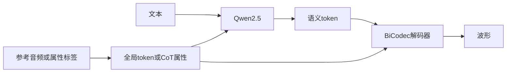
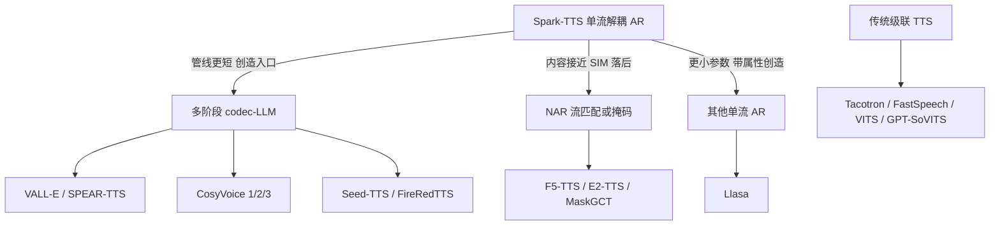

# Spark-TTS 完整介绍

---

## 1. 概述

Spark-TTS 是 2025 年 3 月由 **SparkAudio 开源社区**发布的零样本语音合成（Text-to-Speech, TTS）大模型。社区由出门问问牵头，联合香港科技大学、上海交通大学、南洋理工大学、西北工业大学音频语音与语言处理实验室（Audio, Speech and Language Processing, ASLP）、网易福羲人工智能实验室等机构。官方仓库采用 Apache 2.0 协议。

它不是传统的“文本前端 + 声学模型 + 声码器”级联，也不是 VALL-E、SPEAR-TTS 那种“语义 token + 声学 token / 多码本并行”的多阶段 codec-LLM。官方 README 把它概括为：**完全构建于 Qwen2.5 之上，消除了额外生成模型**。具体做法是：

1. **BiCodec 单流解耦**：把语音拆成承载内容的低码率语义 token，和承载说话人属性的固定长度全局 token，再合成一条序列。
2. **单一文本大语言模型（Large Language Model, LLM）**：用约 0.5B 参数的 Qwen2.5 自回归写出语音 token。
3. **解码器直接重建波形**：BiCodec 解码器从 token 还原波形，不再外挂独立声学模型、条件流匹配（Conditional Flow Matching, CFM）或额外声码器（vocoder）。

这条路线被调研材料称为 LLM 语音合成的**单流解耦拐点**：管线比两阶段 codec-LLM 短，同时把“模仿参考音色”和“无参考音频的虚拟音色创造”放进同一框架。作者自评称，0.5B 参数加约 10 万小时数据即可达到当时领先的零样本克隆效果，并声称超过参数大约 16 倍、数据大约 2.5 倍的 Llasa（8B / 25 万小时）。这是作者自评，评测数字见第 5 节。

| 维度 | 官方口径 |
|------|----------|
| 发布时间 | 2025-03-04 论文与推理开源 |
| 参数量 | 0.5B（Qwen2.5） |
| 训练数据 | 论文设计的 VoxBox，约 10 万小时中英带属性标注 |
| 开源范围 | 0.5B 推理模型、推理代码、CLI / Gradio；训练代码与 VoxBox 截至 2026-09 仍在官方 to-do |
| 核心能力 | 零样本音色克隆、属性可控创造、中英双语与代码切换 |
| 部署 | NVIDIA Triton + TensorRT-LLM；单卡 L20 并发 2 时实时因子（Real-Time Factor, RTF）约 0.074 |

---

## 2. 技术背景与模型定位

### 2.1 语音合成的四次范式

近十五年 TTS 可以看成四个阶段。Spark-TTS 落在第四段：离散语音 token + 语言模型，并且去掉了 flow matching 和额外 vocoder。

1. **统计参数化（约 2010–2015）**：HTS、Merlin 一类系统依赖人工声学特征和统计参数生成。自然度受专家知识限制，难做开放域表达。
2. **波形级建模（约 2016–2018）**：WaveNet 直接建模原始波形，音质上台阶，但逐采样点生成，实时部署困难。
3. **端到端生成（约 2017–2022）**：Tacotron、VITS 把文本到频谱（或波形）收成可训练管线；FastSpeech 用非自回归并行把推理速度抬高一个数量级。系统仍多是“声学模型 + 声码器”，零样本克隆和跨说话人迁移成本高。
4. **离散语音 token + 语言模型（约 2023 起）**：VALL-E、SPEAR-TTS、CosyVoice、Llasa、Spark-TTS 把 TTS 写成和文本生成类似的 next-token 问题。零样本克隆变得容易，但留下管线复杂、多码本并行、只能模仿参考音频等工程缺口。

### 2.2 codec-LLM 的两条谱系

Spark-TTS 站在两条谱系的汇合点。

**语言模型化的生成范式。** VALL-E（Wang et al., 2023）第一次把零样本 TTS 定义为“以文本和参考语音为条件的码本 token 预测”：参考音频经 EnCodec 变成多码本声学 token，自回归模型先写第一层码本，非自回归模型再补残差层。它证明了大模型的上下文学习能做零样本换嗓，但也把“多码本并行 + 两段解码”写进了后续几乎所有 codec-LLM。SPEAR-TTS（Kharitonov et al., 2023）换了一种拆法：先用 HuBERT 语义 token 建一个语言模型，再另训声学模型把语义 token 译成波形侧表示。监督更少、听感往往更稳，级联也更长——语义错了，后面的声学模型救不回来。CosyVoice、Seed-TTS、FireRedTTS 都还走在这条“LLM 写语义 token，再靠流匹配或扩散补声学”的路上。

**声学 token 的压缩谱系。** EnCodec（Défossez et al., 2022）确立多码本残差矢量量化（Residual Vector Quantization, RVQ）的事实标准：一层码本重建残差，再量化下一层。音质好，但 LLM 必须同时盯好几条序列，采样和鲁棒性都变差。Single-Codec（Li et al., 2024）用解耦矢量量化变分自编码器（Vector Quantized Variational Autoencoder, VQ-VAE）把语音压成单码本、单序列，带宽可低到约 304 bps，是“单流”能成立的先行证据。Llasa（Ye et al., 2025）走同一方向，但用有限标量量化（Finite Scalar Quantization, FSQ）把码本扩到 65,536，再用 Llama 预测这一条码流，并主张堆训练和推理算力。Spark-TTS 论文把 Llasa 写成最接近的并发工作：都是单流 + 文本 LLM；差别在于 Spark-TTS 把说话人属性拆成固定长度的全局 token，并加了无参考的属性创造。

Spark-TTS 做了更彻底的简化：语义 token 与说话人属性 token 合进同一个单流表示，生成由单一文本 LLM 完成，波形由 BiCodec 解码器直接重建。论文还提到 TiCodec 是“最接近的单流 codec”（全局信息单独量化），但 BiCodec 的时变部分用的是语义 token，全局量化用可学习查询加 FSQ，而不是分组矢量量化（Group Vector Quantization, GVQ）。Llasa 用 FSQ 做整条语音码流，Spark-TTS 只把 FSQ 用在 32 个全局 token 上，语义侧仍是单码本 VQ。

| 模型 | token 范式 | 生成器 | 参数量 / 训练数据 | 相对 Spark-TTS 的位置 |
|------|------------|--------|-------------------|----------------------|
| VALL-E | 多码本 RVQ 声学 token | 文本 LLM（自回归 + 非自回归） | — | 起点：定义 codec-LLM 范式 |
| SPEAR-TTS | 语义 + 声学两阶段 | 语义语言模型 + 声学模型 | — | 两阶段范式代表 |
| Single-Codec | 单码本单序列 | 解耦 VQ-VAE | — | 单流路线先行者 |
| Llasa | 单层 FSQ 单流（码本 65,536） | Llama 系 LLM | 1B / 3B / 8B，约 25 万小时 | 同源可比、参数更大的对照 |
| Spark-TTS | BiCodec 单流（语义 VQ 8192 + 全局 FSQ） | Qwen2.5 单一 LLM | 0.5B / 约 10 万小时 | 最彻底简化：无独立声学模型与 vocoder |

### 2.3 它解决什么、不解决什么

定位可以概括为一句话：**用解耦 token 换掉多阶段管线，让通用文本 LLM 直接做 TTS，并把“克隆”和“无参考创造”放进同一框架。**

它擅长：

- 一句参考音频的零样本音色克隆，覆盖中英双语与跨语种代码切换；
- 不提供参考音频时，用性别、音高、语速等属性创造虚拟音色；
- 0.5B 量级本地推理，以及官方 Triton / TensorRT-LLM 的低 RTF 部署。

它不是：

- 端到端语音对话或实时打断系统（那是 ASR + 对话 LLM + TTS 的组合）；
- 自带识别的全栈语音模型；
- 多语种基座：官方能力是中英与代码切换，方言和低资源语言主要靠零样本间接实现。

---

## 3. 发展过程

Spark-TTS 目前只有 0.5B 一代开源权重，没有 CosyVoice 那样的 1.0 / 2.0 / 3.0 产品线。下面记的是 2025 年 3 月之后的开源、加速与评测节点，以及论文数据主张和仓库实际放出内容之间的落差。

### 3.1 公开时间线

均以官方或可核验公开来源锚定：

| 时间 | 事件 |
|------|------|
| 2025-03-04 | 论文 *Spark-TTS: An Efficient LLM-Based Text-to-Speech Model with Single-Stream Decoupled Speech Tokens*（arXiv:2503.01710）发布，同步开源推理代码与 0.5B 权重 |
| 2025-03-07 前后 | 出门问问联合多所高校对外宣布开源 |
| 2025-03-12 | 官方加入 NVIDIA Triton 推理服务与 TensorRT-LLM 支持，并公布单卡 L20 的 RTF |
| 2025-03 之后 | 社区补充 ComfyUI 节点、容器化部署、量化导出 |
| 2025-05 之后 | 成为 CosyVoice 3 的 CV3-Eval 等多语言语音克隆第三方基准的对比对象 |

论文投稿 ACL 2025。截至调研时点（2026-09），同行评议正式版本未见广泛引用为唯一口径；SOTA 主张仍以预印本自评加后续第三方基准为准。

### 3.2 开源范围与“数据开放”的落差

论文设计了 VoxBox：清洗后约 102.5k 小时、470 万条、来自 29 个开源集合，带性别、音高、语速标注的中英语料，用来支撑大规模可控 TTS。

截至 2026-09，官方仓库的 to-do 仍将**发布训练代码**和**发布 VoxBox 数据集**列为未完成项。实际随模型开源的是：

- 0.5B 推理权重；
- 推理代码；
- 命令行接口（Command-Line Interface, CLI）与 Gradio WebUI（克隆界面 + 创造界面）。

因此，VoxBox 的规模与标注细节目前只能依据论文表述，无法独立复现训练端。数据怎么洗、怎么标，见 4.5 节。

---

## 4. 技术架构

### 4.1 推理主路径



两条入口共用同一套权重：

- **零样本克隆**：参考音频经 BiCodec 得到全局 token（音色条件），LLM 按文本预测语义 token，解码器合成与参考说话人一致的波形。
- **可控创造**：不提供参考音频，用户给出粗粒度属性（性别、音高等级、语速等级）和可选的细粒度数值（精确音高 Mel、语速 SPS）。LLM 先用思维链（Chain-of-Thought, CoT）写出属性推理标记，再续写语义 token，解码器生成一个“原先不存在”的虚拟音色。

没有独立的梅尔频谱声学模型，也没有 CosyVoice 式的 CFM + HiFT 声码器级联。

### 4.2 BiCodec：语义 token 与全局 token

BiCodec 要同时满足两件事：token 序列足够短，便于 LLM 高效建模；又要留下说话人音色，否则合成出来是“会说话但没有这张脸”的声音。它的解法是把信息分置到两个互补集合。

| token 类型 | 来源 | 速率 / 数量 | 承载信息 | 在管线中的作用 |
|------------|------|-------------|----------|----------------|
| 语义 token | wav2vec 2.0 的 XLSR-53 第 11 / 14 / 16 层特征平均，再经 ConvNeXt 编码和单码本 VQ | 50 token/s（tokens per second, TPS），码本 8192 | 语言内容、韵律 | 被 LLM 逐 token 预测 |
| 全局 token | 梅尔频谱 → ECAPA-TDNN → 可学习查询交叉注意力 → FSQ | 固定 32 个 | 说话人音色等全局属性 | 作为条件输入 LLM，并交给解码器 |

论文按 Pasad et al.（2023）对 wav2vec 2.0 各层语义的分析，取第 11、14 层（偏词）和第 16 层（偏音素）做平均，再送进语义编码器。编码器和解码器都是带 ConvNeXt 块的全卷积网络；量化前把特征投到低维，做法接近 DAC 的 factorized codes。全局侧沿用 Wespeaker 实现的 ECAPA-TDNN 到池化前，再用一组与最终全局长度相同的可学习查询做交叉注意力，得到固定长度序列，最后用 FSQ 而不是 VQ——论文认为全局信息是时不变的，VQ 更容易码本坍塌。

和两条既有路线都不同：

- 相对 SPEAR-TTS 的“HuBERT 语义 token + 独立声学模型”，BiCodec 不需要单独的声学模型，解码器直接从 token 重建波形。
- 相对 VALL-E 的 EnCodec 多码本并行预测，BiCodec 只有单流，LLM 做一次自回归即可。

离散语音 token 综述（Guo et al., 2025）也指出：语义 token 在多数下游任务上优于纯压缩 token，但纯语义表示会丢副语言信息；用少量全局 token 补齐音色，是解耦设计的共同难点。

**训练。** BiCodec 按生成对抗网络（Generative Adversarial Network, GAN）端到端训练：多尺度梅尔 L1 重建、多周期判别器（Multi-Period Discriminator, MPD）、多带多尺度短时傅里叶变换（Short-Time Fourier Transform, STFT）判别器，外加 VQ 的 codebook / commitment 损失。为保住语义，量化后再用 ConvNeXt 预测 wav2vec 2.0 特征。全局嵌入在训练前期不直接把量化结果送进解码器，而是用未量化池化当教师、FSQ 结果当学生，稳定后再切到量化路径。codec 本身在 LibriSpeech 960 小时加 Emilia 中英各约 1000 小时、合计约 3000 小时上训练，16 kHz，约 80 万步。

**为什么是 32 个全局 token。** 论文 Table 2 在 LibriSpeech test-clean 上做了长度消融。指标包括说话人相似度（Speaker Similarity, SIM）、短时客观可懂度（Short-Time Objective Intelligibility, STOI）、感知语音质量评价（Perceptual Evaluation of Speech Quality, PESQ）和自动听感预测 UTMOS：

| 全局设置 | STOI↑ | 窄带 PESQ↑ | UTMOS↑ | SIM↑ |
|----------|-------|------------|--------|------|
| 无 FSQ（上界） | 0.915 | 3.14 | 4.15 | 0.83 |
| GVQ-32（TiCodec 式） | 0.912 | 2.91 | 4.06 | 0.74 |
| 8 个 FSQ | 0.916 | 3.04 | 4.16 | 0.74 |
| 16 个 FSQ | 0.919 | 3.08 | 4.15 | 0.77 |
| **32 个 FSQ（采用）** | **0.922** | **3.13** | **4.18** | **0.80** |

32 个已经接近未量化上界，明显好于同长度 GVQ。论文没有再往 64 做系统对比，更细声纹的容量是否够用仍是开放问题。

BiCodec 默认约 **650 bps**（论文写 0.65 kbps）。和其他低码率 codec 的对照见 5.3 节。

### 4.3 单一 LLM：Qwen2.5

骨干是预训练的 Qwen2.5-0.5B-Instruct（Qwen Team, 2024）。官方把它当作通用文本 LLM 直接做 TTS 骨干，并在同一次指令微调里同时容纳克隆和创造。这是“消除额外生成模型”能成立的前提：语音生成被收编进文本大模型的 next-token 范式，而不是再训一个专用声学网络。文本侧复用 Qwen2.5 的字节对编码（Byte Pair Encoding, BPE）分词器。

两条训练目标混在一起，每条音频做成两个样本：

- **零样本损失 $\mathcal{L}_{zst}$**：条件是文本 token 和从参考音频抽出的全局 token，模型只预测语义 token。
- **创造损失 $\mathcal{L}_{control}$**：条件是文本和粗粒度属性标签，模型按思维链（Chain-of-Thought, CoT）顺序预测细粒度属性值、全局 token、再预测语义 token。

推理时若输入里带性别 / 音高等级 / 语速等级，就走创造路径、不需要参考音频；否则从参考音频取全局 token，走零样本克隆。论文明确对比 CosyVoice 2：Spark-TTS **不需要**流匹配再出声学特征，BiCodec 解码器吃 LLM 输出直接出波形。

24 层、隐藏维度 896、分组查询注意力等对应公开的 Qwen2.5-0.5B 规格。长文本稳定性仍是开放问题。

### 4.4 可控生成：属性标签、细粒度数值与 CoT

Spark-TTS 把可控性做进 token 层面，而不是事后做风格迁移。创造路径的实际序列是：

```text
文本 + 粗粒度标签（性别 / 音高五档 / 语速五档）
  → 细粒度音高值、语速值（取整）
  → 32 个全局 token
  → 语义 token
  → BiCodec 解码器 → 波形
```

只给标签时，模型自己推断细粒度数值；用户手写“音高 = 120、语速 = 某 SPS”时，就变成细粒度控制。

| 能力 | 输入 | 输出 | 对应设计 |
|------|------|------|----------|
| 零样本克隆 | 文本 + 参考音频 | 同说话人语音 | 语义 token + 全局 token 条件化 |
| 可控创造 | 文本 + 性别 / 音高等级 / 语速等级 + 可选细粒度数值 | 新虚拟音色 | CoT：细粒度属性 → 全局 token → 语义 token |

属性怎么离散化，论文写得很具体：

- **音高**：PyWorld 抽平均基频，取整当细粒度 token；转到 Mel 后按男、女分别用 5 / 20 / 70 / 90 分位数切成很低、低、中、高、很高五档。
- **语速**：先做语音活动检测（Voice Activity Detection, VAD）去两端静音，再算每秒音节数（Syllables Per Second, SPS）取整；按 5 / 20 / 80 / 95 分位数切成很慢到很快五档。论文认为按音节算语速，比按字、词或音素更贴说话快慢。
- **性别**：用带性别标签的数据微调 WavLM-large，在 AISHELL-3 测试集上分类准确率 99.4%，再去标没有性别标签的集合。

可以把 CoT 看成可解释、可干预的控制接口，但当前属性空间只覆盖性别、音高、语速；情感、风格、口音强度仍在官方路线图之外。论文 Limitation 也写了：全局 token 和语义 token 之间**没有**额外解耦约束，自回归采样会增加说话人波动，所以零样本 SIM 往往低于多阶段或非自回归（Non-Autoregressive, NAR）方法。后续设想是对语义输入做共振峰 / 音高扰动，让解码器更绝对地听全局 token。

可控创造与克隆保真之间存在取舍：用属性造出的新音色，还原度通常不如直接参考克隆稳。控制效果的官方数字见 5.3 节。

### 4.5 数据：VoxBox

VoxBox 是论文侧的数据主张：清洗后约 **102.5k 小时、470 万条、来自 29 个开源集合**，覆盖中英，并纳入一部分情感识别语料以增加多样性。每条音频标性别、音高、语速，用来支撑 0.5B 的可控训练。

文本质量较差的集合会再洗一遍：Emilia 原转写来自 Whisper-medium，论文用 FunASR（中文 paraformer-zh、英文 SenseVoiceSmall）复识别，相对原转写 WER 超过 0.05 的样本丢掉；MLS-English、LibriSpeech、LibriTTS-R 和情感集合则用 Whisper-large-v3，出现插入或删除就丢。

开源状态见 3.2 节。

---

## 5. 核心能力与性能

读本节数字时先分清三套口径，**不要排成一条“越来越强”的曲线**：

1. **Spark-TTS 论文（2025-03）**：Seed-TTS-eval 的 test-zh / test-en、LibriSpeech 重建与 UTMOS、性别控制准确率。这是作者自评。
2. **CosyVoice 3 论文 CV3-Eval（2025-05）**：更难的多语言 / 跨语 / 情感子集。Spark-TTS 是其中的开源基线，绝对 CER 普遍高于 Seed-TTS-eval，因为集合不同，**不能横比**。
3. **官方仓库 L20 RTF** 与 **应用材料** 的延迟、产能百分比。后者协议往往未写清，单独隔离。

### 5.1 三项核心能力

**零样本声音克隆。** 官方演示覆盖中英双语与跨语种代码切换，形态是“一句参考音频换嗓”。全局 token 携带说话人，语义 token 携带要说的内容，短提示即可条件化，不必为每个声音单独训练声学模型。克隆质量通常看两件事：字有没有念对（中文用字符错误率 Character Error Rate, CER；英文用词错误率 Word Error Rate, WER），以及像不像这个人（SIM / Speaker Similarity, SS）。论文自己的结论更具体：**内容一致性是长板，说话人相似度是短板**——后者弱于多阶段和 NAR，但强于同谱系的 Llasa。

**可控虚拟音色。** 不依赖真人参考时，可用粗粒度等级加细粒度数值合成新音色，适合游戏非玩家角色（Non-Player Character, NPC）、数字人、多角色内容。官方 WebUI 把克隆和创造做成两个界面。控制维度只有性别 / 音高 / 语速；情感指令、方言标签、FreeStyle 自然语言控风格需要对照 CosyVoice 3 / 3.5。

**中英与代码切换。** 官方能力是中英双语，以及同一句话里中英混说。跨语种克隆（用甲语言的声音说乙语言）在官方演示和论文叙述中存在，但是否保住源语言的口音、语调，论文 Limitation 已经点明：全局 token 与语义 token 之间缺少解耦约束，可能把源语言韵律带到目标语言。零样本可能对其他语种“能出声”，质量不保证。

### 5.2 论文 Seed-TTS-eval（作者自评主表）

零样本 intelligibility 按 Seed-TTS-eval：中文 test-zh 报 CER，英文 test-en 报 WER；SIM 为 WavLM-large 说话人嵌入的余弦相似度。下表转写论文 Table 4。† 表示闭源。

| 模型 | 路线 | test-zh CER↓ | test-zh SIM↑ | test-en WER↓ | test-en SIM↑ |
|------|------|--------------|--------------|--------------|--------------|
| Seed-TTS† | 多阶段 | 1.12 | 0.796 | 2.25 | 0.762 |
| FireRedTTS | 多阶段 | 1.51 | 0.635 | 3.82 | 0.460 |
| MaskGCT | NAR 掩码 | 2.27 | 0.774 | 2.62 | 0.714 |
| E2 TTS（32 NFE）† | NAR | 1.97 | 0.730 | 2.19 | 0.710 |
| F5-TTS（32 NFE） | NAR 流匹配 | 1.56 | 0.741 | 1.83 | 0.647 |
| CosyVoice | 多阶段 | 3.63 | 0.723 | 4.29 | 0.609 |
| CosyVoice2 | 多阶段 | 1.45 | 0.748 | 2.57 | 0.652 |
| Llasa-1B-250k | 单流 AR | 1.89 | 0.669 | 3.22 | 0.572 |
| Llasa-3B-250k | 单流 AR | 1.60 | 0.675 | 3.14 | 0.579 |
| Llasa-8B-250k | 单流 AR | 1.59 | 0.684 | 2.97 | 0.574 |
| **Spark-TTS** | **单流 AR** | **1.20** | **0.672** | **1.98** | **0.584** |

读表要点：

- **内容一致性是开源第一梯队（以该表、该时间为准）**：中文 CER 1.20，开源里只落后于闭源 Seed-TTS 的 1.12，好于 CosyVoice2 的 1.45 和 F5-TTS 的 1.56；英文 WER 1.98，只落后于 F5-TTS 的 1.83，好于 CosyVoice2 的 2.57 和 Llasa-8B 的 2.97。
- **说话人相似度明显弱于多阶段 / NAR**：中文 SIM 0.672，低于 Seed-TTS 0.796、MaskGCT 0.774、CosyVoice2 0.748、F5-TTS 0.741；英文同样落后一截。
- **“0.5B 超过 Llasa 8B”只在这张表上成立**：CER / WER 全面好于 Llasa 三档；中文 SIM（0.672 vs 0.684）其实略低于 Llasa-8B，英文 SIM（0.584 vs 0.574）略高。论文把“超越”主要写在 intelligibility 和参数效率上，不是音色贴脸。
- 论文把高 intelligibility 部分归因于语义特征 BiCodec 和 VoxBox 转写清洗。SIM 落后则归因于单码本 AR 在推理时引入的说话人波动。

### 5.3 官方配套评测：控制、音质、codec 重建

这三张表都来自 Spark-TTS 论文，用来补主表没覆盖的侧面，仍然是作者自评。

**性别控制（Table 3）。** 用 PromptTTS 真实语音提示、按 VoxInstruct 与 Parler-TTS 的提示格式重组后，测性别分类准确率：

| 方法 | VoxInstruct | Parler-TTS | Spark-TTS |
|------|-------------|------------|-----------|
| 性别 Acc（%）↑ | 82.99 | 98.12 | **99.77** |

分类器就是 VoxBox 标注用的那套性别模型，存在“自己的标注器评自己”的偏差，但对照同样协议下的两个文本提示 TTS，差距仍然清楚。音高、语速的粗粒度混淆矩阵和细粒度曲线在论文 Fig. 4 / Fig. 5，结论是标签和数值都能对上；正文没有再给单一准确率。

**自动音质 UTMOS（Table 5）。** 按 CosyVoice 2 的设定，在 LibriSpeech test-clean 上用 UTMOS（自动平均意见分预测器）评零样本合成：

| 方法 | 真值 GT | CosyVoice | CosyVoice2 | Spark-TTS |
|------|---------|-----------|------------|-----------|
| UTMOS↑ | 4.08 | 4.09 | 4.23 | **4.35** |

Spark-TTS 高于 CosyVoice2，甚至高于真值——自动预测器会被“更干净、更像朗读”的合成音抬高，**不能当成听测 MOS，也不能和应用材料的 4.2–4.5 混排**。它只说明：在这条自动音质轴上，去掉流匹配之后没有把音质做塌。

**BiCodec 重建（Table 1，低码率档）。** 这是 codec 重建，不是 TTS 端到端主表。带宽小于 1 kbps 时，论文称 BiCodec 多数指标领先，UTMOS 略低于 StableCodec，SIM 略低于 X-codec2。

| 模型 | 码本 / 层数 | TPS | 带宽 (bps) | STOI↑ | PESQ-NB↑ | UTMOS↑ | SIM↑ |
|------|-------------|-----|------------|-------|----------|--------|------|
| Encodec | 1024 × 2 | 150 | 1500 | 0.84 | 1.94 | 1.58 | 0.60 |
| SpeechTokenizer | 1024 × 2 | 100 | 1000 | 0.77 | 1.59 | 2.28 | 0.36 |
| WavTokenizer | 4096 × 1 | 75 | 900 | 0.89 | 2.64 | 3.94 | 0.67 |
| X-codec2 | 65536 × 1 | 50 | 800 | 0.92 | 3.04 | 4.13 | **0.82** |
| StableCodec | 15625 × 2 | 50 | 697 | 0.91 | 2.91 | **4.23** | 0.62 |
| Single-Codec | 8192 × 1 | 23.4 | 304 | 0.86 | 2.42 | 3.72 | 0.60 |
| **BiCodec** | **8192 × 1** | **50** | **650** | **0.92** | **3.13** | **4.18** | **0.80** |

高码率的 DAC（6000 bps，SIM 0.98）不在同一档。BiCodec 的卖点是：用接近语义 codec 的码率，换到接近 X-codec2 的可懂度和音色，并且解码器能直接当 TTS 后端。

### 5.4 第三方 CV3-Eval（2025-05）

CosyVoice 3 论文把 Spark-TTS 当作开源多语言克隆基线。集合比 Seed-TTS-eval 更难，且 CosyVoice 3 是唯一覆盖全部 9 语的系统。日、韩、德、西、法、意、俄全部标成“不支持”，中英错误率也明显高于 CosyVoice 3。

**多语言克隆（Table 5）：**

| 模型 | zh CER↓ | en WER↓ | ja | ko | 德西法意俄 |
|------|---------|---------|----|----|------------|
| F5-TTS | 5.47 | 8.90 | — | — | — |
| **Spark-TTS** | **5.15** | **11.0** | **—** | **—** | **—** |
| GPT-SoVITS | 7.34 | 12.5 | — | — | — |
| CosyVoice2 | 4.08 | 6.32 | 9.13 | 19.7 | — |
| CosyVoice3-0.5B + DiffRO | 2.89 | 3.68 | 5.15 | 4.02 | 有数字 |

**跨语克隆（Table 8）**更能看出音色短板：

| 模型 | en2zh WER↓ | en2zh SS↑ | en2zh MOS | zh2en WER↓ | zh2en SS↑ | zh2en MOS |
|------|------------|-----------|-----------|------------|-----------|-----------|
| F5-TTS | 11.6 | 64.2 | 3.77 | 5.57 | 64.7 | 3.77 |
| **Spark-TTS** | **12.4** | **48.4** | **3.65** | **7.36** | **56.7** | **3.61** |
| CosyVoice2 | 13.5 | 63.3 | 3.87 | 6.47 | 64.3 | 3.75 |
| CosyVoice3-0.5B | 8.48 | 67.4 | 3.82 | 4.99 | 67.8 | 3.75 |
| CosyVoice3-1.5B | 8.01 | 66.9 | 3.83 | 4.32 | 66.4 | 3.77 |

**情感克隆（Table 9，原文写作 Sparks-TTS）**用 emotion2vec 分类准确率。文本相关子集大家都不错，文本无关（要忽略文本情绪、跟参考走）全面掉：

| 模型 | 文本相关 喜/悲/怒 | 文本无关 喜/悲/怒 |
|------|-------------------|-------------------|
| F5-TTS | 0.92 / 0.52 / 0.72 | 0.80 / 0.28 / 0.64 |
| **Spark-TTS** | **0.80 / 0.56 / 0.50** | **0.50 / 0.60 / 0.36** |
| GPT-SoVITS | 0.88 / 0.54 / 0.50 | 0.48 / 0.40 / 0.30 |
| CosyVoice3-1.5B + DiffRO-EMO | 0.98 / 0.68 / 0.84 | 0.98 / 0.50 / 0.68 |

中英内容尚可，跨语 SS 和情感不是长板。

### 5.5 官方 RTF（Triton + TensorRT-LLM）

官方在 2025-03-12 起支持 NVIDIA Triton + TensorRT-LLM，并公布单卡 L20 上的运行基准。RTF 定义为推理耗时除以音频时长，小于 1 表示快于自然语速。

| 并发 | 官方 RTF（约） | 含义 |
|------|----------------|------|
| 1 | 0.136 | 单路已明显快于实时 |
| 2 | 0.074 | 适度并发下超实时 |
| 4 | 0.070 | 吞吐继续摊薄单路开销 |

在官方加速栈和 L20 上，Spark-TTS 已具备实时或超实时合成能力。具体 RTF 随显卡、精度、文本长度和是否 TensorRT-LLM 变化很大，生产环境必须用自己的文本和并发复测。

### 5.6 应用材料补充指标（非官方主表）

下列数字来自《Spark-TTS模型发展及应用》，协议、硬件和对照模型往往未写清，**不可与官方 L20 RTF、论文 Seed-TTS-eval 或 CV3-Eval 排成一条曲线**。

| 指标 | 应用材料中的说法 | 阅读建议 |
|------|------------------|----------|
| 推理速度 | RTF 约 1.2–1.9，并称优于“传统 TTS 的 RTF>3” | 与官方 L20 的 0.07 量级冲突，且 1.2–1.9 本身慢于实时；只当作未标明硬件的旧口径或未加速栈 |
| 听感 | MOS 约 4.2–4.5 | 协议不明；不要和论文 UTMOS 4.35 或 FastSpeech 的 MOS 直接比 |
| 克隆相似度 | 达人类听觉辨识阈值的 82% | 与“仍落后于 Llasa 8B”的同一份材料自相矛盾；以论文 SIM 0.67 / 0.58 为准 |
| 首包 / 端到端延迟 | 首包小于 50ms，客服端到端小于 300ms | 官方未作为主基准公布；流式首包仍是开放工程问题 |
| 长文本 | 3000 字连贯性提升 29%；5000 字从 12 分钟到 98 秒；万字级、内存降 62% | 官方未给出同口径长文本基准 |
| 量化 | INT8 保 97.3% 音质，速度提升 3.2 倍，显存约降 50%；显存可降至约 6GB | 社区量化路线的经验数字，需按具体导出格式复测 |

---

## 6. 竞品对比

Spark-TTS 的行业位置，不是“所有维度第一”，而是**管线最短的开源 codec-LLM 之一：单流解耦、0.5B、克隆与创造同框、官方加速栈清楚；内容一致性强，说话人相似度和多语 / 情感不是长板**。

数字回指第 5 节。Seed-TTS-eval 见 5.2；CV3-Eval 见 5.4。两套集合难度不同，绝对 CER 不能横比。



| 模型 | token / 声学 | 生成器 | 还要不要后级 | 控制入口 | 官方语言 |
|------|--------------|--------|--------------|----------|----------|
| Tacotron / FastSpeech / VITS | 梅尔频谱 | 注意力或时长扩展 | 要声码器（VITS 可端到端） | 说话人 ID / 方差 | 单语为主 |
| VALL-E | EnCodec 多码本 | AR + 非 AR | 要 codec 解码 | 参考音频 | 英语演示 |
| SPEAR-TTS | HuBERT 语义 + 声学 | 两段 LM | 要声学模型 | 参考 / 提示 | 英语 |
| CosyVoice 1/2/3 | 监督语义 token | Qwen 系 LLM | 要 CFM + HiFT | 参考、情感、指令、方言 | 2.0 起多语 + 方言 |
| Seed-TTS / FireRedTTS | 语义 token | AR LM | 要流匹配 | 参考音频 | 中英，Seed 闭源 |
| F5-TTS / E2-TTS / MaskGCT | 梅尔或 codec | 流匹配 / 掩码 NAR | 通常要 vocoder | 参考音频 | 中英为主 |
| Llasa | 单流 FSQ 65536 | Llama | codec 解码 | 参考音频 | 中英 |
| Parler-TTS / VoxInstruct | 描述文本 | LM + codec | 视实现 | 自然语言风格句 | 英语为主 |
| GPT-SoVITS | 语义 + SoVITS | 微调 AR + 声码器 | 要微调 | 参考 + 角色权重 | 社区多语 |
| **Spark-TTS** | **语义 VQ + 32 全局 FSQ** | **Qwen2.5-0.5B** | **只要 BiCodec 解码器** | **参考或性别/音高/语速** | **中英 + 代码切换** |

### 6.1 和传统级联：零样本门槛

Tacotron 用注意力对齐文本和梅尔帧，长句容易漏读、重复。FastSpeech 用显式时长把音素拉成帧，并行快、对齐稳，但每个新声音通常要重新训或做说话人嵌入。VITS 把声学模型和声码器收成端到端，音质好，仍然不是“听一句就会说”的零样本系统。

Spark-TTS 不再做音素时长预测，也不为每个发音人存一份声学模型。代价是：它变成自回归 codec-LLM，延迟形态接近语言模型，而不是 FastSpeech 那种完全并行的梅尔生成。老级联适合固定发音人播报。

### 6.2 和 VALL-E / SPEAR-TTS：管线更短

VALL-E 定义了 codec-LLM，但要并行处理 EnCodec 多码本，并依赖更重的声学侧建模。SPEAR-TTS 把语义和声学分成两段，听感可以更好，级联也更长。Spark-TTS 用 BiCodec 解码器直接出波形，LLM 只预测一条序列。

代价是：全局 token 一旦成为信息瓶颈，细粒度音色和情感就补不回来；两阶段路线至少还能在声学模型或流匹配里再补一层。这也是 CosyVoice / Seed-TTS 在 SIM 上普遍更高的结构原因。VALL-E 完全依赖参考音频，没有“无参考按标签造声”；Spark-TTS 把创造做成同一套权重的第二条入口。

### 6.3 和 CosyVoice / Seed-TTS / FireRedTTS：两阶段工业模型

机制差在后级和语言，不在“要不要 LLM”：

| 维度 | Spark-TTS | CosyVoice 系列 | Seed-TTS / FireRedTTS |
|------|-----------|----------------|------------------------|
| 骨架 | BiCodec + 单一 Qwen2.5，无 CFM / 独立 vocoder | 监督语义 token + LLM + 条件流匹配 + HiFT | AR 写语义 token，流匹配补声学 |
| 参数（开源） | 0.5B 一代 | 1.0 起多代，开源主力约 0.5B，另有 1.5B 论文 / 3.5 | Seed 闭源；FireRed 有开源代 |
| 语言 | 官方中英 + 代码切换 | 3.0 起 9 语种 + 18 种中文方言 | 中英为主 |
| 流式 | 官方给加速后的 RTF，不是双向流式产品叙事 | 2.0 起同一权重兼离线与流式，首包约 150ms | 视产品 |
| 控制 | 性别 / 音高 / 语速 + CoT 创造 | 情感、口音、发音修补、指令 / FreeStyle | 参考音频为主 |
| 评测关系 | 被 CV3-Eval 当作多语言克隆基线 | 发布方；开源 RL 版中文 CER 进入第一梯队 | Seed 是作者表相似度标杆 |

作者表（5.2）上，Spark-TTS 念得比当时的 CosyVoice2 更准（中文 CER 1.20 vs 1.45，英文 WER 1.98 vs 2.57），但不更像（中文 SIM 0.672 vs 0.748）。Seed-TTS 仍是相似度上限（中文 SIM 0.796、英文 0.762），中文 CER 1.12 也略好于 Spark-TTS。FireRedTTS 虽同属两阶段工业模型，作者表上英文 WER 3.82、英文 SIM 0.460，全面低于 Spark-TTS。小红书后续还有 FireRedTTS-2 等对话向工作，和这里的零样本 TTS 表不是同一代。

第三方表（5.4）上，Spark-TTS 中英尚可、日韩不支持，跨语 SS 只有 48–57，情感也偏弱。要极简管线、本地 0.5B、无参考造音色，Spark-TTS 短名单靠前；要中文方言、双向流式、指令控情绪、跨语保音色和现成云 API / Studio，CosyVoice 更常是默认项。要“听起来像指定人、且不必开源”时，闭源旗舰仍常是上限。相似度要追 Seed-TTS，论文自己都说要先加强对全局 token 的解耦，而不是再堆参数。

### 6.4 和 Llasa：更小，但不等于已经赢

Llasa 是最直接的单流对照：单层 FSQ（码本 65,536）+ Llama，1B / 3B / 8B，数据约 25 万小时，没有属性创造入口。作者表（5.2）上，0.5B 的 Spark-TTS 内容一致性全面好于 8B 的 Llasa；相似度上优势很薄，中文 SIM 甚至略低于 Llasa-8B（0.672 vs 0.684）。

选型时把 Llasa 当成“更大、更吃算力、没有官方造声入口的同谱系选项”。若已经有 Llama 推理栈、只做中英克隆、能接受 8B，Llasa 仍可试；若要 0.5B、Triton 数字和属性创造，Spark-TTS 更合适。这条对比没有被 CV3-Eval 用同一协议再打一遍。

### 6.5 和 F5-TTS / E2-TTS / MaskGCT：NAR 更像，AR 更好控

F5-TTS、E2-TTS 用流匹配在梅尔上做非自回归生成；MaskGCT 用掩码生成 codec token。它们不走“文本 LLM 写一条语义码流”，所以没有 Spark-TTS 那种 CoT 属性创造，但往往把参考音色学得更死。

作者表（5.2）上：英文 WER 是 F5-TTS 最好（1.83 vs Spark-TTS 1.98）；中文 CER 是 Spark-TTS 更好（1.20 vs F5-TTS 1.56）；SIM 则是 MaskGCT / E2 / F5 全部高于 Spark-TTS 的 0.672。CV3-Eval（5.4）英文和跨语 SS 同样是 F5-TTS 明显更强。

NAR 还多一个推理旋钮：函数评估次数（Number of Function Evaluations, NFE）。表里 F5 / E2 都是 32 NFE，离线批量可以加大，实时要减。Spark-TTS 的延迟主要在 LLM 自回归步数，官方用 TensorRT-LLM 打 RTF，而不是调 NFE。

选型：离线批量、显存紧、要更像参考、不太要标签造声，选 F5-TTS。要 LLM 式属性创造、更短开源推理链、官方 Triton 栈，选 Spark-TTS。E2-TTS 多数权重闭源，只作论文对照。MaskGCT 的 SIM 很高，但中文 CER 在作者表里偏弱。

### 6.6 和 GPT-SoVITS / Parler-TTS：微调社区 vs 描述式控制

GPT-SoVITS 社区大，几分钟参考加微调就能出一个很像的角色，创作者用来做固定虚拟人很合适。它不是严格意义上的大规模零样本：换一个新角色通常要再训或再抽特征。CV3-Eval 上它的中英错误率（7.34 / 12.5）高于 Spark-TTS（5.15 / 11.0），情感也不占优。选型：一个角色打磨很久、可以接受维护权重，用 GPT-SoVITS；多个声音进 API、不想存一堆微调包、还要按标签造 NPC，用 Spark-TTS。

Mega-TTS 走大规模零样本加内在归纳偏置，偏扩散族，开源推理链和部署文档都不如 Spark-TTS / CosyVoice 完整，适合当论文对照，不适合当默认生产基座。

Parler-TTS、VoxInstruct 用自然语言句子描述风格（“一个低沉的男声，略快”），更接近 CosyVoice 3.5 的 FreeStyle。Spark-TTS 控的是结构化标签和数值。论文 Table 3 里性别准确率 99.77% 高于 Parler-TTS 的 98.12% 和 VoxInstruct 的 82.99%，说明在“男 / 女”这种粗标签上，离散属性比开放文本稳。情感、语气一类指令它没有做成产品能力，CV3-Eval 情感数字也偏弱；需要自然语言控风格时，应看 CosyVoice 3.x 或 Parler 一族。

### 6.7 选型矩阵

| 需求 | 更合适的选择 | 主要依据 |
|------|----------------|----------|
| 闭源极致贴脸 | Seed-TTS 等旗舰 API | 作者表 SIM 0.80 量级 |
| 中文方言、9 语、流式、情感指令 | CosyVoice 3 / 3.5 | CV3-Eval 全语覆盖；首包约 150ms |
| 离线批量、更像参考、中英 | F5-TTS | 英文 WER 与跨语 SS 好于 Spark-TTS |
| 已有 Llama 栈、能上 8B、只要克隆 | Llasa | 同谱系更大模型；无官方造声 |
| 单角色反复微调 | GPT-SoVITS | 社区工具链，不是大规模零样本 |
| 自然语言风格句 | CosyVoice 3.5 / Parler-TTS | 与 Spark-TTS 的标签控制不同轨 |
| **0.5B 私有化、中英混说、标签造声、要 Triton RTF** | **Spark-TTS** | **管线最短；作者表 CER/WER 强；CV3-Eval 跨语/情感弱** |

---

## 7. 应用场景

能力到场景的映射如下。带具体百分比的案例均来自应用材料，属于个案转述，**未独立核验**。

| 应用场景 | 主要依赖的能力 | 典型形态 |
|----------|----------------|----------|
| 实时语音交互 | 低 RTF、可加速部署 | 智能客服、语音助手、车载对话 |
| 零样本声音克隆 | 短参考音频、中英 / 代码切换 | 品牌音色、个人声音包、虚拟主播 |
| 可控虚拟音色 | 性别 / 音高 / 语速，无参考 | 游戏 NPC、多角色内容、数字人 |
| 有声内容生产 | 长文本、风格参数 | 有声书、播客、新闻与教育朗读 |
| 影视 / 游戏配音 | 跨语克隆、多角色区分 | 补台词、本地化、NPC 声线 |
| 无障碍与医疗沟通 | 亲友音色克隆（必须授权） | 视障朗读、失语沟通辅具 |
| 多模态口播 | TTS + 唇形同步等外部模块 | 虚拟主播、讲解视频 |

### 7.1 智能助手与品牌音色

应用材料把个性化声纹写成智能音箱、车载和客服机器人的入口：用户提供约 3–10 秒参考音频即可定制声音。出门问问一侧的商业化叙述是 TicVoice 7.0 接入该能力，并称客户满意度提升 35%、平均通话时长减少 28%；某客服平台把定制周期从 3–5 天收到“实时生成”。这些数字是产品宣传口径，复制时要单独测授权录音质量、ASR 和对话策略，不能归因成纯 TTS 增益。

多角色数字人场景里，应用材料称某直播平台为约 100 位虚拟主播定制声线，用户满意度提升 42%、主播活跃度增加 3 倍。技术上更站得住的部分是：全局 token 可切换，同一套模型出多把声音，不必为每个主播训一份声学模型。

无障碍方面，应用材料提到某三甲医院为失语患者定制亲友声音沟通设备，满意度 92%、沟通效率提升 60%。这类场景对授权和误用极度敏感，必须走本人或监护人书面授权，不能用爬取或病房旁路录音。

实时交互上，应用材料写流式首包小于 50ms、CPU 可运行、客服端到端小于 300ms。官方可核验的是 L20 上的 RTF（5.5 节）。智能体、客服要上线时，应自己测首包、打断恢复和并发。

### 7.2 有声阅读与教育

应用材料认为传统 TTS 的两个痛点是长文本连贯和风格适配，并给出三级控制：全局（语速 0.5x–2.0x、音高 ±2 个半音）、段落（情感强度、停顿系数）、句子（重音、呼吸点）。官方属性空间能核验的是语速与音高；段落 / 句子级标记属于应用层分轨或 SSML 式包装。

产能叙述：单日处理约 20 万字，成本降至传统配音的约 1/10；某有声书平台留存率提升 18%；某教育平台完播率提升 27%；5000 字推理从 12 分钟到 98 秒。这些数字说明的是**降录棚成本**的方向，不是官方长文本基准。多角色长书仍建议在应用层做角色标记和分轨，不要指望单次前向自动演完一台戏。

教育侧，应用材料列出多音字消歧、数字日期规范化、特殊符号等中文优化。Spark-TTS 本身没有 CosyVoice 3 那样公开的拼音 / CMU 音素修补和 LLM 文本归一化（Text Normalization, TN）产品模块。数字、商标和多音字应在业务层预置读法表，并做 CER 复测。

### 7.3 内容创作：配音、游戏、自媒体

| 用法 | 应用材料中的说法 | 落地时注意 |
|------|------------------|------------|
| 影视补台词 / 历史影像修复 | 为缺失台词的角色生成语音，周期缩短约 90% | 版权与人格权；历史声线复刻必须授权或明确合理使用边界 |
| 游戏 NPC | 按性格、背景调全局 token，增强沉浸感 | 适合批量“能用的角色声”，不是主演级表演 |
| 跨语配音 | 中文参考出英文，并称保持口音和情感 | 官方是中英 / 代码切换；韵律串扰是已知风险 |
| 方言 | 四川话、粤语等，家庭沟通与文化内容 | 官方数据以中英为主，方言靠零样本，必须用目标方言文本听测 |
| 自媒体 / 播客 | 生产效率提升约 4 倍，周期从数天到数小时 | 个人声线同样要授权；平台侧需防未授权名人音 |

跨语言本地化的合理预期是：降低“同一把声音出中英版本”的录棚次数，而不是自动得到院线级配音。方言内容先当实验能力，再当交付承诺。

### 7.4 多模态：TTS 是其中一环

应用材料把 Spark-TTS 和 wav2lip 一类唇形同步、直播数字人、虚拟新闻主播放在一起，并称用户活跃度提升 3 倍、端到端小于 300ms。架构上，Spark-TTS 只负责出声；唇形、表情、视觉生成是外部模块。多模态一致性（声、唇、脸是否同步）是系统问题，不是 BiCodec 已经解决的问题。

正确拼装是：流式 ASR + 对话 LLM + Spark-TTS + 口型 / 渲染。官方支持的是 TTS 段的加速推理，不是整条数字人链路的 SLA。

### 7.5 合规与使用边界

官方 README 明确禁止未经授权的音色克隆、冒充、诈骗和深度伪造，并要求遵守当地法律。零样本越强，未授权复刻的成本越低，鉴伪、水印和声纹授权的研究越滞后。

建议在业务层至少做到：

- 本人授权留痕，不用爬取的公众人物或员工音频；
- 声纹 / 文本黑名单，拦截名人、竞品品牌和高风险话术；
- 合成内容水印或审计日志；
- 医疗、金融、外呼等高风险场景人工复核。

本地开源部署能减少音频出域，**责任仍在使用者**。

---

## 8. 生态、部署与工程实践

### 8.1 开源栈

官方提供：

- 0.5B 推理权重（Hugging Face / 项目页）；
- Python 推理代码；
- CLI；
- Gradio WebUI，分克隆与创造两个界面；
- Triton + TensorRT-LLM 示例与 L20 RTF 基准。

社区补充 ComfyUI 节点、容器化、ONNX / 量化导出等。二次开发的常见路径是：先用官方脚本验证克隆和创造，再用 Triton 扛并发，最后按需量化。

### 8.2 官方加速基准

以 5.5 节 L20 表为准。并发 1 / 2 / 4 的 RTF 约 0.136 / 0.074 / 0.070，说明在官方栈上已经具备实时或超实时能力。应用材料另写 NVIDIA Triton / TensorRT-LLM 可将显存降到约 6GB，适配 RTX 3090 / 4090，并提到 vLLM、Docker、机器人操作系统（Robot Operating System, ROS）一键部署。6GB、消费卡和 ROS 属于经验档位，随精度、是否同时加载 BiCodec 解码器和批大小变化。

### 8.3 部署档位

应用材料给出的三档可以保留为选型框架，能力边界按官方口径收紧：

| 方式 | 适合谁 | 备注 |
|------|--------|------|
| 云 API / REST | 客服试点、有声内容、快速验证 | 应用材料口径；需评估数据出域、配额和音色授权 |
| 开源私有化（GPU） | 企业内网、研究、品牌音色 | 官方主路径；建议 Triton + TensorRT-LLM，用业务文本测 RTF |
| WebUI / CLI | 试用、演示、内容同学 | 官方现成，不适合高并发 |
| 量化后的单卡服务 | 中小流量线上 | GPTQ / AWQ / GGUF、INT8 等来自应用材料与社区，保真度要听测 |
| CPU / WebAssembly 端侧 | 嵌入式、离线助手 | 仅应用材料主张；音质和克隆能力会明显下降 |

### 8.4 落地时的工程顺序

1. 先用目标中英文本、代码切换句和真实参考音做 CER / 听感，不要只听官方 demo。
2. 再测 RTF 和并发：短句助手、长句播报分开看；需要首包指标就自己打点。
3. 品牌音色走授权录音 + 固定参考；不要用爬来的名人音。
4. 数字、多音字、商标名在应用层预置读法，不要假设模型内置完整 TN。
5. 需要“造声音”时走官方创造界面的属性空间；需要情感、方言、自然语言风格时，对比 CosyVoice 或在应用层做后处理。
6. 需要对话时，另接 ASR 和业务 LLM，不要让 TTS 兼做理解。

---

## 9. 优势、局限与选型建议

### 9.1 优势

1. **架构极简且方向清楚**：单流解耦 token + 单一文本 LLM + 解码器出波形，升级叙事不是再叠一级声学模型。
2. **0.5B 可私有化**：相对 8B 级同谱系模型，推理和显存门槛更低；官方给了 Triton / TensorRT-LLM 和 L20 RTF。
3. **克隆与创造同框架**：既可以一句参考换嗓，也可以无参考按性别 / 音高 / 语速造声，这是相对早期 codec-LLM 最有区分度的产品能力。性别控制在论文协议下达到 99.77%。
4. **中英内容一致性强（作者表）**：Seed-TTS-eval 上中文 CER 1.20、英文 WER 1.98，开源当时仅次于 Seed-TTS / F5-TTS，并明显好于 CosyVoice2 和 Llasa-8B。
5. **已被第三方基准收编**：进入 CosyVoice 3 的 CV3-Eval 对照。

### 9.2 局限

1. **说话人相似度是结构短板**：作者表中文 SIM 0.672，低于 CosyVoice2 / F5-TTS / Seed-TTS；CV3-Eval 跨语 SS 只有 48–57。论文自己归因于单码本 AR 和缺少全局 / 语义解耦约束。
2. **SOTA 缺独立统一基准**：0.5B 超越 Llasa 8B 主要在 intelligibility；CV3-Eval 上中英尚可、日韩不支持，情感偏弱。
3. **训练不可复现**：VoxBox 与训练代码截至 2026-09 仍未随推理模型开源。
4. **语言覆盖窄**：官方中英为主；CV3-Eval 把日韩欧语标成不支持。
5. **控制粒度有限**：没有做成情感 / 风格 / FreeStyle；32 个全局 token 接近重建上界，但细声纹仍可能不够。
6. **长文本与流式首包**：万字连贯、分层记忆、首包小于 50ms 均非官方主基准；LLM 序列长度和实时交互仍是工程约束。
7. **合规与能力绑定**：克隆越像，未授权使用的危害越大；鉴伪和水印滞后于合成扩散。

### 9.3 适合优先采用

- 中英为主，需要零样本克隆或中英混说，且更看重念对字（作者表 CER / WER）而不是极致贴脸；
- 希望同一套 0.5B 权重既克隆又造虚拟声，不想为每个 NPC 微调；
- 要私有化，不能把音色和文本送到第三方；
- 团队能接受 codec-LLM 自回归延迟，并用 Triton / TensorRT-LLM 把 RTF 打到小于 1；
- 评测上需要一个开源对照，而不是只对 CosyVoice / F5-TTS。

### 9.4 不建议当作默认最优

- 只要单一闭源音色的极致相似，且可以接受 API；
- 主战场是中文方言、9–13 语种或自然语言情感指令——优先 CosyVoice 3 / 3.5；
- 必须双向流式、明确首包 SLA（例如约 100–150ms），且没有精力自建流式封装；
- 主要语种是官方从未承诺的小语种或低资源语言；
- 需要端到端语音对话、实时打断和语义理解——TTS 只是其中一环；
- 团队完全没有 GPU 推理经验，又只是偶发配音（这时用现成云 TTS 即可，不必自建 Spark-TTS）。

更细的机制对照和数字依据见 6.7 节选型矩阵。

---

## 10. 总结

Spark-TTS 是 2025 年 3 月 SparkAudio（出门问问牵头）把 codec-LLM 收成单流解耦的一次开源落地：BiCodec 把内容和音色拆开，Qwen2.5-0.5B 直接写语音 token，解码器出波形，不再叠独立声学模型和 vocoder。它的贡献不在又一个更大的参数量，而在**用更短的管线同时做零样本克隆和属性创造**，并给出可核验的 Triton / TensorRT-LLM 推理数字。

评测上必须把三套数字分开读：**作者 Seed-TTS-eval 看内容一致性**（中文 CER 1.20、英文 WER 1.98，好于当时的 CosyVoice2 和 Llasa-8B）；**CV3-Eval 看跨语和情感**（中英尚可，日韩不支持，跨语 SS 明显落后，情感不是长板）；**应用材料的 MOS / RTF / 产能百分比是个案**。说话人相似度弱于多阶段和 NAR，是论文自己承认的结构问题。

应用上，它已经从换嗓演示走到客服、有声书、数字人、游戏 NPC 和无障碍沟通；这些场景故事大多来自应用材料。语言上它是中英模型。

选型时记住：官方实时性看 L20 的 RTF 0.07 量级；克隆必须授权。用业务音频把 CER、相似度、RTF 和违禁声线测完，再决定是自建 Spark-TTS、改走 CosyVoice 或 F5-TTS，还是只用云 API。

---

## 参考资料

1. Wang, X. et al. [Spark-TTS: An Efficient LLM-Based Text-to-Speech Model with Single-Stream Decoupled Speech Tokens](https://arxiv.org/abs/2503.01710). arXiv:2503.01710, 2025.
2. Wang, C. et al. [VALL-E: Neural Codec Language Models are Zero-Shot Text to Speech Synthesizers](https://arxiv.org/abs/2301.02111). arXiv:2301.02111, 2023.
3. Kharitonov, E. et al. [Speak, Read and Prompt: High-Fidelity Text-to-Speech with Minimal Supervision](https://aclanthology.org/2023.tacl-1.95/). Transactions of the Association for Computational Linguistics, 2023.
4. Jiang, Z. et al. [Mega-TTS: Zero-Shot Text-to-Speech at Scale with Intrinsic Inductive Bias](https://arxiv.org/abs/2306.03509). arXiv:2306.03509, 2023.
5. Du, Z. et al. [CosyVoice: A Scalable Multilingual Zero-shot Text-to-speech Synthesizer Based on Supervised Semantic Tokens](https://arxiv.org/abs/2407.05407). arXiv:2407.05407, 2024.
6. Ye, Z. et al. [Llasa: Scaling Train-Time and Inference-Time Compute for Llama-based Speech Synthesis](https://arxiv.org/abs/2502.04128). arXiv:2502.04128, 2025.
7. Li, H. et al. [Single-Codec: Single-Codebook Speech Codec towards High-Performance Speech Generation](https://arxiv.org/abs/2406.07422). arXiv:2406.07422, 2024.
8. Défossez, A. et al. [High Fidelity Neural Audio Compression](https://arxiv.org/abs/2210.13438). arXiv:2210.13438, 2022.
9. Baevski, A. et al. [wav2vec 2.0: A Framework for Self-Supervised Learning of Speech Representations](https://papers.neurips.cc/paper_files/paper/2020/file/92d1e1eb1cd6f9fba3227870bb6d7f07-Paper.pdf). NeurIPS 2020.
10. Qwen Team. [Qwen2.5 Technical Report](https://arxiv.org/abs/2412.15115). arXiv:2412.15115, 2024.
11. Chen, Y. et al. [F5-TTS: A Fairytaler that Fakes Fluent and Faithful Speech with Flow Matching](https://arxiv.org/abs/2410.06885). arXiv:2410.06885, 2024.
12. Guo, H. et al. [Recent Advances in Discrete Speech Tokens: A Review](https://arxiv.org/abs/2502.06490). arXiv:2502.06490, 2025.
13. Du, Z. et al. [CosyVoice 3: Towards In-the-wild Speech Generation via Scaling-up and Post-training](https://arxiv.org/abs/2505.17589). arXiv:2505.17589, 2025.
14. [SparkAudio / Spark-TTS 官方仓库（README、Triton 基准、使用声明）](https://github.com/SparkAudio/Spark-TTS).
15. 《Spark-TTS 发展过程与语音方向应用调研》
16. 《Spark-TTS模型发展及应用》

> 注：架构、出品方、VoxBox 开源状态、L20 RTF，以及 Seed-TTS-eval / BiCodec 重建 / 性别 99.77% 以 Spark-TTS 论文和官方仓库为准。CV3-Eval 多语言、跨语、情感数字以 CosyVoice 3 论文为准，不可与 Seed-TTS-eval 的绝对 CER 横比。TicVoice 7.0、医院与直播案例、MOS 4.2–4.5、RTF 1.2–1.9、20+ 语种、首包小于 50ms 等来自应用调研材料，实际效果需以对应权重、文本和部署环境的复测为准。
