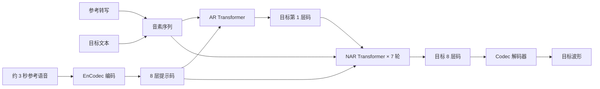
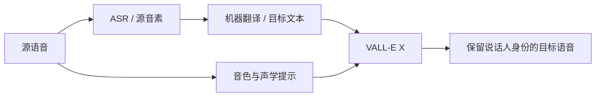

# VALL-E 完整介绍

## 1. 概述

VALL-E 是 Microsoft Research Asia 于 2023 年提出的零样本文本转语音（Text-to-Speech, TTS）模型。它最重要的贡献不是单独发明了声音克隆，而是把 TTS 明确改写为一个与文本生成相似的**条件语言建模问题**：

```text
传统路线：文本 / 音素 → 连续 mel 频谱 → 声码器 → 波形
VALL-E： 文本 / 音素 + 参考语音 token → 离散声学 token → codec 解码器 → 波形
```

模型先用现成的 EnCodec 把语音压缩成离散码，再让 Transformer 根据文本和一段参考录音预测目标语音的码序列。原始论文使用约 6 万小时英语语音训练；面对训练中未见过的说话人，只需约 3 秒参考录音，不更新模型参数，就能合成与参考音色相似的语音，并在一定程度上继承情绪、语速、混响和背景环境。

这使 VALL-E 成为神经编解码语言模型（neural codec language model）TTS 路线的标志性工作。此后微软围绕跨语言、稳定性、推理效率和连续表示继续扩展：

| 模型 | 首次公开 | 主要定位 | 核心变化 |
|------|----------|----------|----------|
| VALL-E | 2023-01 | 英语零样本 TTS | EnCodec 多码本；AR 生成首层，NAR 补齐残差层 |
| VALL-E X | 2023-03 | 中英跨语言 TTS / S2ST | 统一音素空间、语言 ID、跨语言声学提示 |
| VALL-E 2 | 2024-06 | 更稳健、更高效的零样本 TTS | 重复感知采样、分组码建模 |
| VALL-E R | 2024-06 | 文本忠实度与推理效率 | 音素单调对齐、codec merging |
| MELLE | 2024-07 | 连续值自回归 TTS | 直接生成 mel 帧，绕开矢量量化 |
| FELLE | 2025-02 | 连续值生成质量 | 自回归骨架结合 token-wise flow matching |
| PALLE | 2025-04 | 并行化与低延迟 | 伪自回归动态 span + 低置信 token 重生成 |

> **名称边界：**截至 2026 年 9 月，微软官方 VALL-E Family 页面列出了 VALL-E、VALL-E X、VALL-E R、VALL-E 2、MELLE、FELLE 和 PALLE，未发布名为“VALL-E 3”的正式版本。VioLA、SpeechX、RALL-E、LatentLM 和 VibeVoice 与这条路线密切相关，但不是都能算作 VALL-E 的正式代际。

---

## 2. 技术背景与模型定位

### 2.1 VALL-E 之前的 TTS

现代神经 TTS 大致经历了三种表示路线：

1. **连续声学特征回归**：Tacotron、FastSpeech 等模型预测 mel 频谱，再交给 WaveNet、HiFi-GAN 一类声码器。训练目标直观，但零样本说话人适配通常需要单独的说话人编码器、对齐器或微调。
2. **端到端波形生成**：VITS 等系统联合学习对齐、声学建模和波形生成，管线更紧凑，但大规模开放说话人上的上下文学习并非其原始重点。
3. **离散语音 token 建模**：AudioLM 等工作证明音频可以像文本一样离散化并用语言模型生成。VALL-E 把这个思想直接用于“文本条件 + 短语音提示”的零样本 TTS。

VALL-E 的位置可以概括为：**让离散 codec 成为 TTS 的声学接口，让大规模语音预训练产生说话人级上下文学习能力。**

### 2.2 “零样本”和“上下文学习”分别指什么

- **零样本说话人适配**：测试说话人未出现在训练集中，推理时不针对该说话人微调参数。
- **声学提示（acoustic prompt）**：用几秒参考语音的 codec token 作为生成前缀或条件。
- **上下文学习（in-context learning）**：模型从当前输入的参考语音中临时提取音色和声学环境，而不是把每个新说话人写入权重。

这不等于“只有 3 秒录音就能训练 VALL-E”。基础模型仍依赖数万小时预训练数据。标准推理还通常需要参考录音对应的文本或音素，以及待合成文本。

### 2.3 为什么选择 codec token

连续频谱回归倾向于对多种合理发音取平均，可能削弱细节；原始波形又具有极高采样率。神经音频 codec 在两者之间提供了一个可学习的离散接口：

- token 率远低于 24 kHz 波形采样率；
- 离散类别可直接用语言模型交叉熵训练；
- 多层残差码本能逐步恢复从粗结构到细声学纹理的信息；
- 预训练 codec 的解码器可直接把预测 token 还原为波形。

代价是量化失真、多码本建模复杂，以及自回归声学序列仍远长于文本序列。

---

## 3. 发展过程

### 3.1 VALL-E：建立 neural codec LM 范式（2023-01）

2023 年 1 月，微软发布论文 *Neural Codec Language Models are Zero-Shot Text to Speech Synthesizers*。模型用约 6 万小时 LibriLight 英语有声书数据训练，是当时公开零样本 TTS 工作中非常激进的数据扩展。

它确立了三项关键设计：

1. 用预训练 EnCodec 将 24 kHz 语音转为八层残差量化码；
2. 自回归（Autoregressive, AR）模型沿时间生成第一层码；
3. 非自回归（Non-Autoregressive, NAR）模型分七轮补齐第 2—8 层码。

论文展示了约 3 秒参考语音下的未见说话人克隆、同一文本的多样采样，以及情绪和声学环境保留。它也暴露了后来几代持续解决的问题：漏词、重复、静音循环、序列过长和推理较慢。

### 3.2 VALL-E X：从单语克隆到跨语言生成（2023-03）

VALL-E X 把英语 LibriLight 与 1 万小时以上 WenetSpeech 中文数据合并训练，加入统一的中英语音素表示和语言 ID。它可以：

- 用中文参考声音说英语，或用英文参考声音说中文；
- 在跨语言合成时保留说话人音色；
- 用语言 ID 调节更偏目标语言母语口音还是保留源语言口音；
- 作为语音到语音翻译管线中的语音生成模块；
- 生成中英 code-switching 样例。

“跨语言”不应被写成“支持任意语言”。原论文的训练与系统评测主要覆盖中文和英文；社区版增加日语等能力，不能倒推为微软官方模型能力。

### 3.3 VioLA 与 SpeechX：从 TTS 走向通用语音任务（2023）

VioLA 将 codec decoder-only language model 扩展到 ASR、TTS、机器翻译和语音翻译等任务，说明统一离散语音—文本序列可以承载“听、读、翻译、说”。

SpeechX 则通过任务提示统一零样本 TTS、语音增强、目标说话人提取、说话人移除和语音编辑。原始 VALL-E 把 speech editing 列为潜在应用，但真正对局部内容替换和噪声环境保持做系统实验的是 SpeechX。两者是 VALL-E 思想的扩展，不应当作 VALL-E 1.5 或 VALL-E 2。

### 3.4 RALL-E：显式规划韵律（2024-04）

RALL-E 针对语言模型式 TTS 的错读和不稳定韵律，引入类似 chain-of-thought 的中间步骤：先预测时长、音高等韵律信息，再生成语音 token。它由微软研究者参与并与多所高校合作完成，是直接学术后续，但未被当前官方总览列为 VALL-E Family 的命名版本。

### 3.5 VALL-E 2：解决采样循环和长序列（2024-06）

VALL-E 2 保留“AR 第一层 + NAR 后七层”的总体骨架，重点改进两处：

- **Repetition-Aware Sampling（RAS）**：观察最近生成历史的 token 重复程度，在 nucleus sampling 和更开放的随机采样之间切换，降低小 `top-p` 下陷入重复或静音循环的概率。
- **Grouped Code Modeling（GCM）**：把连续多个 codec frame 组成一组，组间自回归、组内并行预测，缩短 AR 序列。

论文在 LibriSpeech 与 VCTK 的指定设置中报告了“human parity”。准确含义是：在这些英语朗读基准、特定提示和 WER/自然度/说话人相似度评测协议下达到或超过真实录音的若干结果，不表示所有语言、口音、长文本、情绪和真实噪声场景都已达到人类水平。

### 3.6 VALL-E R：显式单调对齐（2024-06）

VALL-E R 的发布日期略晚于 VALL-E 2，但编号并非简单代际顺序。它将音素信息显式注入声学 token 生成，并约束音素—声学序列保持单调对齐，以减少：

- 跳词和漏词；
- 重复朗读；
- 音素顺序错乱；
- decoder-only 注意力在长句上的对齐崩溃。

同时，codec merging 对浅层离散码降采样，减少 AR 步数。官方报告推理时间节省超过 60%，WER 接近真实语音。它还允许使用独立韵律参考，增强音色与韵律的组合控制。

### 3.7 从离散码转向连续值：MELLE、FELLE、PALLE（2024—2025）

后续工作开始反思：为音频压缩设计的矢量量化，是否一定是生成式 TTS 的最佳表示。

- **MELLE**：单阶段自回归生成连续 mel-spectrogram 帧，不再预测 VQ 索引；用 spectrogram flux loss 改善连续性，并通过潜变量采样保留生成多样性。
- **FELLE**：在连续 mel token 上结合 token-wise flow matching，以 coarse-to-fine 流程改善时间和频率方向的连续性。
- **PALLE**：在固定时间步内预测动态长度 span，以“伪自回归”保留时间顺序，同时获得更高并行度；第二阶段重生成低置信 token。论文报告最高约 10 倍推理加速，但结果受具体基准和配置约束。

这三项工作说明 VALL-E Family 已从“一个 EnCodec 模型的连续升级”演化为围绕语言模型式 TTS 的多条表示和解码路线。

### 3.8 相关后续，但不是 VALL-E 3

- **LatentLM**：用 next-token diffusion 统一连续与离散模态，TTS 只是其多模态能力之一。
- **VibeVoice**：采用超低帧率连续 token 与 next-token diffusion，面向长语音、多说话人和实时语音；它是独立的 VibeVoice 家族。
- **NaturalSpeech 2/3**：微软的扩散式零样本语音合成路线，不属于 VALL-E。
- **ELLA-V、VALL-T**：外部或联合团队提出的相关改进，名称相近但不是微软正式 VALL-E 型号。

---

## 4. EnCodec 与离散语音 token

### 4.1 EnCodec 的工作方式

VALL-E 使用 Meta 提出的 EnCodec 作为固定的语音 tokenizer 和重建器。其简化流程为：


Residual Vector Quantization（RVQ）逐层量化剩余误差。第一层表示最主要的信息，后续层不断补偿重建残差：

$$
\mathbf{z} \approx \mathbf{q}_1 + \mathbf{q}_2 + \cdots + \mathbf{q}_8
$$

其中 $\mathbf{q}_1$ 是第一码本输出，$\mathbf{q}_{2:8}$ 逐层恢复细节。

### 4.2 VALL-E 使用的 codec 配置

| 属性 | 配置 |
|------|------|
| 采样率 | 24 kHz，单声道 |
| 目标码率 | 6 kbps |
| 时间帧率 | 75 帧/秒 |
| RVQ 量化器 | 8 个 |
| 每个码本大小 | 1024 |
| 每个索引信息量 | 约 10 bit |
| 每帧覆盖时间 | 约 13.33 ms |

码率可以直接验证：

$$
75 \times 8 \times \log_2 1024
= 75 \times 8 \times 10
= 6000\ \text{bit/s}
$$

3 秒提示包含约 225 个时间帧，即八层合计约 1800 个离散索引。相比 72,000 个 24 kHz 波形采样点，它大幅降低了时间分辨率；相比文本 token，序列依然很长。

### 4.3 第一层为何用 AR，后七层为何用 NAR

第一层码最能决定时长、停顿和主要声学轨迹，需要严格的时间依赖，因此使用 AR：

$$
p(\mathbf{c}_{:,1}\mid \mathbf{x},\tilde{\mathbf{c}})
= \prod_{t=1}^{T}
p(c_{t,1}\mid \mathbf{x},\tilde{\mathbf{c}},c_{<t,1})
$$

其中 $\mathbf{x}$ 是文本/音素条件，$\tilde{\mathbf{c}}$ 是参考语音码。

后续码本主要补细节。在第 $j$ 层，NAR 模型已看到文本、声学提示和目标语音的较浅层码，可沿时间并行预测：

$$
p(\mathbf{c}_{:,j}\mid
\mathbf{x},\tilde{\mathbf{c}},\mathbf{c}_{:,<j})
$$

因此“NAR”不是一次生成全部七层，而是执行七轮；每一轮内部的所有时间位置并行。

---

## 5. 原始 VALL-E 架构

### 5.1 总体流程



### 5.2 AR 模型

AR Transformer 将参考音频第一层码作为前缀，根据“参考音素 + 目标音素”逐步预测目标第一层码。论文配置为 12 层、16 个注意力头、隐藏维度 1024、前馈层维度 4096、dropout 0.1。

推理时采用采样而非纯贪心。这样能生成不同语速、停顿和韵律，但也使同一个输入具有随机性，并带来重复、遗漏和循环风险。

### 5.3 NAR 模型

NAR Transformer 也采用 12 层、16 头和 1024 隐藏维度。训练时随机选择一个待预测码本层；推理时从第 2 层到第 8 层依次执行，每一层使用：

- 文本音素；
- 参考语音的完整八层 codec 提示；
- 目标语音已经生成的较浅层码。

它使用贪心解码补齐细节，避免八层全部沿时间自回归所造成的巨大延迟。

### 5.4 训练数据与设置

| 项目 | 原始 VALL-E |
|------|-------------|
| 数据 | LibriLight 英语有声书 |
| 规模 | arXiv 版本约 60,000 小时 |
| 说话人 | 约 7,000 |
| 文本来源 | ASR 生成伪转写，再转为音素 |
| 训练片段 | 随机裁剪约 10—20 秒 |
| 优化 | AdamW，32k warm-up，峰值学习率约 $5\times10^{-4}$ |
| 训练硬件 | 16 张 NVIDIA V100 32GB |
| 训练步数 | 约 800k |

> **60K 与 50K 的差异：**2023 arXiv 论文和官方演示页使用“60K hours”；2025 IEEE/ACM TASLP 期刊版摘要出现“50K hours”。两者属于版本口径差异，引用时应注明来源，不能混成一个精确不变的数字。

LibriLight 原本缺少完整人工转写。论文用在 LibriSpeech 960 小时上训练的 ASR 系统产生伪标签，这让超大规模训练成为可能，也会把识别错误和有声书领域偏差带入 TTS。

### 5.5 推理条件并不只有一段音频

完整推理通常需要：

1. 参考语音；
2. 参考语音的转写；
3. 待合成目标文本。

参考与目标文本被转换成音素并拼接，参考音频则转换为 codec 前缀。产品宣传常简化为“3 秒克隆”，但 3 秒指说话人声学注册量，不代表系统无需文本前端或参考转写。

---

## 6. VALL-E X、VALL-E 2 与 VALL-E R 的关键变化

### 6.1 VALL-E X

VALL-E X 的 Multi-lingual AR（MAR）与 Multi-lingual NAR（MNAR）总体继承原始架构，主要增加：

- 基于 IPA 思路统一的中英语音素集合；
- 英语 LibriLight 与中文 WenetSpeech 混合训练；
- 目标语言 ID embedding；
- 源语言语音、源文本与目标文本的联合条件。

| 数据 | 约数 | 作用 |
|------|------|------|
| LibriLight | 60k 小时英语 | 英语声学与大规模说话人覆盖 |
| WenetSpeech | 10k+ 小时中文 | 中文内容和跨语言能力 |
| 合计 | 约 70k 小时 | 无需同一说话人的中英平行录音 |

跨语言 TTS 的生成器以源语音和目标文本为条件。做完整 Speech-to-Speech Translation（S2ST）时，前面仍需识别/翻译模块得到源和目标文本或音素，因此 VALL-E X 并不单独完成语音理解与翻译。

### 6.2 VALL-E 2

VALL-E 2 改用约 5 万小时带更可靠文本的 LibriHeavy 英语数据，并将文本表示从音素改为 BPE token。声学侧仍是 24 kHz、6 kbps EnCodec，论文使用预训练 Vocos 解码预测的 codec token。

#### 重复感知采样

普通 nucleus sampling 只保留累计概率达到 `top-p` 的最小候选集合。`p` 较小时输出稳定，却可能反复选择少数 token 并陷入循环；完全随机采样较容易跳出循环，但错误率更高。

RAS 在近期窗口中估计重复程度：

- 重复程度低时，使用 nucleus sampling 保持稳定；
- 重复程度高时，扩大到完整分布随机采样，尝试逃离循环。

论文实验使用长度为 10 的近期窗口和 0.1 左右的重复阈值，并在不同 `top-p` 下比较。其价值是动态处理“稳定性—多样性”矛盾，而不是保证彻底消除所有错读。

#### 分组码建模

若组大小为 $G$，原先长度为 $T$ 的第一层码被组织为约 $T/G$ 个组：

```text
G = 1: c1 → c2 → c3 → c4 → ...
G = 2: [c1,c2] → [c3,c4] → ...
G = 4: [c1,c2,c3,c4] → ...
```

组间仍保持自回归顺序，组内多个码并行预测。它理论上按 $G$ 缩短 AR step 数，但端到端加速还受 Transformer、NAR、codec 解码和实现效率影响。论文没有给出一个可脱离硬件与配置直接复用的“固定加速 X 倍”结论。

### 6.3 VALL-E R

VALL-E R 直接处理“文本 token 与声学 token 没有强单调绑定”的结构问题。模型预测声学码时同时跟踪当前音素位置，并要求对齐只能向前推进。这样不仅改善 WER，也提供音素级可控性。

Codec merging 则把浅层相邻码合并为更紧凑表示，减少最昂贵的 AR 时间步。相对仅靠采样策略的 VALL-E 2，VALL-E R 更像从架构上显式加入传统 TTS 已知有用的单调对齐归纳偏置。

### 6.4 三者解决的问题不同

| 模型 | 主要问题 | 方法 | 仍保留的限制 |
|------|----------|------|--------------|
| VALL-E X | 单语、跨语言口音 | 双语训练 + language ID | 主要只有中英证据 |
| VALL-E 2 | 重复循环、AR 序列长 | RAS + GCM | 对齐仍主要隐式学习 |
| VALL-E R | 漏词重复、对齐脆弱、速度 | 单调音素对齐 + codec merging | 仍依赖 codec 和 AR 生成 |

---

## 7. 官方实验结果应该怎样解读

### 7.1 原始 VALL-E

LibriSpeech test-clean 自动指标：

| 系统 | WER ↓ | 说话人相似度 SPK ↑ |
|------|------:|-------------------:|
| Ground truth | 2.2 | 0.754 |
| YourTTS | 7.7 | 0.337 |
| VALL-E | 5.9 | 0.580 |

LibriSpeech 人工说话人相似度 MOS（SMOS）中，VALL-E 为 $4.38\pm0.10$，YourTTS 为 $3.45\pm0.09$；相对 YourTTS 的自然度 CMOS 约为 +0.12。

VCTK 3 秒提示下：

| 系统 | SPK ↑ | SMOS ↑ |
|------|------:|-------:|
| Ground truth | 0.546 | — |
| YourTTS | 0.357 | $3.70\pm0.09$ |
| VALL-E | 0.382 | $3.81\pm0.09$ |

论文报告 VALL-E 相对 ground truth 的自然度 CMOS 约 +0.04，差异不显著。这个结果说明当时的人评自然度很强，但自动说话人相似度仍明显低于真实录音。

### 7.2 VALL-E X

以中文提示生成英语的实验中：

| 系统 | ASV ↑ | WER ↓ | NISQA ↑ |
|------|------:|------:|--------:|
| YourTTS | 0.30 | 8.53 | 3.36 |
| VALL-E X | 0.36 | 4.07 | 3.54 |

50 条人工样本中，VALL-E X 的 SMOS 为 4.00，基线为 3.42，自然度 CMOS 约 +0.24。中译英 S2ST 实验报告 BLEU 30.66，高于基线 27.49；说话人相似度和 NISQA 也有提升。

Language ID 的口音人评说明它能显著改善目标语言自然口音，但“更像目标语言母语者”和“完全保留源说话人声学细节”之间可能存在权衡。

### 7.3 VALL-E 2

LibriSpeech、单次采样：

| 系统 | SIM ↑ | WER ↓ | DNSMOS ↑ |
|------|------:|------:|---------:|
| Ground truth | 0.779 | 1.6 | 3.891 |
| 重训 VALL-E | 0.633 | 3.1 | 3.985 |
| VALL-E 2，G=1 | 0.643 | 1.5 | 3.987 |
| VALL-E 2，G=2 | 0.635 | 1.5 | 4.000 |

VCTK、3 秒提示、单次采样：

| 系统 | SIM ↑ | WER ↓ | DNSMOS ↑ |
|------|------:|------:|---------:|
| VALL-E | 0.430 | 2.4 | 3.667 |
| VALL-E 2，G=1 | 0.447 | 0.9 | 3.666 |

VCTK 人评中，ground truth 与 VALL-E 2 G=2 的 SMOS 都为 $4.47\pm0.13$；VALL-E 2 的 CMOS 也可与真实录音相当。这是“human parity”口径的重要依据。

### 7.4 为什么合成语音的 WER 可能低于真实语音

较低 WER 不必然等于“声音全面超过真人”。合成语音可能：

- 背景更干净；
- 发音更规整；
- 停顿更符合 ASR 训练分布；
- 缺少真实录音中的呼吸、吞音和设备噪声。

同样，DNSMOS 是预测模型而非真人听感，SIM 又依赖特定说话人验证器。严谨比较应同时看内容一致性、自然度、音色、韵律、鲁棒性和真实业务错误。

### 7.5 多次采样再挑选不等于单次部署表现

部分论文会为同一文本生成多次，再按 WER 或 SIM 选择较好样本。这能测量模型能力上限，但实际在线合成通常只能单次输出。阅读结果时必须确认：

- 单次还是多次采样；
- 是否用外部 ASR/说话人模型重排；
- 提示来自同一 utterance 还是另一条录音；
- 提示长度是否固定；
- ground truth 是否与提示共享录音条件。

---

## 8. 在语音方向的应用

### 8.1 零样本个性化 TTS

这是 VALL-E 最直接的应用。用户提供少量授权录音，系统即可生成通知、导航、课程、有声内容或虚拟角色语音，无需为每个说话人单独训练模型。

适合：

- 个性化语音助手和数字人；
- 授权配音演员的批量内容生产；
- 企业品牌声线和客服播报；
- 用户自有声音的辅助朗读。

风险在于“注册门槛降低”和“冒充门槛降低”是同一项能力的两面。

### 8.2 跨语言配音与本地化

VALL-E X 展示了让单语说话人以自身音色说另一种语言。它可用于：

- 视频、影视和课程的跨语言配音；
- 国际会议内容本地化；
- 游戏角色多语言版本；
- 保持人物身份的一致化语音翻译。

生产系统还需要机器翻译、专名处理、口型/时长约束和人工审校。VALL-E X 的官方实验证据主要是中英，不能直接承诺全球多语种。

### 8.3 语音到语音翻译

典型管线是：



VALL-E X 负责目标语言声学生成，不代表识别、语义理解和翻译错误会自动消失。完整系统的 BLEU、名称准确率和端到端延迟取决于各模块共同表现。

### 8.4 情绪、韵律与声学环境迁移

官方样例表明，参考音频中的 anger、sleepy、amused、disgusted 等情绪，以及混响、电话信道和背景噪声，可被部分带入合成结果。

这是一种**隐式提示跟随**，不是完全解耦的可控生成：

- 无法保证稳定复现某个标签和强度；
- 音色、情绪、语速、口音和环境可能相互耦合；
- 参考中的噪声与隐私线索也可能被复制；
- 定性演示不能替代大样本情绪识别和听感评测。

VALL-E R 的独立韵律提示、RALL-E 的显式韵律规划，是对此能力的进一步结构化。

### 8.5 语音编辑、修复与后期制作

原始 VALL-E 的生成方式天然启发“只替换一段文本，其余声学上下文不变”。但严格来说，SpeechX 才系统展示：

- 修改说错的词句；
- 在噪声环境中保留上下文背景；
- 语音增强；
- 目标说话人提取；
- 特定说话人移除。

因此，VALL-E 适合被视为语音编辑范式的基础，而不是一套已经公开交付、带时间轴编辑器的产品。

### 8.6 内容创作与生成式 AI 组合

文本大模型可以产生脚本，VALL-E 类模型负责用指定声音朗读，从而用于：

- 有声书和播客草稿；
- 游戏 NPC 与交互剧情；
- 短视频旁白；
- 多角色对话原型；
- 广告和营销素材的 A/B 版本。

长篇内容仍要处理角色一致性、跨段韵律、错读检测、分段拼接和授权范围。原始 75 Hz AR 序列并不适合无限长连续生成。

### 8.7 语音数据增强

同一文本和说话人提示可采样出多种停顿、语速和声学环境，理论上可扩增 ASR、说话人识别或情感识别数据。但使用合成数据要防止：

- 把 TTS 的发音偏差反馈给 ASR；
- 数据多样性只是采样噪声，未覆盖真实人群；
- 训练集与评测集说话人泄漏；
- 未经授权扩增真实人物音色；
- 合成痕迹导致下游模型学到捷径。

### 8.8 无障碍与声音保留

VALL-E R 官方提到为失语症等人群创建语音的潜力。更广泛的方向包括：

- 在用户仍能说话时授权保存其声音；
- 疾病或手术后通过辅助设备输出个性化语音；
- 为阅读障碍或视障用户提供熟悉声线。

这类应用价值很高，但要求身份确认、可撤回授权、模型与样本加密，以及家属和医疗机构的清晰权限边界。

---

## 9. 开源、复现与工程状态

### 9.1 微软官方开放了什么

截至 2026 年 9 月：

- 已公开论文、项目说明和音频演示；
- `microsoft/unilm` 仓库存在 `valle` 目录，但主要是论文和演示入口；
- 未公开微软原始 VALL-E、VALL-E X、VALL-E R 或 VALL-E 2 的完整训练/推理代码；
- 未公开官方 checkpoint；
- 未提供可普遍申请的官方公共 API；
- VALL-E 2 页面明确将其定位为研究演示，没有产品化或扩大公共访问的计划。

所以“VALL-E 已开源”是不准确的。更准确的说法是：**论文与样例公开，官方模型和完整实现未开源，社区存在独立复现。**

### 9.2 主要第三方实现

| 项目 | 定位 | 许可证/状态 | 重要区别 |
|------|------|-------------|----------|
| `lifeiteng/valle` | 较早的 PyTorch 复现 | Apache-2.0 | 提供训练流程，但不提供微软权重 |
| `enhuiz/vall-e` | 非官方 PyTorch 实现 | 以仓库声明为准 | 明确标注 unofficial |
| `Plachtaa/VALL-E-X` | 可运行的中英日社区版 | MIT；仓库已归档 | 权重为独立训练，不是微软模型 |
| OpenMMLab Amphion | 综合语音生成工具箱中的 VALL-E recipe | MIT | 提供较小规模 LibriTTS/LibriLight 社区 checkpoint |
| `e-c-k-e-r/vall-e` | 长期演化实验平台 | AGPL-3.0 | 加入多种架构与权重格式，已偏离忠实复刻 |

### 9.3 许可证不是唯一合规条件

代码采用 MIT、Apache-2.0 或 AGPL-3.0，不代表整套系统自动可商用。还要分别检查：

- checkpoint 的模型许可证；
- EnCodec/Vocos 等依赖；
- G2P、字体和文本前端资源；
- 训练语音数据的用途限制；
- 参考说话人的声音权、人格权和合同授权；
- 生成内容所在地区的标记与披露要求。

### 9.4 复现为什么很难达到论文效果

核心差距往往不在 Transformer 代码，而在：

- 数万小时数据的获取、去重、切分和质量控制；
- 约 7,000 位说话人的覆盖；
- 伪转写、音素化和异常文本清洗；
- codec 版本与重建质量；
- 训练稳定性、batch 组织和计算预算；
- 采样、候选重排和提示预处理；
- 论文未完全披露的工程细节。

用数百或数千小时训练出的社区 checkpoint 可以验证架构，但不能把其音质、安全策略或语言能力视为微软模型的复现结论。

---

## 10. 优势与局限

### 10.1 主要优势

1. **范式简洁**：把 TTS 统一为文本条件下的离散 token 预测，能复用语言模型的扩展规律。
2. **零样本音色适配**：新说话人无需微调，少量提示即可工作。
3. **保留声学上下文**：音色之外，还能隐式继承情绪、韵律和环境。
4. **生成多样性**：随机采样可为同一文本产生不同停顿和语速。
5. **跨语言扩展自然**：VALL-E X 证明声学提示和语言内容可以跨语言组合。
6. **研究影响大**：后续 codec-LLM、语义 token TTS、低帧率 codec 和连续 token 生成都把它作为重要基线。

### 10.2 结构性局限

1. **序列仍然很长**：75 Hz 首层码使 10 秒语音就有约 750 个 AR step，远长于对应文本。
2. **对齐是薄弱点**：原始 decoder-only 架构没有强单调约束，可能漏词、重复、错序。
3. **采样稳定性矛盾**：更随机有助多样性和逃离循环，却可能损害文本忠实度；更贪心又可能僵化或循环。
4. **多码本管线复杂**：AR + 七轮 NAR 比单流 codec 或并行 flow 模型更难部署和优化。
5. **量化损失**：压缩 codec 为通信设计，离散化可能损失高频、细粒度音色和自然瞬态。
6. **提示高度敏感**：长度、信噪比、房间、说话状态和文本覆盖都会影响相似度。
7. **长文本和开放域不足**：训练以英语有声书为主，不能代表自然对话、强口音、歌唱和任意真实环境。
8. **官方不可获取**：缺少代码、权重和 API，研究结果难以完全独立复核，也不适合直接做生产选型。

### 10.3 “像”不等于“可控”

提示语音把多个属性压在同一个声学条件中。模型可能很像参考人，却无法独立指定：

- 只换情绪、不换音色；
- 只换口音、不改变节奏；
- 去掉背景噪声但保留房间感；
- 精确控制每个词的时长和重音；
- 在长篇多个段落中维持同一角色状态。

显式风格 token、韵律规划、可编辑对齐和后续 flow/diffusion 渲染，都是后继模型继续探索的原因。

---

## 11. 安全、伦理与治理

### 11.1 主要风险

- 未经同意克隆公众人物、亲友、员工或配音演员；
- 用逼真语音实施亲属诈骗、企业转账和社会工程攻击；
- 绕过依赖静态声纹的身份认证；
- 跨语言冒充，扩大攻击覆盖地区；
- 伪造录音证据或修改原始发言；
- 复制参考音频中的背景、地点和隐私线索；
- 未经授权替代创作者劳动或超范围二次使用声线。

### 11.2 微软论文提出的边界

官方页面明确承认冒充和声纹欺骗风险，实验假设目标说话人同意使用其声音；若用于真实未见说话人，应建立说话人批准协议，并配套合成语音检测。

这只是原则，不是已经被论文验证为充分的安全方案。检测器可能受压缩、重录、噪声和新生成器影响，也存在攻防迭代。

### 11.3 生产系统的最低治理组合

1. **明确授权**：记录说话人、用途、语言、地区、期限、可否再授权和撤回方式。
2. **活体注册**：避免仅凭网络公开视频创建声线。
3. **敏感声线保护**：公众人物、高管、政府和金融相关身份使用更严格策略。
4. **用途与文本控制**：限制诈骗、身份验证、政治误导和违法内容。
5. **速率限制与审计**：保留谁在何时以哪一声线生成了什么内容。
6. **可感知披露**：在适用场景向听众明确说明音频为合成。
7. **机器可读来源标记**：结合水印、内容凭证和元数据，而非只押注单一检测器。
8. **认证升级**：高风险业务不能只用声纹，应结合设备、密钥、挑战应答和行为风控。

### 11.4 监管趋势

- 美国 FCC 已明确 AI 生成语音属于电话消费者保护规则下的人工或预录语音，相关自动呼叫通常需要事先同意。
- 美国 FTC 持续关注声音克隆诈骗、生物特征滥用和创作者声音挪用。
- 欧盟 AI Act 第 50 条对合成内容的机器可读标记和 deepfake 披露提出透明度要求，并自 2026 年进入适用阶段。

具体义务取决于司法辖区、部署角色和应用场景，产品上线前应由法律与安全团队复核最新规则。

---

## 12. 与其他路线的比较

| 路线 / 模型 | 中间表示 | 生成方式 | 主要优势 | 主要代价 |
|-------------|----------|----------|----------|----------|
| Tacotron / FastSpeech | 连续 mel | AR 或 NAR 回归 | 体系成熟、控制链清晰 | 零样本音色泛化通常需额外设计 |
| VITS | 连续潜变量 / 波形 | VAE + flow + GAN | 端到端、单模型音质高 | 大规模提示式克隆不是原始重点 |
| AudioLM | 语义 + 声学 token | 分层 LM | 通用无条件/提示音频生成 | 不是以文本条件 TTS 为核心 |
| VALL-E | EnCodec 八层 RVQ | AR 首层 + NAR 残差层 | 3 秒提示、声学上下文保留 | 长序列、对齐和多码本复杂 |
| VALL-E X | 同上 | 跨语言 AR/NAR | 中英跨语言保音色 | 语言证据有限 |
| NaturalSpeech 2/3 | codec latent / 因子化表示 | diffusion | 高保真、属性建模灵活 | 多步生成和工程复杂度 |
| Voicebox | 连续表示 | 非自回归 flow matching | 编辑、去噪、多语言统一 | 与 VALL-E 的 AR codec 路线不同 |
| MELLE / FELLE | 连续 mel token | AR / AR + flow | 避免 VQ 保真损失 | 连续概率建模与求解成本 |
| PALLE | 动态 span token | 伪 AR + 并行修复 | 更高并行度 | 置信度调度和实现更复杂 |

### 12.1 VALL-E 与 AudioLM

AudioLM 更早展示了将音频离散化并进行分层语言建模，重点是从音频提示延续自然音频。VALL-E 的差异是把**音素条件、说话人声学提示和大规模转写语音**结合起来，明确面向 zero-shot TTS。称 VALL-E 为“最早的音频语言模型”不准确；称其为“神经 codec 零样本 TTS 的标志性起点”更合适。

### 12.2 VALL-E 与现代 flow/diffusion TTS

VALL-E 的离散 AR 模型天然适合 next-token scaling 和采样，却承担长序列误差累积。Flow/diffusion 模型通常可并行生成连续帧，编辑与全局一致性更灵活，但需要数值求解、时长或对齐条件，并可能增加部署复杂度。

后来的系统经常混合两者：语言模型负责语义/粗 token，flow 或 diffusion 负责声学细节。MELLE、FELLE、LatentLM 也说明微软自身在探索超越固定 EnCodec 多码本的表示。

---

## 13. 研究与工程选型建议

### 13.1 适合作为研究对象

- 研究 codec language model 和语音上下文学习；
- 比较音素、BPE、语义 token 与纯声学 token；
- 研究 AR/NAR 分层生成、采样稳定性和单调对齐；
- 研究跨语言音色、口音和情绪解耦；
- 作为现代零样本 TTS 的历史基线。

### 13.2 不宜把“微软 VALL-E”直接写入生产方案

官方权重、代码和服务没有公开，团队实际部署的一定是第三方复现或另一款产品。因此选型文档应写出具体仓库、checkpoint、codec、训练数据和许可证，而不是只写“采用 VALL-E”。

### 13.3 社区复现上线前应测试

- 业务语言和领域文本的 CER/WER；
- 同语与跨语说话人相似度；
- 单次采样的失败率，而非只听精选样例；
- 数字、日期、缩写、人名和重复短语；
- 长文本漏词、重复、静音和超时；
- 不同提示长度、信噪比和设备；
- RTF、首包延迟、显存和并发；
- 未授权声线注册、敏感人物和诈骗文本拦截；
- 水印在压缩、重录和剪辑后的可检测性。

### 13.4 何时考虑其他模型

- 要官方开源权重和完整部署链：优先评估活跃开源 TTS 项目；
- 要低延迟流式对话：优先评估专门的流式 token/flow 架构；
- 要多语言、方言和自然语言风格控制：选择有对应训练与公开评测的模型；
- 要精确语音编辑：选择显式掩码编辑、对齐和局部重生成系统；
- 要长篇多说话人：选择低帧率连续 token、分层记忆或专门长音频模型。

---

## 14. 常见误解

### 14.1 “VALL-E 只靠 3 秒录音就能训练”

错误。3 秒是推理时适配未见说话人的声学提示；基础模型训练需要数万小时数据。

### 14.2 “VALL-E 已经由微软开源”

错误。微软公开了论文、项目页和演示，没有公开原始完整代码和 checkpoint。GitHub 上可运行项目是第三方实现。

### 14.3 “VALL-E X 支持任意语言”

证据不足。官方论文主要是中英双语。社区项目增加其他语言不等于微软模型具备相同能力。

### 14.4 “VALL-E 2 在所有场景超过真人”

错误。“Human parity”限定于 LibriSpeech、VCTK 和论文指定指标/协议。自动 WER 低于真实录音，也可能只是合成语音更干净规整。

### 14.5 “VALL-E 的第一层是纯语义 token”

不准确。它是 EnCodec 的第一层声学量化码，包含较粗粒度且最重要的声学信息，但不是由 ASR 监督得到的纯语义 token。

### 14.6 “VALL-E R、VALL-E 2 是严格顺序发布的第二、第三代”

不准确。VALL-E 2 和 VALL-E R 在 2024 年 6 月相近时间公开，解决重点不同；名称不是线性产品版本号。

### 14.7 “VibeVoice 就是 VALL-E 3”

错误。VibeVoice 是微软后续独立语音模型家族，采用超低帧率连续 token 与 next-token diffusion，并未被官方命名为 VALL-E 3。

---

## 15. 总结

VALL-E 的历史意义在于：它证明了大规模 TTS 可以不再围绕“预测一张 mel 频谱”组织，而是把语音压成离散 token，再让语言模型根据文本和短声学提示续写声音。约 3 秒参考录音、训练中未见说话人、音色与环境共同迁移，使 zero-shot voice cloning 从专用说话人适配问题变成了基础模型的上下文学习能力。

系列演进也清楚暴露了这条路线的难点：

- VALL-E 建立 AR + NAR 多码本范式；
- VALL-E X 把它扩展到中英跨语言生成；
- VALL-E 2 用重复感知采样和分组建模改善稳定性与长度；
- VALL-E R 用显式单调对齐和 codec merging 处理文本忠实度与速度；
- MELLE、FELLE、PALLE 开始在连续表示、flow matching 和并行生成上寻找下一步。

应用上，VALL-E 影响了个性化 TTS、跨语言配音、语音翻译、编辑、内容生成、数据增强和无障碍语音。但微软没有公开原始权重或产品接口，现有可运行版本主要来自社区，质量和许可不能与论文模型画等号。

最后，声音克隆的价值和风险由同一能力产生。真正可部署的系统不仅要测自然度和相似度，还要同时解决文本忠实度、单次生成失败率、授权链、身份验证、审计、来源标记和滥用响应。对 VALL-E 最准确的评价不是“一个已经开放的人类级语音产品”，而是：**它定义了 2023 年以后语言模型式零样本 TTS 的重要起点，并推动整个行业把声音视为可被提示、生成和治理的 token 序列。**

---

## 参考资料

### VALL-E 官方论文与项目

1. Wang, C. et al. [Neural Codec Language Models are Zero-Shot Text to Speech Synthesizers](https://arxiv.org/abs/2301.02111). arXiv:2301.02111, 2023；后发表于 IEEE/ACM TASLP, 2025.
2. [Microsoft Research: VALL-E 官方演示页](https://www.microsoft.com/en-us/research/project/vall-e-x/vall-e/).
3. Zhang, Z. et al. [Speak Foreign Languages with Your Own Voice: Cross-Lingual Neural Codec Language Modeling](https://arxiv.org/abs/2303.03926). arXiv:2303.03926, 2023.
4. [Microsoft Research: VALL-E X 官方演示页](https://www.microsoft.com/en-us/research/project/vall-e-x/vall-e-x/).
5. Chen, S. et al. [VALL-E 2: Neural Codec Language Models are Human Parity Zero-Shot Text to Speech Synthesizers](https://arxiv.org/abs/2406.05370). arXiv:2406.05370, 2024.
6. [Microsoft Research: VALL-E 2 官方演示与责任说明](https://www.microsoft.com/en-us/research/project/vall-e-x/vall-e-2/).
7. Han, B. et al. [VALL-E R: Robust and Efficient Zero-Shot Text-to-Speech Synthesis via Monotonic Alignment](https://arxiv.org/abs/2406.07855). arXiv:2406.07855, 2024.
8. [Microsoft Research: VALL-E R 官方演示页](https://www.microsoft.com/en-us/research/project/vall-e-x/vall-e-r/).
9. [Microsoft Research: VALL-E Family 总览](https://www.microsoft.com/en-us/research/project/vall-e-x/).

### 编解码器、数据与相关研究

10. Défossez, A. et al. [High Fidelity Neural Audio Compression](https://arxiv.org/abs/2210.13438). arXiv:2210.13438, 2022.
11. [Meta EnCodec 官方仓库](https://github.com/facebookresearch/encodec).
12. Kahn, J. et al. [Libri-Light: A Benchmark for ASR with Limited or No Supervision](https://arxiv.org/abs/1912.07875). 2019.
13. Kang, W. et al. [LibriHeavy: A 50,000 Hours ASR Corpus with Punctuation Casing and Context](https://arxiv.org/abs/2309.08105). 2023.
14. Zhang, B. et al. [WenetSpeech: A 10000+ Hours Multi-domain Mandarin Corpus for Speech Recognition](https://arxiv.org/abs/2110.03370). 2021.
15. Wang, T. et al. [VioLA: Unified Codec Language Models for Speech Recognition, Synthesis, and Translation](https://arxiv.org/abs/2305.16107). 2023.
16. Wang, C. et al. [SpeechX: Neural Codec Language Model as a Versatile Speech Transformer](https://arxiv.org/abs/2308.06873). 2023.
17. Xin, D. et al. [RALL-E: Robust Codec Language Modeling with Chain-of-Thought Prompting for Text-to-Speech Synthesis](https://arxiv.org/abs/2404.03204). 2024.
18. Kharitonov, E. et al. [Speak, Read and Prompt: High-Fidelity Text-to-Speech with Minimal Supervision](https://aclanthology.org/2023.tacl-1.95/). TACL, 2023.
19. Borsos, Z. et al. [AudioLM: A Language Modeling Approach to Audio Generation](https://arxiv.org/abs/2209.03143). 2022.
20. Le, M. et al. [Voicebox: Text-Guided Multilingual Universal Speech Generation at Scale](https://arxiv.org/abs/2306.15687). 2023.

### VALL-E Family 后续

21. Meng, L. et al. [Autoregressive Speech Synthesis without Vector Quantization](https://arxiv.org/abs/2407.08551). 2024.
22. Wang, H. et al. [FELLE: Autoregressive Speech Synthesis with Token-Wise Coarse-to-Fine Flow Matching](https://arxiv.org/abs/2502.11128). 2025.
23. Yang, Y. et al. [Pseudo-Autoregressive Neural Codec Language Models for Efficient Zero-Shot Text-to-Speech Synthesis](https://arxiv.org/abs/2504.10352). 2025.
24. [Microsoft Research: MELLE 项目页](https://www.microsoft.com/en-us/research/project/vall-e-x/melle/).
25. [Microsoft Research: FELLE 项目页](https://www.microsoft.com/en-us/research/project/vall-e-x/felle/).
26. [Microsoft Research: PALLE 项目页](https://www.microsoft.com/en-us/research/project/vall-e-x/palle/).
27. [Microsoft VibeVoice 官方仓库](https://github.com/microsoft/VibeVoice).

### 实现、安全与监管

28. [Microsoft UniLM VALL-E 目录](https://github.com/microsoft/unilm/tree/master/valle).
29. [lifeiteng/valle：非官方 PyTorch 复现](https://github.com/lifeiteng/valle).
30. [Plachtaa/VALL-E-X：非官方跨语言实现](https://github.com/Plachtaa/VALL-E-X).
31. [OpenMMLab Amphion](https://github.com/open-mmlab/Amphion).
32. [e-c-k-e-r/vall-e](https://github.com/e-c-k-e-r/vall-e).
33. [FCC: AI-Generated Voices in Robocalls](https://www.fcc.gov/document/fcc-makes-ai-generated-voices-robocalls-illegal).
34. [FTC: Preventing Harms from AI-Enabled Voice Cloning](https://www.ftc.gov/policy/advocacy-research/tech-at-ftc/2023/11/preventing-harms-ai-enabled-voice-cloning).
35. [European Commission: Transparency Obligations under Article 50 of the AI Act](https://digital-strategy.ec.europa.eu/en/faqs/transparency-obligations-under-article-50-ai-act).

> 调研截止：2026-09-14。架构、训练和指标优先采用论文与 Microsoft Research 官方页面；“human parity”、语言覆盖、发布时间和开源状态均按相应来源的适用范围表述。第三方仓库的活跃状态、许可证和权重可用性可能继续变化，实际采用前应再次核验。
