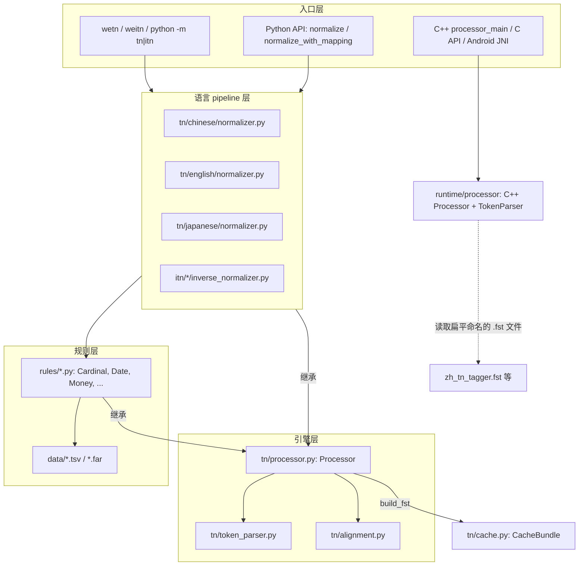
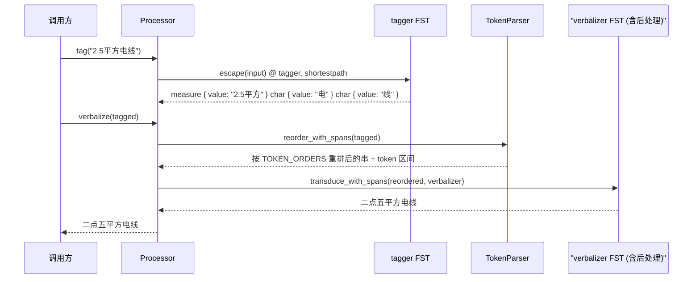
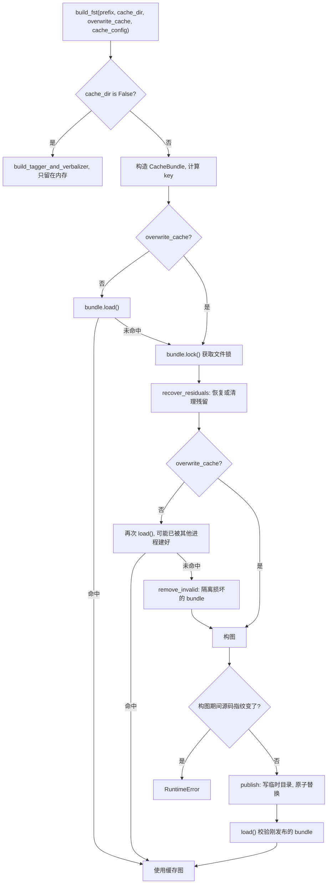

# WeTextProcessing 源码架构文档

## 1. 总览

WeTextProcessing 提供两个方向的文本处理：

- **TN（Text Normalization）**：书面形式 → 口语形式，例如 `2.5平方电线` → `二点五平方电线`。用于 TTS 前端。
- **ITN（Inverse Text Normalization）**：口语形式 → 书面形式，例如 `二点五平方电线` → `2.5平方电线`。用于 ASR 后处理。

两个方向各支持中文（zh）、英文（en）、日文（ja），共 6 条 pipeline。系统分成两个阶段：

- **构图期**：Python 代码用 Pynini 把规则描述成 FST，组装成一张 tagger 图和一张 verbalizer 图，写入缓存。
- **推理期**：Python（`Processor`）或 C++ runtime 加载这两张图，对输入文本做 FST 复合和最短路径搜索。



图中虚线表示 C++ runtime 需要扁平命名的 `.fst` 文件，而当前 Python 缓存产出的是哈希目录里的 `tagger.fst`，两者之间没有现成的转换工具，详见[第 12 节](#12-已知不一致与风险)。

---

## 2. 仓库模块地图

| 路径 | 职责 |
|------|------|
| `tn/processor.py` | 引擎基类 `Processor`：FST 积木、字段编解码、规则合并、构图与缓存调度、推理与 n-best |
| `tn/token_parser.py` | 中间串（wire format）的解析、重排与序列化 |
| `tn/alignment.py` | 在一条 WFST 路径上追踪 token 的输入区间和输出区间 |
| `tn/cache.py` | 内容寻址的图缓存 `CacheBundle` |
| `tn/cli.py` | TN/ITN 共用的命令行实现 |
| `tn/main.py`、`itn/main.py` | 入口，分别调用 `run("tn")`、`run("itn")` |
| `tn/utils.py`、`itn/utils.py` | 数据文件路径与词表加载工具；`itn/utils.py` 复用 `tn.utils` 的大部分函数 |
| `tn/<lang>/`、`itn/<lang>/` | 语言 pipeline：`normalizer.py` / `inverse_normalizer.py` + `rules/` + `data/` + `test/` |
| `runtime/processor/` | C++ `Processor`、`TokenParser` 和 C API |
| `runtime/bin/` | 命令行工具 `processor_main` |
| `runtime/bindings/android/`、`runtime/android/` | JNI 绑定和 Android 示例应用 |
| `runtime/utils/`、`runtime/cmake/` | 日志、命令行参数、UTF-8 字符串工具；OpenFst、glog、gflags、gtest 的 CMake 依赖 |
| `.github/workflows/` | 4 个 CI workflow，见[第 11 节](#11-测试与-ci) |

`itn` 包没有自己的引擎，所有 ITN pipeline 和规则都继承 `tn.processor.Processor`。

---

## 3. 核心抽象

### 3.1 `Processor`：所有 pipeline 和规则的基类

每个规则类（如 `Cardinal`）和每个顶层 pipeline（如 `Normalizer`）都是 `Processor` 的子类。规则类负责产出自己的 `tagger` 和 `verbalizer` 两张子图；顶层 pipeline 负责把规则组装起来并调用 `build_fst`。

基类提供的能力分四组：

- **FST 积木**：`__init__` 中定义的 `VCHAR`、`SIGMA`、`CHAR`、`DELETE_SPACE`、`INSERT_SPACE` 等常用图。
- **规则工具**：`build_rule`（封装 `cdrewrite` 上下文重写）、`add_tokens` / `delete_tokens`（加上或剥掉 `name { ... }` 外壳）。
- **字段编解码**：`tag_field`、`verbalize_field`、`input_projection`、`apply_input_processor`。
- **装配与推理**：`tagger_union`、`verbalizer_union`、`build_fst`、`tag`、`verbalize`、`normalize`、`normalize_with_mapping`。

### 3.2 字段编解码：tagger 只保存原始值

这是当前架构最核心的约定：

```python
    @staticmethod
    def input_projection(graph):
        # ...（docstring 省略）...
        projected = graph.copy().project("input")
        return projected.optimize()

    def tag_field(self, name, graph):
        """Tags a weighted raw field using the quoted-field wire encoding."""

        serialized = self.input_projection(graph) @ self.CHAR.star
        return insert(f'{name}: "') + serialized + insert('"')

    def verbalize_field(self, name, graph=None, leading_space=False):
        """Decodes a quoted raw field, then applies its semantic transducer."""

        decoded = self.SIGMA if graph is None else self.SIGMA @ graph
        prefix = (" " if leading_space else "") + f'{name}: "'
        return delete(prefix) + decoded + delete('"')
```

- 每个规则先构造一张「书面形式 → 规范形式」的语义图，例如 `Cardinal.cardinal` 负责把 `2.5` 转成 `二点五`。
- `tag_field` 对语义图做 `project("input")`，只保留输入侧，再用 `CHAR` 转义引号和反斜杠。所以 tagger 输出的是 `cardinal { value: "2.5" }`，**值是原始文本**。
- `verbalize_field`（或手写的等价逻辑）在 verbalizer 中把原始值解码，再喂给同一张语义图完成转换。

这样设计的原因是：tagger 输出的每个字段都能精确对应回原文，`normalize_with_mapping` 才能沿着真实的 WFST 路径给出原文区间到结果区间的映射，而不必退化成文本 diff。

需要在匹配前规范化输入时（例如日文的全角转半角），规则通过 `apply_input_processor` 把预处理图复合进语义图。`input_projection` 取到的仍是预处理之前的原始输入，因此这个约定依然成立。

### 3.3 `RuleSpec`：一份清单生成两张图

```python
@dataclass(frozen=True)
class RuleSpec:
    """One pipeline rule and its top-level classifier weight."""

    rule: object
    tagger_weight: Optional[float] = None
    verbalize: bool = True
```

```python
    @staticmethod
    def tagger_union(rule_specs):
        """Builds the classifier union from one ordered rule inventory."""

        taggers = [add_weight(spec.rule.tagger, spec.tagger_weight) for spec in rule_specs if spec.tagger_weight is not None]
        if not taggers:
            raise ValueError("rule inventory must contain at least one tagger")
        return union(*taggers).optimize()

    @staticmethod
    def verbalizer_union(rule_specs):
        """Builds the verbalizer union from the same rule inventory."""

        verbalizers = [spec.rule.verbalizer for spec in rule_specs if spec.verbalize]
        if not verbalizers:
            raise ValueError("rule inventory must contain at least one verbalizer")
        return union(*verbalizers).optimize()
```

- 有 `tagger_weight` 的规则参与 tagger 并集，权重越小越优先。
- `tagger_weight=None` 的规则只进 verbalizer。典型例子是 `Range`：它不单独参与分类，而是作为 `range_tagger` 嵌在 `Date`/`Time` 的 tagger 里，但它产出的 `range { ... }` token 需要顶层 verbalizer 认识。
- `verbalize=False` 用于「只分类、不需要顶层 verbalizer」的规则。

tagger 和 verbalizer 从同一份清单生成，可以避免新规则只被加到其中一边。

---

## 4. 中间格式（wire format）

tagger 和 verbalizer 之间传递的是一段纯文本：

```
name { key: "value" key2: "value2" } name2 { value: "..." }
```

相关约定：

- **转义**：值里的 `"` 和 `\` 必须转义。tagger 侧由 `CHAR` 处理，`TokenParser` 侧由 `escape_value` 处理。
- **字段顺序**：tagger 产出的字段顺序可能和口语顺序不同，由 `TokenParser` 按 schema 重排。
- **schema 归属**：每条 pipeline 在自己的文件里定义 `TOKEN_ORDERS`，通过 `Processor(..., token_orders=TOKEN_ORDERS)` 传入。`tn/token_parser.py` 里的 `TN_ORDERS` / `ITN_ORDERS` / `EN_TN_ORDERS` 只是直接实例化单个规则时的后备默认值。
- **重排规则**：schema 中列出的字段按 schema 顺序输出，schema 没有列出的字段追加在后面；若 token 带 `preserve_order: "true"`，则保持原顺序。

```python
    def string(self, orders):
        output = self.name + " {"
        order = self.order
        if self.name in orders.keys():
            if "preserve_order" not in self.members.keys() or self.members["preserve_order"] != "true":
                canonical_order = orders[self.name]
                extra_fields = [key for key in self.order if key not in canonical_order]
                order = canonical_order + extra_fields

        for key in order:
            if key not in self.members.keys():
                continue
            output += ' {}: "{}"'.format(key, escape_value(self.members[key]))
        return output + " }"
```

`TokenParser` 是手写的递归下降解析器。格式错误时抛出 `TokenParseError`，例如重复字段、未闭合的引号或花括号。`reorder_with_spans` 在重排的同时记录每个 token 在新文本中的区间，供对齐子系统使用。

---

## 5. 各语言 pipeline 的装配

6 条 pipeline 都遵循同一模式：实例化规则 → 声明 `RuleSpec` 清单 → `tagger_union` / `verbalizer_union` → 拼接后处理 → `build_fst`。差别主要在输入预处理、token 之间的拼接方式和后处理：

| pipeline | 文件 | 输入预处理 | token 拼接 | 后处理 |
|----------|------|-----------|-----------|--------|
| zh TN | `tn/chinese/normalizer.py` | 无 | `tagger_union(...).star` | `PostProcessor`：繁转简、去语气词、去标点、全角转半角、OOV 标注 |
| zh ITN | `itn/chinese/inverse_normalizer.py` | 无 | `.star` | `PostProcessor`：只有去语气词 |
| en TN | `tn/english/normalizer.py` | 无 | 标点 + 空格分隔的 token 序列 | 无独立后处理，verbalizer 自己处理空格 |
| en ITN | `itn/english/inverse_normalizer.py` | 无 | 标点 + 空格分隔的 token 序列 | 无独立后处理 |
| ja TN | `tn/japanese/normalizer.py` | `PreProcessor` 作为 `input_normalizer` 注入各规则 | `.star` | `PostProcessor` |
| ja ITN | `itn/japanese/inverse_normalizer.py` | `PreProcessor` 作为 `input_processor` 注入各规则 | `.star` | 无 |

补充说明：

- **zh TN**：没有独立的预处理阶段，繁转简放在 `PostProcessor` 里，因为规则契约要求 tagger 保留原始输入。权重从 `date`(1.02) 到 `char`(100)；`Range` 只参与 verbalizer。
- **zh ITN**：独有 `LicensePlate`（车牌）和 `TrainNumber`（车次），权重都是 1.0。构造参数 `enable_standalone_number` / `enable_0_to_9` / `enable_million` 会传给 `Cardinal` 等规则。
- **en TN / en ITN**：英文需要保留词与词之间的空格，所以没有用 `.star`，而是显式写出「标点* + 分类 token + 标点*」，token 之间以空格或标点分隔。英文 TN 的 verbalizer 只在分类 token 后插入空格，标点 token 自带空格信息。
- **ja TN**：`transliterate=True` 时额外加入 `Transliteration` 规则（权重 1.04）。
- **ja ITN**：除了常规 `Cardinal`，还构造了一个 `enable_million=True` 的 `Cardinal`，专门给 `Fraction` 使用。

各 pipeline 传给 `build_fst` 的 `cache_config`（例如 zh TN 的 6 个布尔开关）会进入缓存 key，所以不同参数组合各自对应一个缓存。

---

## 6. 推理数据流

### 6.1 单条路径：`tag` → `verbalize`



命令行和 C++ `processor_main` 都是这样分两步调用的，并分别打印两步的结果。

### 6.2 `normalize`：联合 n-best 搜索

`normalize` 不是简单的 `verbalize(tag(x))`。它在 tagger 和 verbalizer 两级上联合排序候选（`_normalization_candidates`）：

1. `_UniqueOutputPathStream` 把 tagger 的输出路径按权重从小到大懒加载，每次需要更多候选时把 `nshortest` 翻倍，并对输出去重。
2. 每取出一个 tagged 候选，就为它建一个 verbalizer 路径流。
3. 候选按下面的权重放进最小堆：

```python
    @property
    def weight(self):
        return self.tagger_weight + self.verbalizer_weight - self.best_verbalizer_weight
```

减去该 tagged 串的最优 verbalizer 权重后，跨 tagged 串的比较只看 tagger 权重，同一 tagged 串内部的多种口语形式仍保留相对代价。这样，尚未展开的 tagged 候选的 tagger 权重就是一个精确下界，可以安全地决定何时展开下一个候选。

4. 按输出文本去重，直到凑够 `nbest` 个。

`nbest=1` 返回字符串，`nbest>1` 返回列表。

### 6.3 `normalize_with_mapping`

先用 6.2 得到候选，再对每个候选用对齐子系统求出每个 token 的输入区间和输出区间，封装成 `NormalizationResult`。

---

## 7. 对齐子系统（`tn/alignment.py`）

目标：对于每个 tagged token，给出它在**原文中的区间**和在**结果中的区间**。实现完全基于 WFST 路径，没有文本 diff 兜底。

- **输出侧**：`transduce_with_spans(重排后的串, verbalizer, token 区间, output_text)` 先把输入约束为该串（如果给了 `output_text`，输出也约束为它），再取唯一最短路径，然后逐条弧线扫描：消耗了某个 token 输入区间内字节的弧线，其输出就归这个 token；token 边界处的空白输出不归任何 token；被整体删除的 token 得到一个零宽区间。
- **输入侧**：`trace_input_spans(原文, tagged 串, tagger, token 区间)` 构造 `accep(原文) @ tagger @ accep(tagged)`，沿唯一路径反向确定每个 token 消耗了原文的哪些字节。
- 路径必须是线性的（`_linear_arcs` 遇到分叉或环会抛 `AlignmentError`）；内部按 UTF-8 字节计算，最后换算回 **Unicode 字符偏移**（左闭右开）。如果路径把一个码点切开，同样会抛错。

结果结构：

- `NormalizationMapping`：`kind`（`equal` / `replace` / `delete`）、`token_type`、输入和输出的起止偏移与文本。
- `NormalizationResult`：`input_text`、`output_text`、`mappings`，并提供 `as_dict()`。

默认不返回 `equal`（原文和结果相同）的映射，`include_identity=True` 时才返回。

---

## 8. 缓存子系统（`tn/cache.py`）

### 8.1 缓存 key 与目录布局

```python
        config_identity = {
            "config": cache_config,
            "ordertype": ordertype,
            "prefix": prefix,
        }
        self.config_digest = _hash_bytes(_canonical_json(config_identity))
        bundle_identity = {
            "builder": self.builder,
            "config_digest": self.config_digest,
            "source_fingerprint": source_fingerprint,
        }
        self.bundle_digest = _hash_bytes(_canonical_json(bundle_identity))
        self.parent = self.cache_root / prefix / self.config_digest
        self.path = self.parent / self.bundle_digest
        self.lock_path = self.parent / ".{}.lock".format(self.bundle_digest)
```

- `source_fingerprint`（`production_source_fingerprint`）：对 `tn/`、`itn/` 下所有 `.py` / `.tsv` / `.far` 的内容做 SHA-256，排除 `test/`、`__pycache__` 和 `_version.py`。**改任何规则或词表，key 都会变。**
- `builder`（`_builder_identity`）：缓存格式版本、Python 版本与实现、pynini 版本、字节序。
- `cache_config`：pipeline 的构造参数。

目录布局：

```
<cache_root>/<prefix>/<config_digest>/<bundle_digest>/
    tagger.fst
    verbalizer.fst
    manifest.json      # 记录身份信息，以及两个 .fst 文件的大小和 sha256
```

`cache_root` 的取值：

| `cache_dir` 参数 | 行为 |
|------------------|------|
| `None`（默认） | `default_cache_dir()`，即 `<基础目录>/wetextprocessing`。基础目录优先取 `$XDG_CACHE_HOME`（必须是绝对路径）；否则 macOS 为 `~/Library/Caches`，Windows 为 `%LOCALAPPDATA%`，其他系统为 `~/.cache` |
| `False` | 只在内存中构图，不读也不写缓存 |
| 路径 | 作为缓存根目录 |

wheel 包不再附带预编译的 `.fst` 文件（`pyproject.toml` 的 package-data 只包含 `.tsv` / `.far`），因此首次使用时会在本机构图。

### 8.2 `build_fst` 的流程



可靠性相关的设计：

- **加锁**：POSIX 用 `flock`，Windows 用 `msvcrt.locking`。默认超时 10 分钟，可用环境变量 `WETEXTPROCESSING_CACHE_LOCK_TIMEOUT` 调整。锁文件里记录持有者的主机名和时间，超时时会报出来。
- **原子发布**：先写到 `.<digest>.tmp-*` 临时目录并 fsync，再用 `os.replace` 换到正式路径。旧 bundle 先挪到 `.previous-*`，发布失败时可以恢复。
- **完整性校验**：`load()` 要求目录里恰好有 3 个文件，manifest 中的身份信息全部匹配，且 `.fst` 的大小和 sha256 与 manifest 一致；任一不符都视为未命中。
- **路径安全**：拒绝符号链接、Windows junction 和特殊文件；所有子路径都必须位于缓存根目录之下。

因为 key 包含源码指纹，修改规则后直接重新运行就会构建新的 bundle。`overwrite_cache=True` 只是在同一个 key 已有缓存时强制重建。

---

## 9. 命令行入口（`tn/cli.py`）

入口关系：

- `pyproject.toml` 中 `wetn = tn.main:main`、`weitn = itn.main:main`。
- `python -m tn` / `python -m itn` 经由 `__main__.py` 调用同一个 `main`。
- 两个 `main` 都只是 `tn.cli.run("tn")` / `run("itn")`。

`run` 的工作方式：

1. `_selected_language` 先只解析 `--language`，然后 `create_parser(direction, language)` 只注册该语言、该方向支持的参数。例如 zh TN 有 `--remove-erhua`，ja TN 有 `--transliterate`。
2. 布尔参数同时支持 `--flag`、`--no-flag` 和旧的 `--flag True|False` 写法。
3. `create_processor` 按需导入并构造对应的 pipeline。
4. 输入来源三选一：`--text`、`--file`、标准输入。每行只去掉行尾换行符，其他空格原样保留。
5. 每行输入输出两行：

```python
def _process_line(processor, text, stdout):
    tagged = processor.tag(text)
    print(tagged, file=stdout)
    print(processor.verbalize(tagged), file=stdout)
```

注意命令行走的是 `tag` + `verbalize` 两步，不是 `normalize` 的联合搜索。

---

## 10. C++ runtime 与 Android

### 10.1 C++ runtime（`runtime/`）

C++ 侧只做推理，不构图。依赖 OpenFst、glog、gflags（通过 `runtime/cmake/*.cmake` 用 FetchContent 拉取），使用 C++20 标准。

- **`wetext::Processor`**（`runtime/processor/wetext_processor.cc`）：构造时读入 tagger 和 verbalizer 两个 `.fst`，并根据 tagger **路径中是否包含** `zh_tn_`、`zh_itn_`、`en_tn_`、`en_itn_`、`ja_tn_`、`ja_itn_` 来决定 `ParseType`，都不包含时 `LOG(FATAL)`：

```cpp
  if (tagger_path.find("zh_tn_") != tagger_path.npos) {
    parse_type_ = ParseType::kZH_TN;
  } else if (tagger_path.find("zh_itn_") != tagger_path.npos) {
    parse_type_ = ParseType::kZH_ITN;
  } else if (tagger_path.find("en_tn_") != tagger_path.npos) {
    parse_type_ = ParseType::kEN_TN;
  } else if (tagger_path.find("en_itn_") != tagger_path.npos) {
    parse_type_ = ParseType::kEN_ITN;
  } else if (tagger_path.find("ja_tn_") != tagger_path.npos) {
    parse_type_ = ParseType::kJA_TN;
  } else if (tagger_path.find("ja_itn_") != tagger_path.npos) {
    parse_type_ = ParseType::kJA_ITN;
  } else {
    LOG(FATAL) << "Invalid fst prefix, prefix should contain"
               << " either \"_tn_\" or \"_itn_\".";
  }
```

  `Tag` 是「编译输入串 → `Compose` → `ShortestPath`」；`Verbalize` 先用 `TokenParser` 重排，再过 verbalizer；`Normalize` 等于 `Verbalize(Tag(input))`。
- **`wetext::TokenParser`**（`runtime/processor/wetext_token_parser.cc`）：Python `TokenParser` 的 C++ 移植，按 UTF-8 字符解析。schema 在源码里写死：`ZH_TN_ORDERS`、`JA_TN_ORDERS`、`EN_TN_ORDERS`，三种 ITN 共用 `ITN_ORDERS`。
- **C API**（`runtime/processor/wetext_processor_c_api.h`）：`wetext_create_processor` / `wetext_destroy_processor`，`wetext_tag` / `wetext_verbalize` / `wetext_normalize`。返回的字符串在堆上分配，调用方必须用 `wetext_free_string` 释放。
- **`processor_main`**（`runtime/bin/processor_main.cc`）：参数为 `--tagger`、`--verbalizer`、`--text`、`--file`，对每行输出 tag 和 verbalize 两行结果，与 Python 命令行一致。

### 10.2 Android

- JNI 绑定 `runtime/bindings/android/wetextprocessing.cc` 向 `com.wenet.WeTextProcessing.WeTextProcessing` 注册 `init`、`normalize`、`inverse_normalize` 三个 native 方法。`init(modelDir)` 从固定文件名加载模型：

```cpp
  std::string tnTagger = std::string(pModelDir) + "/zh_tn_tagger.fst";
  std::string tnVerbalizer = std::string(pModelDir) + "/zh_tn_verbalizer.fst";
  processorTN = std::make_shared<wetext::Processor>(tnTagger, tnVerbalizer);

  std::string itnTagger = std::string(pModelDir) + "/zh_itn_tagger.fst";
  std::string itnVerbalizer = std::string(pModelDir) + "/zh_itn_verbalizer.fst";
  processorITN = std::make_shared<wetext::Processor>(itnTagger, itnVerbalizer);
```

- Android 应用（`runtime/android/`，Kotlin + Compose）启动时把 assets 中的 4 个 `.fst` 解压到 `filesDir`，再调用 `init`。native 库由 CMake preset 构建并安装到 `jniLibs/`，Gradle 只负责打包。

---

(11-测试与-ci)=

## 11. 测试与 CI

### 11.1 测试

- **Python**：每个语言目录下都有 `test/`。
  - 规则级测试（如 `cardinal_test.py`）读取 `test/data/<rule>.txt` 中的「输入 ⇒ 期望输出」用例。
  - `normalizer_test.py` 做 pipeline 级测试。
  - `tn/chinese/test/` 还有引擎层的专项测试：`processor_test.py`、`token_parser_test.py`、`alignment_test.py`、`cache_test.py`、`cache_safety_test.py`。
  - `tn/english/test/nbest_test.py` 覆盖 n-best。
- **C++**（`runtime/test/`，gtest）：
  - `processor_test.cc`：加载 `tn/zh_tn_tagger.fst`，用 `tn/chinese/test/data/normalizer.txt` 中的用例校验 `Normalize`。
  - `token_parser_test.cc`、`string_test.cc`。

### 11.2 CI workflow

| workflow | 触发 | 内容 |
|----------|------|------|
| `unittest.yml` | PR 改动 `.py` / `.tsv` / `.toml` / `.yml` 等；手动触发 | flake8 + pytest。PR 只跑 ubuntu，手动触发时跑三个系统；Python 3.9 |
| `runtime.yml` | PR 改动 `runtime/`（Android 部分除外） | ubuntu 和 macOS 构建 C++；ubuntu 上先 `python -m tn --language zh --overwrite_cache` 生成模型，再跑 ctest；Windows 只构建、不测试 |
| `android.yml` | PR 改动 Android 工程或它编译的共享 C++ 代码（`runtime/processor`、`runtime/utils`、`runtime/cmake` 等）；手动触发 | 用 CMake preset 构建 arm64-v8a native 库，用 `--cache_dir assets` 生成模型，Gradle 打 release APK |
| `wheels.yml` | 手动触发 | 构图，把 `tn/*.fst`、`itn/*.fst` 和 `*_cache.json` 作为 artifact 上传；构建 wheel，在 master 分支上发布到 PyPI |

---

(12-已知不一致与风险)=

## 12. 已知不一致与风险

以下问题是通读源码时发现的。我没有实际运行 CI 或 C++ 测试来验证，结论来自代码比对。

### 12.1 Python 缓存产物与 C++ / Android / CI 期望的文件不一致（影响最大）

重构后，Python 写出的是 `<root>/<prefix>/<config_digest>/<bundle_digest>/tagger.fst`，但下列位置仍按旧格式期望扁平的 `zh_tn_tagger.fst` 这类文件：

- `runtime/test/processor_test.cc` 从 `tn/zh_tn_tagger.fst` 读模型；而 `runtime.yml` 生成模型时没有指定 `--cache_dir`，模型会写进 CI 机器的用户缓存目录，不会出现在 `tn/` 下。
- `android.yml` 和 `Android assets README` 用 `--cache_dir "$assets"` 生成模型，得到的是 assets 下的哈希子目录；JNI 代码加载的是 `assets` 根下的 `zh_tn_tagger.fst`。
- `wheels.yml` 拷贝 `tn/*.fst` 和 `tn/*_cache.json`，新缓存不会在这些位置产出文件（`_cache.json` 也已被 `manifest.json` 取代）。
- 即使手动把哈希路径传给 C++，路径里通常只有 `zh_tn/`，没有 `zh_tn_`，`ParseType` 判断会走到 `LOG(FATAL)`。

README 里写了「Python cache files are not C++ runtime exports」，但仓库中没有提供导出工具。需要补一个把 bundle 导出为 `<prefix>_tagger.fst` / `<prefix>_verbalizer.fst` 的命令，并让上述 CI 和文档改用它。

### 12.2 C++ `TokenParser` 与 Python 行为不同

- **schema 来源**：C++ 写死在源码里；Python 由各 pipeline 的 `TOKEN_ORDERS` 决定。两者已经出现差异：ja TN 在 Python 中有 `date`、`fraction`、`measure`、`money`、`time` 五项，C++ 的 `JA_TN_ORDERS` 只有 `date` 和 `money`：

```cpp
const std::unordered_map<std::string, std::vector<std::string>> JA_TN_ORDERS = {
    {"date", {"year", "month", "day"}}, {"money", {"value", "currency"}}};
```

- **schema 外的字段**：Python 把它们追加在后面；C++ 直接用 schema 替换顺序列表，**schema 外的字段会被丢掉**：

```cpp
  std::string String(
      const std::unordered_map<std::string, std::vector<std::string>>& orders) {
    std::string output = name + " {";
    if (orders.count(name) > 0 && (members.count("preserve_order") == 0 ||
                                   members.at("preserve_order") != "true")) {
      order = orders.at(name);
    }

    for (const auto& key : order) {
      if (members.count(key) == 0) {
        continue;
      }
      output += " " + key + ": \"" + members[key] + "\"";
    }
    return output + " }";
  }
```

### 12.3 C++ 没有联合 n-best 和对齐

C++ `Normalize` 是 `Verbalize(Tag(input))`：先取 tagger 的单条最短路径，再取 verbalizer 的单条最短路径。Python `normalize` 是联合排序，在存在歧义时两边结果可能不同。C++ 也没有与 `normalize_with_mapping` 对应的接口。

### 12.4 遗留测试数据

`tn/chinese/rules/preprocessor.py` 已删除，但 `tn/chinese/test/data/preprocessor.txt` 还在，且没有任何测试引用它。

---

## 13. 扩展指南（简版）

**新增一条规则**（以中文 TN 为例）：

1. 在 `tn/chinese/rules/` 新建规则类，继承 `Processor`，构造语义图，tagger 用 `add_tokens(tag_field(...))`，verbalizer 用 `delete_tokens(verbalize_field(...))`。写法见 `python-rule-architecture.md`。
2. 需要的词表放进 `tn/chinese/data/`。
3. 在 `tn/chinese/normalizer.py` 的 `rules` 清单中加入 `RuleSpec(新规则, 权重)`。
4. 如果 token 有多个字段且顺序有要求，更新该文件的 `TOKEN_ORDERS`；**若 C++ 也要用这条 pipeline，同步修改** `runtime/processor/wetext_token_parser.cc` 中写死的 schema（见 12.2）。
5. 在 `tn/chinese/test/data/` 中加用例，并补对应的 `*_test.py`；涉及 n-best 或对齐时补相应测试。

不需要手动清缓存：源码指纹变化后，下次运行会自动重建。

**新增一种语言**：

1. 新建 `tn/<lang>/` 或 `itn/<lang>/`，包含 `normalizer.py` / `inverse_normalizer.py`、`rules/`、`data/`、`test/`。
2. 在 `tn/cli.py` 的 `LANGUAGES`、参数注册函数和 `create_processor` 中接入。
3. 在 `pyproject.toml` 的 package-data 中加入新的数据文件模式。
4. C++ 侧在 `ParseType`、`Processor` 构造函数的前缀判断和 `TokenParser` 的 schema 选择中加入新语言。
